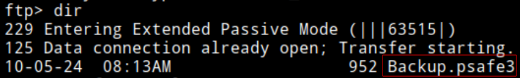
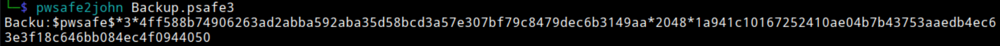
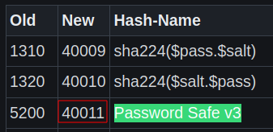
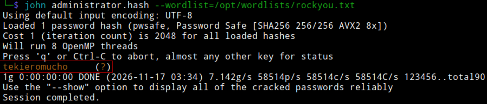
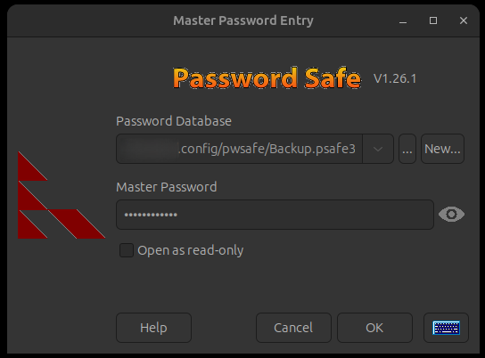
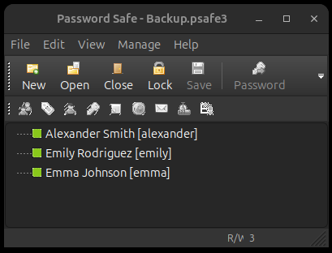

## Administrator
### Info:
- Name: **Administrator**
- OS: **Windows**
- Type: **Assumed Compromise**
- Difficulty: **Medium**
- Status: **Retired**

### Content:
- [**`testing.md`**](https://github.com/cac3r/htb_machines/blob/main/administrator/testing.md)                - Raw notes / working log
- [**`report.pdf`**](https://github.com/cac3r/htb_machines/blob/main/administrator/report.pdf)                - Professional report
- [**`attack_chain.png`**](https://github.com/cac3r/htb_machines/blob/main/administrator/attack_chain.png)   - Attack chain diagram
- `screenshots/`           - Supporting screenshots

---
---
### Brief:
#### Recon & Enum
Starting the test against the target system `DC.ADMINISTRATOR.HTB` authenticated as this is an assumed compromise engagement. After host reconnaissance and basic domain enumeration, enumerating with BloodHound discover a chain of ACL controls that can be abused to harvest domain user credentials.
#### Credential Harvesting & Pivoting
##### ACL: GenericAll / ForceChangePassword -> Reset passwords
Starting with owned object `Olivia` GenericAll control over `Michael`, reseting the latter account password. The same is done from now owned `Michael`, abusing ForceChangePassword control over `Benjamin`.
##### Password Database exposed > Crack Master key > Disclose 3 credentials > 1 valid
As `Benjamin` discover permission to login to FTP, connecting and finding a Password Safe v3 database file (`Backup.psafe3`). Using john utility `pwsafe2john` can extract the master key hash for the database file, and crack it using common password list rockyou.txt, recovering plaintext master key (`tekieromucho`). Downloading the official Password Safe software can open the database file and disclose 3 crendentials, one of them being valid for domain user authentication (`Emily:UXLCI5iETUsIBoFVTj8yQFKoHjXmb`).
##### ACL: GenericWrite -> Targeted Kerberoast
Refreshing BloodHound data after new owned objects were added, reveal another chain of ACL permissions from `Emily` account that lead to full domain compromise. Starting with `Emily` GenericWrite control over `Ethan`, abused by setting SPN, request a TGS and capture the TGS response "service" password hash, cracked with mode `13100` and rockyou.txt password list, recovering plaintext password (`limpbizkit`).
#### Full compromise: DCSync
As `Ethan` have replacation permission over the domain, enables to abuse the directory replication protocol and disclose all domain NTLM hashes, including the DC `Administrator` (Domain Administrator) and `krbtgt` top tier accounts. The `Administrator` NT hash is used to Pass-the-Hash via WinRM, establishing a remote connection to the target DC as a Domain Administrator with full control over the `ADMINISTRATOR.HTB` domain.

---
---
### Techniques
- `GenericAll` / `ForceChangePassword` abuse -> Change password
- Extracting Password Safe v3 (`.psafe3`) database file master key hash and cracking it (`pwsafe2john`, `john`)
- (Using Password Safe software to open password database file `.psafe3`)
- `GenericWrite` abuse -> Targeted Kerberoast -> Crack TGS-REP hash
- DCSync -> All Domain accounts NTLM hashes (Full Domain compromise)
---
---
### Lesson
- Doing shadow credentials with `pywhisker` is better in general. `certipy` works via PKINIT, so without CA (ADCS) fails.
Reporting:
- Weak Kerberos encryption (DES) is a low severity finding that should be reported (especially when is a full domain policy affecting privileged accounts)
- When `krbtgt` account is compromised, the remediation should specify that the password must be rotated twice since KDC validates current and previous `krbtgt` password for Kerberos TGT signing.
#### Password Safe database file

A backup password manager database file is found exposed over the network (example FTP). **`.psafe3`** in this case, for **Password Safe v3**.



"**PSAFE3 files** are specific encrypted files from Password Safe v3" - https://filext.com/file-extension/PSAFE3

As with KeePass, the master key password hash can be extracted with `*2john` utilities. Using **`pwsafe2john`**:

```
pwsafe2john Backup.psafe3
```



Hash:
```
$pwsafe$*3*4ff588b74906263ad2abba592aba35d58bcd3a57e307bf79c8479dec6b3149aa*2048*1a941c10167252410ae04b7b43753aaedb4ec63e3f18c646bb084ec4f0944050
```



Cracking with hashcat modes (Old mode `5200`, Current mode `40011`) return errors:
- `40011` - `/usr/share/hashcat/modules/module_40011.so: cannot open shared object file: No such file or directory`
- `5200` - `Hash '<file>': Signature unmatched`

Using **john** instead:

```
john administrator.hash --wordlist=/opt/wordlists/rockyou.txt
```



Cracked

##### Opening the file

Use official software for Linux to open it: https://github.com/pwsafe/pwsafe/releases?q=non-windows&expanded=true (`passwordsafe-debian12-1.26.1-amd64.deb` for Debian / Ubuntu)

```
sudo dpkg -i passwordsafe-debian12-1.26.1-amd64.deb
```

`Errors were encountered while processing: passwordsafe`

Fix missing dependencies:

```
sudo apt -f install
```

Launch the app, place the file in app default location and open it

```
mv Backup.psafe3 ~/.config/pwsafe/
```

Input master password



Enter



Click on entries to copy its password.
