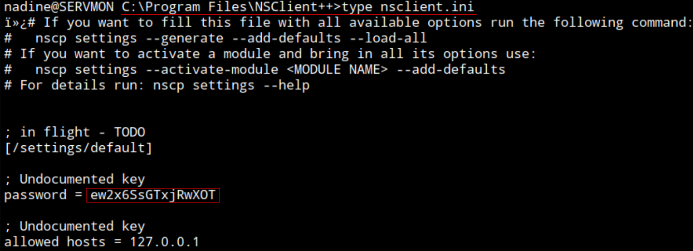

## ServMon
### Info:
- Name: **ServMon**
- OS: **Windows**
- Type: **Unauthenticated**
- Difficulty: **Easy**
- Status: **Retired**

### Content:
- [**`testing.md`**](https://github.com/cac3r/htb_machines/blob/main/servmon/testing.md)                - Raw notes / working log
- [**`report.pdf`**](https://github.com/cac3r/htb_machines/blob/main/servmon/report.pdf)                - Professional report
- [**`attack_chain.png`**](https://github.com/cac3r/htb_machines/blob/main/servmon/attack_chain.png)   - Attack chain diagram
- `screenshots/`           - Supporting screenshots

---
---
### Brief:
#### Information disclosure
Starting the test against the target system `SERVMON` unauthenticated. After host reconnaissance connect to the exposed FTP service which was set to allow anonymous login, enabling to connect unauthenticated. Discover `Users` directory and `Nadine`, `Nathan`. The `Nadine` directory contains a text file `Confidential.txt` writen by Nadine stating that a sensitive file `Passwords.txt` is located in the Desktop directory of `Nathan` (`/Users/Nathan/Desktop/Passwords.txt`).
#### Foothold: Password disclosure via CVE-2019-20085 LFI -> SSH
Connected to HTTP service exposed at port 80 see NVMS-1000 login page. Searching for vulnerabilities affecting this software find a Local File Inclusion vulnerability CVE-2019-20085. With a path traversal of 12 directories from the webroot to reach the system root include `/Users/Nathan/Desktop/Passwords.txt` to read its contents in the response, which discloses 7 plaintext passwords.

With the saved passwords begin to check them against known system users `Nathan` and `Nadine`, and discover one of the passwords is valid for authentication to the system as `Nadine`. As SSH service is exposed, remotely connect as `Nadine` to the target system enabling to read system files and execute arbitrary commands.

---
---
### Techniques:
- LFI with path traversal - CVE-2019-20085
- *(Post-testing)* SSH port forwarding 

---
---
### Lesson:

### SSH Port forwarding

In the NSClient++ software initialization/configuration file `nsclient.ini` observe parameter that whitelist hosts that are allowed to connect to the service



Only allowed host is localhost/127.0.0.1 and have a password
With host reconnaissance discovered the NSClient++ app is running on port 8443

##### Setup port forwarding using SSH
Enter SSH command mode
Type ENTER then `~C`

```
-L 8443:127.0.0.1:8443
```

First port is the one that will open in the local system (attacker system) (set to the same number 8443 for convenience, but could be any)
The following `127.0.0.1:8443` is where that local port will reach to forward the connection
The command is ran in the attacker system although it gives the impression that is done in the target system as the command is ran in the target's shell, but SSH command mode happens on client (attacker system).

Now in the attacker system can browse for https://127.0.0.1:8443 that directs to my localhost on port 8443 that now is set for SSH tunneling and forwards to target system 127.0.0.1:8443 running the application.

Difference from SOCKS proxy:
- `-L 8443:127.0.0.1:8443` → one fixed pipe to one place.
- `-D 1080` → a doorway into the whole network reachable from the target. You can hit 10.10.10.50:80, 10.10.10.60:445, any port on any host the target can see, all through that single proxy port.

Directly tunnel, no shell:

```
ssh -N -f -L 8443:127.0.0.1:8443 user@target
```

The flag for that is `-N`, which means “don’t run a remote command.” Combined with `-f` (go to the background)
